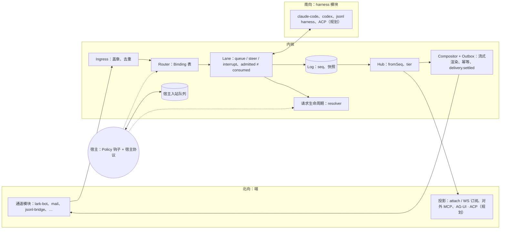

# 瘦身：定义核心流程，给每个功能分级，其余移成模块或交还宿主

> 状态：已采纳（2026-11-23，决定 16）。§9 各项 owner 全部按推荐拍板。第 0 阶段的守卫（§6）、第一条接缝 G1（`ChannelCaps.pacing`）、生产代码不再用 testkit、`aio e2e` 移出 daemon 已落地，其余按 §4 推进。
>
> 参照：persona 的 [#13411](https://github.com/nwverse/persona/issues/13411)（功能瘦身：定义核心流程、给每个功能分级）、#13430（Persona Core 与模块、只降不升的守卫）、#13438 / #13551 / #13555（内建领域按第三方同一契约做成扩展；`interactive_sessions`、`work_executor` 契约）。persona 在 agent IO 上的做法见 §7。

## 0. 问题

agents-io 的包级分层是干净的：`protocol` 不依赖任何包，`session` 只依赖 `protocol`，适配器（`harness/*`、`channel/*`）也只依赖 `protocol`。问题都集中在 `packages/daemon`：它既是组合根，又装着所有功能，而且直接认识具体的适配器。

| 指标（`main` 638eccf） | 数值 |
|---|---|
| 非测试源码 | 约 37.5K 行。daemon 11.6K（`gateway.ts` 3263、`config.ts` 1615），session 8.0K，codex 4.7K，lark-bot 4.2K，protocol 3.3K，host-mcp 1.9K，claude-code 1.8K |
| 宿主协议 feature 标记 | 17 个（`packages/daemon/src/host.ts` `FEATURES`） |
| 会话事件种类 | 31 种（`packages/protocol/src/events.ts`） |
| 聊天命令 | 16 个（`packages/daemon/src/commands.ts`） |
| 给模型的工具 | 内部 15 个（`host-mcp/src/server.ts`）、对外端点 6 个 |
| 不变量 | 102 条（`docs/INVARIANTS.md`） |
| 核心文件越界（§6 守卫初始基线） | 318 处：`gateway.ts` 直接 import 5 个适配器包，按 `instanceof LarkBotAdapter`、`kind === 'codex'` 分支；`config.ts` 115 处飞书 / Codex 专属校验；`protocol/src/admin.ts` 带着飞书机器人开通的类型；生产代码从 `testkit` 取 `AsyncQueue`、`loadEnvFile` |

这和 persona 是同一个病：persona 有 33 个 assistant 文件直接 import `feishubot`，这里是 `gateway.ts` import `LarkBotAdapter` 再按它分支。后果也一样：

- 内核删不掉、关不干净、也没法单独测任何一个通道或 harness；
- 第三方的通道和 harness 拿不到内建适配器享有的能力（飞书的回复节奏、Codex 的重启接管、Claude Code 的上下文压缩，都写在 gateway 的分支里，而不是在契约里）；
- 定位上要成为"不耦合业务、可以嵌进任何框架"的组件，就必须做到：**内核不认识任何具体通道、harness 和模型，内建适配器与第三方走同一条契约**（persona #13438 的原则）。

## 1. 核心流程

一句话：**一条输入从任意通道进来，先盖上来源，再按确定的规则落到一个会话的 lane；lane 把它交给任意 harness 的一轮；这一轮的过程写进带 seq 的日志，任何端都能按 fromSeq 订阅；正式答复按投递义务送回来源，每次以 `delivery.settled` 结束；途中的请求（审批、提问）由宿主指定的 resolver 结算。**

**内核保留的东西**（列出名字，以免以后搬家时被顺手带走）：

- **协议**：`InboundEnvelope` / `Origin` / `Evidence`、`SessionEvent`、`Command`、`ChannelAdapter` / `HarnessAdapter` 及其 caps、`Policy` 钩子、进程外 JSONL 帧、JSON Schema。
- **会话内核**（`packages/session`）：Ingress（盖章、IN-5 去重）、Router（确定的 Binding 表）、Lane（单写者、queue / steer / interrupt、消费对账）、Log（内存 / SQLite、seq）、Hub（订阅、快照、tier）、Compositor（`ProgressView` → 各 tier 的 `RenderedMessage`，即"中立的卡片模型"）、Outbox（operationId 幂等）、请求与 resolver（auto / model / human / host）、宿主入站队列、因果链与防循环。
- **宿主控制面**：`host.hello` 与 features、`bindings.put/get`、入站队列（推 / 拉 / ack / 补投）、`run.start/cancel/ended`、`deliver`、`input` / `resolve`、各回调（route / resolve / outbound / contact / external / review）、`session.prepare/launch/compact`。
- **可解释性**：路由与副作用记录、`aio explain`、`aio verify`。
- **IO 原语工具**：`send_message`、`send_file`、`ask_choice`、`get_channel_context`。
- **守护进程内核**：配置的通用部分、模块加载、本地 socket / WS 服务、token、私有文件、`aio` 的基础命令（serve、attach、input、sessions、tail / ack、explain、verify、run、send、bindings、redispatch）。

内建的 claude-code、codex、lark-bot、mail、jsonl-bridge 是**默认随 `aio` 打包的模块**，不是内核。

## 2. 功能分级

等级：

- **core**：留在内核。
- **module**：做成模块，与第三方走同一条契约（`use: "module"` 或 JSONL 桥），默认随 `aio` 打包，行为不变。
- **opt-in**：留在仓库，默认关，配置开启（相当于 persona 的"二级菜单"：不在默认面上）。
- **host**：属于宿主的策略或业务。agents-io 只留钩子，现有默认实现降级为一个可替换的模块。这一级是 agents-io 特有的，"不耦合业务"主要靠它。
- **delete**：删除。

载体一栏写现有机制，或者需要先补的接缝（G 编号见 §3）。

| 功能 | 现在在哪 | 等级 | 载体 | 阶段 |
|---|---|---|---|---|
| 飞书回复节奏（5 秒开卡、2 秒预览、回复卡不带停止按钮） | `gateway.ts` `compose` 里的 `instanceof LarkBotAdapter` | core 机制，数值归适配器 | G1 `ChannelCaps.pacing` | **已完成** |
| 飞书 / 邮件 / 桥的构造与配置校验 | `gateway.ts` `new LarkBotAdapter`、`channelOwner`、`grantedByDefault`；`config.ts`（115 处） | module | G2 | P1–P2 |
| Claude Code / Codex 的构造，以及按 `kind` 的分支：压缩、TUI 接入、停止时 detach、重启接管、Plan 模式、bypass、会话 env 改走 stdio | `gateway.ts`、`launch.ts`、`commands.ts`、`media.ts` | module | G3 | P1–P2 |
| 话题机制（一个对话多个会话、当前指针、`topic.changed`） | `session/src/topics.ts` | core | – | – |
| 话题标题由模型生成（临时起一个 Codex thread） | `daemon/src/topic-title.ts` | host | G4 | P2 |
| 控制 IO 的聊天命令：`/help` `/status` `/stop` `/steer` `/answer` `/new` `/topics` `/switch` | `commands.ts` | core（每个通道可关） | – | – |
| 改运行配置的聊天命令：`/model` `/effort` `/agent` `/preset` `/plan` `/bypass` `/compact` | `commands.ts` | module（"主人命令"，默认开）；真正的接缝是 `Policy.plan` | G3、G6 | P2 |
| agent 预设 | `config.ts` `presets` | host（运行配置属于策略），默认实现做成模块 | G6 | P2 |
| 陌生人放行卡片（允许一次 / 总是 / 忽略） | `daemon/src/strangers.ts` | host（`Policy.admit` 的一种默认实现），做成模块 | G6 | P2 |
| 监听与汇总：路由动作 `context` / `digest` | `session/src/router.ts`、`watch.ts` | core | – | – |
| 监听的模型工具 `watch_*` | `host-mcp` | opt-in 模块 | G6 | P2 |
| 话题的模型工具 `session_list/rotate/switch` | `host-mcp` | opt-in 模块（跟着话题） | G6 | P2 |
| 实时语音、会议（`live_*` 工具、`HarnessLive`、`openLive`） | protocol、session、host-mcp、codex、私有 open-lark | 协议与 LN 不变量留 core；工具和实现做成模块 | G6；**改决定 12**（§9） | P2 |
| 外部持有的会话：Claude Code TUI 接管、Codex `--remote` | `tui-claude.ts`、`tui-bridge.ts` | module（harness 的 `attach` 能力） | G3 | P2 |
| 对外 MCP 端点 | `external-mcp.ts`、`host-mcp/src/external.ts` | opt-in 模块（现已默认关） | G6 | P2 |
| 控制台 admin HTTP API、配置编辑 | `console.ts`、`console-config.ts` | module（`console` 包） | G5 | P2 |
| 飞书机器人开通（扫码建应用） | `daemon/src/provision.ts`、`protocol/src/admin.ts` | 归 lark-bot 模块；protocol 不留飞书类型 | G5 | P0（类型）/ P2 |
| 任务运行（`run.start` / `run.ended`、task agent） | `runs.ts` | core（调用方形态的 agent 通信） | – | – |
| 宿主入站队列、补投、Binding 表、各回调 | `session/src/host-queue.ts`、`host.ts` | core | – | – |
| agent 之间的通信：地址、因果链、跳数上限、`Policy.contact` | session、daemon | core（ROADMAP §2） | – | – |
| 回执表情、会话历史、回复链 | `ChannelAdapter` 的可选方法 | core 接口；实现归模块 | – | – |
| `aio e2e` 场景运行器 | `daemon/src/e2e.ts`，在运行时依赖 testkit | 移出生产包：`packages/daemon-e2e`（私有，bin `aio-e2e`，`pnpm e2e`） | – | **已完成** |
| testkit 里被生产代码用到的工具（`AsyncQueue`、`loadEnvFile`） | `daemon` 的 `client.ts`、`config.ts`、`console-config.ts`、`tui-claude.ts` | `AsyncQueue` 搬到 session，`parseEnv` / `loadEnvFile` 搬进 daemon 的 `env-file.ts`；testkit 留着自己的一份 | – | **已完成** |
| `aio-dev` 旧名包装 | `examples/dev-gateway` | delete（定一个日期） | – | P3 |

## 3. 接缝缺口

| 编号 | 缺什么 | 挡住了哪些搬家 |
|---|---|---|
| G1 | 通道声明自己的回复节奏（`ChannelCaps.pacing`）。**已完成**：飞书适配器声明，gateway 不再判断类型，通道条目照旧可以覆盖延迟 | 飞书节奏 |
| G2 | 通道模块契约带上配置 schema、校验和默认证据授予。内建类型也按模块注册，`channelOwner` / `grantedByDefault` 不再列具体类型 | 通道构造与校验、`config.ts` 里飞书多机器人的冲突检查 |
| G3 | harness 的可选能力由 caps 声明、由适配器方法实现，gateway 里不再出现 `kind ===`。具体包括：`compact()`、跨重启的 `detach()` / 是否可接管、`attach`（原生终端加入，`nativeClient` 已有）、`modes`（Plan）、权限 profile、会话 env 的运行方式、媒体解析 | Claude Code / Codex 分支、外部持有会话、`/plan` `/bypass` `/compact` |
| G4 | 内核不再自己发起模型调用：话题标题改为宿主钩子（`Policy.title?`）或一个默认关的模块 | 话题标题 |
| G5 | 模块可以贡献 admin 路由和配置界面所需的 schema（相当于 persona 的 `settings_section`）；protocol 的核心类型里不再出现飞书 | 控制台、飞书开通 |
| G6 | 一份模块清单，内建和第三方同一形状：`{ id, kind, config schema, features, mcpTools, commands, admin }`，带 `origin: builtin \| module`（对应 persona #13430 的 `Origin = builtin \| extension`）。关掉的模块即不存在：工具不挂、命令不列、feature 不报 | 所有 P2 搬家 |
| G7 | 标准投影 `attention`：从日志 fold 出"现在需要人"（有未答的人工请求、失败、等待），并用 fixture 固定。persona #13552 正需要这个，现在每个宿主各算一遍 | 宿主的角标、推送 |
| G8 | 与语言无关的一致性 fixture：JSON 写的"输入序列 → 期望的事件与帧"，非 TS 的实现或宿主不用跑 TS 就能自检（persona 的 `spec/fixtures` 做法） | §8 的语言选择、§9 的通用组件定位 |
| G9 | 标准协议适配：南向 ACP harness，北向 AG-UI / ACP 投影（POSITIONING §9） | 成为各框架的 IO 层 |
| G10 | outbox 结算合成一个事务：结算记录、出站索引、`delivery.settled` 一起提交，扇出推迟到提交之后（`hub.batch`）。今天在 put 之后、append 之前崩溃，日志里就永远没有这条 settled，也不会自愈。附带：`fromSeq > head` 改发快照 | DL-1、EX-2、ID-8 的缝 |
| G11 | 客户端命令的操作 id（feature `client.opId`）：回执与事件同一事务写入，重放时答第一次的结果，冲突时答 `op_id_conflict`，应答带 `seq` | 客户端断线重发导致重复打断、重复建话题和监听 |

## 4. 阶段

**P0：不加新机制的清理。**

- [x] §6 守卫、分类文件和初始基线。
- [x] G1 `ChannelCaps.pacing`：基线从 318 降到 311。
- [x] `AsyncQueue`、`loadEnvFile` 移出 testkit；daemon 的 `dependencies` 去掉 testkit（只留在 `devDependencies`，给测试用）。
- [x] `aio e2e` 场景运行器移出 daemon 生产包：`packages/daemon-e2e`（`aio-e2e`），`aio e2e` 只提示改用它、退出码 2。这两项把基线从 311 降到 295。
- [ ] `AdminLarkBot*` 类型移出 `protocol/src/admin.ts`，放到 lark-bot 或 console 包（schema 文件同步）。

**P1：补接缝。** 依次做 G3（harness caps）、G2（通道模块契约）、G6（模块清单）、G5（admin 贡献）。每一步都是"抽接口、不改行为"的 PR；守卫的计数只降。

**P2：搬家。** 按收益与风险排序：

1. 新建 `packages/daemon/src/bundle.ts` 作为唯一的组合根，内建模块全在这里注册；gateway 不再 import 任何适配器包。
2. 话题标题（G4）、主人命令、预设、陌生人放行，各成模块。
3. 监听工具、话题工具、live 工具、对外 MCP、TUI 接管，各成 opt-in 模块。
4. 控制台独立成包。
5. 加一个 `aio` 的 core-only 构建：只带 jsonl-bridge 和假 harness。core 测试在它上面必须全部通过（对应 persona 的 `persona_core_only`）。

**P3：删除。** 删 `aio-dev` 包装、到期的兼容别名，以及被冻结且已确认没有使用者的宿主接口。

## 5. 每一步都要守的规则

- **默认不变**：现有配置升级后行为一致，除非这一步写明要改（飞书节奏就是这样处理的：数值从 gateway 搬到适配器的 caps，部署者无感）。
- **承诺不变**：INVARIANTS 不因搬家而改。搬家 PR 只搬代码或抽接口，不改行为。wire 兼容：帧字段只增不删，未知字段原样透传，新能力用 feature 标记。
- **同一条契约**：内建模块拿到的能力，第三方模块也拿得到。内核永不 import 模块，组合根除外。
- **基线只降**：新违例在代码里修掉，不加进基线。
- **无模块也是产品**：core-only 构建要可测、可用。

## 6. 守卫

`scripts/boundaries.mjs`（`pnpm boundaries:check`）只读文本，不构建也不跑测试，对应 persona #13430 M0 的"分类文件 + 只降不升的基线"：

- **分类**：`scripts/boundaries.json` 把每个工作区包标为 `core`、`module`、`test` 或 `example`，并列出它可以 import 的包。新加的包没分类，守卫直接报错。core 包可以指定 `bundle` 文件作为组合根，只有这些文件能 import 模块。
- **规则**：
  - `import:<包>`：生产代码（`src/`）引用了不在许可列表里的工作区包。
  - `vendor`：core 文件（组合根除外）的代码里出现具体模块的名字，包括含 lark、feishu、codex、claude、imap、smtp 的标识符，以及等于模块 id 的字符串字面量。注释不算；`mail` 不算，它同时是一种会话类型。
- **基线**：`scripts/boundaries.baseline.json`。计数超过基线就报错；修掉违例后跑 `shrink` 把新计数写进基线，`shrink` 在有计数超标时拒绝执行。
- **现状**：初始基线 318 处，做完 G1 后是 311 处，P0 去掉 testkit 和 e2e 之后是 295 处，全部在 `packages/daemon` 和 `protocol/src/admin.ts`。`session` 和 `host-mcp` 已经是 0。
- **已知盲区**：模板字符串 `${…}` 里的代码不检查。

## 7. 从 persona 学到的

persona 在自己的 Go 服务里做了一整套 agent IO（代码位置以 `origin/main` 7954ea436a 为准）。逐项对照：

| persona 的机制 | agents-io 的对应物 | 借鉴什么 |
|---|---|---|
| 每会话一条 seq，批次带 `from_seq` / `to_seq`，客户端记录已覆盖到哪、用 `after_seq` 补洞；订阅者的队列（512 条）满了就断开，不静默丢消息（`docs/protocol/protocol.md`） | Log 的 seq、Hub 的 `fromSeq` 与快照；慢订阅者只丢 ephemeral 事件（`Subscription.dropped` 计数），durable 事件改从日志重读（`lagging`），不用断开 | agents-io 这里做得更细，但 INVARIANTS 没有对应条目。补一条"慢订阅者不丢 durable 事件"，并配上测试 |
| 三种状态分开：客户端操作回执（`X-Persona-Op-Id`：pending / done / failed / unknown，重试时重放）、传输状态（processing / delivered / failed / unknown）、执行状态（`Session.status`）；"1 秒内显示 Processing"写成超级规则 | `input.admitted` / `consumed` / `rejected`、`delivery.settled`、`session.state`、`acknowledge` 表情 | 方向一致。可以补上：客户端发命令也带操作 id，按 id 重放结果；把"多快给出已接收反馈"写成可测的承诺 |
| `needs_you` / `working` / `unread` 等状态，以及 needs-you 计数，用 `spec/fixtures/{needs-you,attention}` 固定 | 没有 | G7 |
| Claude Code 跑在交互式 TUI 面板里，靠 tail transcript、hooks 和插件桥工作；明确不用 `claude -p` 跑 agent（`docs/server/architecture.md`） | Agent SDK 无头运行，外加外部持有会话（决定 15） | "人在原生 TUI 里用、agents-io 旁挂 IO"是一等形态，不是边角情况。G3 的 `attach` 要按这种用法设计：谁持有进程、谁写输入 |
| `runtime.sock` 运行时协议加一个零依赖的 JS SDK（`listSessions` / `items` / `send` 按 `client_msg_id` 去重 / `interrupt` / `fork` / `rewind`；回调 `rt.append` / `rt.stream` / `rt.ask`）；opencode 经 ACP 桥接入 | `HarnessAdapter`、JSONL harness 帧、harness 模块 | 给适配器作者发零依赖的 SDK，JS 之外再给 Python 和 Go；做一个 ACP harness 适配器，一次接入一批 agent（G9） |
| 审批路由：hook 阻塞等卡片；先答的生效；在别处答了就撤回卡片；超时后交回 TUI | `request.opened/resolved`、RQ-1（只结算一次）、RQ-2（超时即拒） | 补两种 resolver 行为：在原生端被答了就撤回各端的卡片；超时后交回原生端，而不是拒绝 |
| `channel` 包：`Capabilities`（格式、字数上限、提问方式、typing、进度、线程），`send` 的 `kind` 分 answer / note / ask / push，按 `ref` 幂等重试 | `ChannelCaps`、`RenderedMessage`、tier、Outbox | 基本一致。persona 缺**中立的卡片模型**（#13408 要先补它，Lark 才能搬出去），而 agents-io 的 `ProgressView` → tier 渲染正是这个模型 |
| 跨语言一致性靠 fixture，不靠共享库：Rust 客户端核心、Go hub、JS SDK 各自实现，用 `spec/fixtures` 对齐 | testkit 一致性套件，只有 TS | G8，也是 §8 的依据 |
| Persona Core 与模块：各平台一份同名字段的清单；关掉的模块即不存在；守卫基线只降；core-only 构建要测 | 本文 §4–§6 | 已采纳 |

反过来看，persona 正在规划的几个契约，agents-io 已经有可用的语义：

- `interactive_sessions`（#13551：流式记录、卡片、回执、send / queue / interrupt）对应 SessionEvent + Command + Hub；
- `work_executor`（#13555：start / send / interrupt / status / events / cards / artifacts）对应 `HarnessAdapter` + `run.start`；
- `attention`（#13552）对应 G7；
- Lark 搬出去之前需要的中立卡片模型，对应 Compositor 与 tier。

这是 agents-io 作为通用组件可以提供给 persona 这类宿主的部分，详见 POSITIONING §9。

### 7.1 从 t3code 学到的

t3code（pingdotgg/t3code，MIT，Effect-TS）是开源 coding agent 控制台。2026-11-23 读了它的源码（homelab 评估见 lan-bing-homes `docs/homelab/parts/t3code.md`）。

**协议的取舍：不采用它的协议。** 它的 WS RPC 契约（`packages/contracts`，Effect Schema，0.x，nightly）是一个产品的内部接口，不是标准。它的模型是单用户、只有自己的客户端、投影为真相、事件只留约 1 天。缺的那一半正是 agents-io 的核心：通道、身份盖章、投递义务、多方同场，还有宿主策略。和它互通走 ACP：t3code 本身支持任意 ACP agent，agents-io 把会话暴露成 ACP agent（G9 的北向投影），它就能接上，Zed、JetBrains 也一样。概念能一一对上，所以真需要接它的客户端时，再做一个 t3code 投影模块：

| t3code | agents-io |
|---|---|
| AppThread | session（`sessionKey`） |
| Run | turn |
| ExecutionNode 树 | item 树（`itemId` / `parentItemId`） |
| ProviderThread | `nativeId`（`session.bound`） |

**借鉴的设计：**

| t3code | 借鉴到哪 |
|---|---|
| `ProviderAdapterV2` + 能力标记，缺失时由编排层显式降级，不按 provider 名字分支 | G3。教训：它约 72 个能力标记里有约 46 个没有任何读取方，所以每个新 cap 都要有读取方和测试 |
| 每个请求标注 `responseCapability`：进程在才能答、可以用新消息作答、重启后不可续 | `request.opened` 加可选字段，配合 RQ-2 和 RS 系列 |
| 命令回执、事件、投影、outbox 在一个 SQLite 事务里，先提交后发布 | G10：outbox 结算今天分三步各自提交，见 §3 |
| 客户端带 `commandId`；被拒的也记回执；id 冲突单独报错；应答带 `sequence`，客户端据此读到自己的写 | G11：客户端命令的操作 id |
| 续传有上限：游标超前、或者积压太多，就改发快照 | `fromSeq > head` 今天会被静默夹到 head，应改发快照（G10 附带） |
| 真实 provider 的录制回放：NDJSON transcript，加上输入脚本和断言 | G8：transcript 沿用它的格式；输入和断言也写成数据，按端保持顺序、端与端之间不排序 |
| Peer Link 的权限只缩不扩；子 agent 的 turn 结束不关父 Run | agent 之间的通信（`agent_run`）与 item 树各补一条不变量 |
| 一次性配对码换取有 scope、可撤销的 session | 以后有远程或移动端接入时用；本地形态下，现在的 token 文件和每客户端令牌够用 |

**不借鉴的：** effect 的"至少一次、可回放就重跑"（平台发送不可撤回，DL-2 的"unknown 不重发"是对的）；fork、rollback、checkpoint、跨 provider 交接（属于 agent 状态，归宿主）；17K 行的 Orchestrator（正是瘦身要避开的形态）。

## 8. 实现语言

**建议：参考实现继续用 TypeScript（Node 24），不重写。语言中立靠协议、JSON Schema 和 fixture（G8），不靠换语言。**

依据：

1. **宿主不受语言限制**：宿主经进程边界（socket、JSONL、JSON Schema）使用 agents-io（HOSTS §1）。persona 的 Go hub、Python 写的框架都能直接接，用不着同一种语言。
2. **离上游越近，越该用 TS**：变化最快的上游，最好或唯一的 SDK 都在 TS：
   - Claude Agent SDK 只有 TS 和 Python。`spawnClaudeCodeProcess`、`reinitialize()`、hooks 回调、进程内 MCP 都是 SDK 能力，换成 Go 或 Rust 要自己逆向 stream-json 控制协议，并且每个版本都跟着改。
   - Codex 有 `generate-ts`。
   - 飞书官方有 node SDK。
   - MCP、AG-UI、ACP、Vercel Chat SDK 都是 TS 优先。
3. **瓶颈不在运行时**：瓶颈是语义正确（102 条不变量），以及跟上上游的速度。单机守护进程的负载在模型调用上，不在 Node。
4. **重写代价大**：37.5K 行源码加 20K 行测试，全部换掉要停下功能开发很长时间，换来的是同样的语义。

**什么时候重新评估，换成什么：**

| 触发条件 | 做法 |
|---|---|
| 有宿主要把内核**嵌进进程**里（例如 persona-node 的 Go 进程，或移动端） | 只移植内核（protocol + session，约 11K 行），用 G8 的 fixture 对齐。首选 Rust：能经 FFI 嵌进 Go、Swift、Kotlin、Node、Python；Codex 的 app-server 类型和 ACP 都有 Rust 版；persona 的客户端核心也是 Rust。适配器仍是 TS，作为进程外模块经 JSONL 接入 |
| 只想单文件分发、少依赖 | 不换语言：用 Node 的 single executable application 打包；`node:sqlite` 已内置 |
| 单机会话数或内存成为瓶颈（预计远在模型配额之后） | 先测量；必要时把 Log 和 Hub 放进一个原生进程，适配器不动 |

不建议换成 Go：Go 换来部署方便，但丢了 Claude Agent SDK 和大部分 TS 优先的生态；要嵌进 Go 宿主，Rust 内核加 cgo 同样可行，还能顺带覆盖其他语言。

## 9. owner 拍板（2026-11-23，全部按推荐采纳，见决定 16）

1. **§2 的分级**，特别是"改运行配置的聊天命令、预设、陌生人放行归 host 级"。这几项现在是 agents-io 默认就有的能力，降级成可替换的模块后，默认部署仍然开启。
2. **决定 12 的修订**：决定 12 规定实时语音是核心能力。建议改为"live 的协议、事件和 LN 不变量留在核心，工具和实现是模块"，与 persona owner 把全双工语音改成模块（#13430）的判断一致。
3. **§8 的语言建议**。
4. **POSITIONING §9 的定位扩展**：从"x-work-os 等宿主的 IO 层"扩大为"各 agent 框架共用的会话 IO 运行时"，南北两侧都接标准协议。
