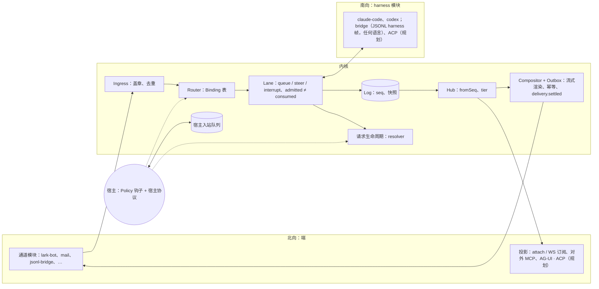

# 瘦身：定义核心流程，给每个功能分级，其余移成模块或交还宿主

> 状态：已采纳（2026-11-23，决定 16）。§9 各项 owner 全部按推荐拍板。第 0 阶段已全部落地：守卫（§6）、第一条接缝 G1（`ChannelCaps.pacing`）、生产代码不再用 testkit、`aio e2e` 移出 daemon、飞书机器人开通连同它的 admin 类型移进 lark-bot。G10（outbox 结算一个事务、游标超前给快照、LN-10）也已落地。G11（客户端命令的操作 id，feature `client.opId`：回执与决定它的事件同一事务写进 `client_ops`，重发答第一次的应答，冲突答 `op_id_conflict`，应答带 `seq`；新承诺 PR-3）也已落地。G3 的第一块（停止与重启：`HarnessAdapter.detach` / `dispose` / `adopts`）、第二块（压缩、Plan 模式、主人切换权限档：`compact` / `modes` / `ownerProfileSwitch`，回复里的名字取 `displayName`）和第三块（会话 env、指令、媒体：`sessionEnv` / `ownProcess`、`HarnessOpenArgs.instructions`、`HarnessFactoryInit.blobs`）已落地，评审的后续（模块声明的类型检查、只读的 blob 视图、CT-2 / CT-3 / RN-1 的 core 测试、EX-8 跨重启）也已落地。第四块（工厂注册与配置形状：harness 种类是各自包里的 `HarnessModule`，由组合根 `packages/daemon/src/bundle.ts` 注册，`config.ts` 和 `gateway.ts` 不再 import harness 包）也已落地。G2 的第一块（通道模块契约 `ChannelModule`；lark-bot、mail、bridge、module 各一份描述符，由 `bundle.ts` 注册；`config.ts` 经注册表拼出 `channels[]` 的 schema、解析条目、做跨条目校验，不再点名任何通道类型；通道与 harness 模块共用一个加载器）也已落地。G2 的第二块（gateway 经注册表构造通道、判 id 归属，不写 `evidence` 时的证据由组合根注册时给定，gateway 不再 import 通道包；控制台按类型的 `x-credential` 标记和 `isCredential` 判断凭据）也已落地，它的后续（类型名与模块成员在注册时检查，网关建不出的条目是配置错误，延后的证据授予检查有 core 测试，控制台对字面凭据的建议由类型给出，module harness 的 `nativeClient` 也在 CF-4 的检查里）也已落地。G5（模块贡献 admin 路由和控制台设置：`AdminContribution`；飞书机器人开通的两个路由、`console.larkBotCommand` 和 `LarkBotJobs` 的挂载都由 lark-bot 的描述符贡献，`console.ts`、`config.ts` 不再点名飞书）也已落地。G6 的注册表骨架（第 0 步）和第 1 步（对外 MCP 端点成为内建功能模块 `external-mcp`，由 `bundle.ts` 注册；配置段 `externalMcp`、缺省关、`external.mcp` 只在监听时报、状态块都不变）也已落地。G6 第 2 步即 G4（模型生成的话题标题成为内建功能模块 `topic-title`，经 `onTurnCompleted` 钩子，由 `bundle.ts` 注册；缺省开、行为不变，`topicTitles: { enabled: false }` 关；触发规则先由网关层测试钉住再搬）也已落地，它们的后续（模块拿到的是内核跑的临时一轮 `KernelLaneHarness.ephemeralTurn`，不再是 harness 适配器；bridge 等 hello 生效才处理 inbound，偶发失败的测试因此稳定；只差大小写的通道类型名被拒；文档与实际一致）也已落地。G6 第 3 步（`watch_*`、`live_*`、`session_*` 三组模型工具成为内建功能模块 `tools.watch`、`tools.live`、`tools.topics`，由 `bundle.ts` 注册；缺省开，工具列表逐字节不变，话题提示走 `inputHint` 钩子；监听路由、live 机制、话题交接留在内核）也已落地，它的后续（话题交接的 TP-1 规则由内核对每个调用方查：模块直接调 `KernelContext.topics.rotate` / `switch` 也是每轮一次、不来回转）也已落地。G6 第 4 步（陌生人放行成为内建功能模块 `strangers`，经 `onUndispatched`、`onAction`、`resolver`、`identities` 四个钩子，由 `bundle.ts` 注册；`policy.strangers` 照旧是它的配置、缺省 `drop` 即关；"邮件除外"改由通道声明 `ChannelCaps.openInbox`，内核不再认通道 id）也已落地。G6 第 5 步（改运行配置的聊天命令 `/agent` `/preset` `/model` `/effort` `/plan` `/bypass` `/compact` 和 `/status` 的 Plan 一行成为内建功能模块 `owner-commands`，经注册表的命令表和 `statusLines` 钩子，由 `bundle.ts` 注册；缺省开，`ownerCommands: { enabled: false }` 关，关掉时这几个 `/名字` 是普通消息；回复、`/help` 和 `/status` 逐字节不变；设过的值（records 的 `run:<会话>`）、`withRunOverride` 即 `Policy.plan` 链、预设的配置解析和控制 IO 的命令留在内核）也已落地。G3 的最后一块（原生终端接管，即 G6 第 6 步：harness 静态声明 `attach`（`'join'` 经 `nativeClient`，Codex；`'takeover'` 经 `takeover`，Claude Code），`ClaudeTuiService` 和 bridge 搬进 `harness/claude-code`，`aio tui-bridge` 由 claude-code 种类经 `HarnessModule.cli` 加给 CLI；gateway 只走通用流程，不再点名任何 harness，守卫基线归零）也已落地。§4 P2 第 5 项（没有模块的内核：`packages/kernel/src/core.ts` 的 `coreRegistries()` 给出 harness、通道、功能模块三个空的注册表，通道与 harness 由嵌入方交给网关；`packages/kernel/test/core-only.test.ts` 在它上面跑内核的承诺；配置用到注册表里没有的模块时加载即失败并说出它，CF-4）也已落地。与 `origin/main`（b9b35ed）的合并也已完成（§4 P1 末尾一项：origin 的功能各自放进新结构，定时任务的工具是内建工具模块 `tools.schedules`，U20 的出口检查对模块都在内核的路径上，飞书的开卡节奏是 `ChannelCaps.pacing.openOnProcess`），合并评审发现的定时任务问题（agent 的定时消息绕过外发检查、发不出去的到点忙着重试、删掉的外部客户端的定时任务以守护进程的身份发出）也已修好。进程外 harness 的宿主端（§3 G9 一行的缺口，§4 P1 最后一项：harness 种类 `bridge`，新包 `harness/jsonl-bridge`；程序在 `probe` 的回答里带上 G3 的静态声明和 `detach`，守护进程启动时就问它（`HarnessModule.probeAtStart`）；`inject`、`detach`、`closed`、`blob.stat` / `blob.get` 等新帧只加不改；`serveHarness` 把进程内的适配器服务成这样的程序，testkit 的 `runHarnessConformance` 对两边跑同一套检查）也已落地。G7（标准投影 `attention`：会话现在有什么在等，从日志 fold 出，经 `SessionInfo`、快照、`aio sessions` 和宿主可订阅的 `attention.changed` 帧给出；新承诺 LN-11）也已落地，它的规则由仓库里第一批与语言无关的 fixture 固定（G8 落地时改成了一致性场景的格式，见下一句）。G8（与语言无关的一致性 fixture，§3 G8，格式见 `docs/design/conformance-fixtures/`）也已落地：两层，都是 NDJSON，文件里没有 TS，都在 `packages/testkit/conformance/`：录下的 harness transcript（L1，t3code 的形状；真实 Codex 0.171 的普通一轮、steer、审批、打断由 `harness/codex/scripts/record-transcripts.ts` 在 Codex 适配器的 `Transport` 上录下、去掉本机的值，经真实 `CodexHarness` 回放；回放程序 `aio-transcript-replay` 是一个 stdio 进程，任何语言的内核都能 spawn 它）和内核场景（L2：输入 `emit` / `clock` / `fault` / `harness`，期望 `expect`，按子集匹配、`<$名字>` 绑定、端内保持顺序；testkit 的 `runScenario` 在没有模块的内核上跑；`scripts/invariants.mjs` 把场景文件算作它头部编号的 core 测试）；`core-only.test.ts` 的六条测试（IN-1、IN-5、DL-1、DL-2、EX-2、LN-1、LN-10、RQ-1、HQ-1、LN-2）各有一个场景，原来的测试留着；G7 的 attention fixture 也改成了场景格式。录下的 steer 查出 HC-1 的一条不成立（以 `it.fails` 记下，没修）。G6 第 3 步留下的单独一步（`live_*` 只在有运行中的通道能开 live 时挂上，每次请求宿主 MCP 端点时判断：`ModuleInstance.offeredTools`、`KernelContext.live.channels`；有意的行为变化，CF-6）也已落地。第三方走同一条契约的缺口（§5"同一条契约"原先只对嵌入方成立）也已补上：打包的 `aio serve` 在解析配置之前导入配置指名的模块文件（`loadConfigModules`），`modules` 条目加载第三方功能模块（origin `module`，拿到与内建模块相同的 `KernelContext`），`type: "module"` 通道文件可以导出 `ChannelModule` 描述符，`use: "module"` 的 harness 描述符的 `declares`、`cli` 起作用，`ChannelModule.implicitEnv` 有了读取方。预设也成了模块（§4 P2 第 2 项的最后一块）：预设的配置解析与查找是内建功能模块 `presets` 的（`packages/daemon/src/presets.ts`，配置段 `presets` 不变），内核与 `owner-commands` 经新的接缝"具名的运行缺省"（`ModuleManifest.runDefaults`）问它，这就是原先缺的"模块之间共享配置段的办法"；没有它的构建里，配置写了 `agents.<n>.preset` 加载即失败，说 `no registered module provides presets`（CF-4）。不含模块包的构建（§4 P2 第 5 项的余下部分）也已落地：内核是自己的包 `@agents-io/kernel`（`packages/kernel`，不依赖任何模块包，不给注册表时就是空的），`@agents-io/daemon` 是组合根（`bundle.ts`、`cli.ts`、内建功能模块），以内建注册表为缺省再导出内核的 API；守卫也查核心包的 `package.json` 依赖（§6）。下文说到的 daemon 里模块与组合根之外的文件（如"daemon 的 `config.ts`"），现在都在 `packages/kernel/src/`，文件名不变。控制台也独立成包（§4 P2 第 4 项）：`console.ts`、`console-config.ts` 在 `@agents-io/console`（`packages/console`，只依赖 protocol 与内核），内核只留它与控制台之间的接缝（`console-host.ts`），由组合根经 `GatewayOptions.consoleFactory` 接上；harness 种类也能贡献 admin（`HarnessModule.admin`，G5 的余下部分）。下文说到的内核的 `console.ts`、`console-config.ts` 现在都在 `packages/console/src/`。还没做的列在 §4 末尾。
>
> 参照：persona 的 [#13411](https://github.com/nwverse/persona/issues/13411)（功能瘦身：定义核心流程、给每个功能分级）、#13430（Persona Core 与模块、只降不升的守卫）、#13438 / #13551 / #13555（内建领域按第三方同一契约做成扩展；`interactive_sessions`、`work_executor` 契约）。persona 在 agent IO 上的做法见 §7。

## 0. 问题

agents-io 的包级分层是干净的：`protocol` 不依赖任何包，`session` 只依赖 `protocol`，适配器（`harness/*`、`channel/*`）也只依赖 `protocol`。问题都集中在 `packages/daemon`：它既是组合根，又装着所有功能，而且直接认识具体的适配器。

| 指标（`main` 638eccf） | 数值 |
|---|---|
| 非测试源码 | 约 37.5K 行。daemon 11.6K（`gateway.ts` 3263、`config.ts` 1615），session 8.0K，codex 4.7K，lark-bot 4.2K，protocol 3.3K，host-mcp 1.9K，claude-code 1.8K |
| 宿主协议 feature 标记 | 17 个（`packages/daemon/src/host.ts` `FEATURES`） |
| 会话事件种类 | 31 种（`packages/protocol/src/events.ts`） |
| 聊天命令 | 16 个（`packages/daemon/src/commands.ts`） |
| 给模型的工具 | 内部 15 个（`host-mcp/src/server.ts`）、对外端点 6 个 |
| 不变量 | 102 条（`docs/INVARIANTS.md`） |
| 核心文件越界（§6 守卫初始基线） | 318 处：`gateway.ts` 直接 import 5 个适配器包，按 `instanceof LarkBotAdapter`、`kind === 'codex'` 分支；`config.ts` 115 处飞书 / Codex 专属校验；`protocol/src/admin.ts` 带着飞书机器人开通的类型；生产代码从 `testkit` 取 `AsyncQueue`、`loadEnvFile` |

这和 persona 是同一个病：persona 有 33 个 assistant 文件直接 import `feishubot`，这里是 `gateway.ts` import `LarkBotAdapter` 再按它分支。后果也一样：

- 内核删不掉、关不干净、也没法单独测任何一个通道或 harness；
- 第三方的通道和 harness 拿不到内建适配器享有的能力（飞书的回复节奏、Codex 的重启接管、Claude Code 的上下文压缩，都写在 gateway 的分支里，而不是在契约里）；
- 定位上要成为"不耦合业务、可以嵌进任何框架"的组件，就必须做到：**内核不认识任何具体通道、harness 和模型，内建适配器与第三方走同一条契约**（persona #13438 的原则）。

## 1. 核心流程

一句话：**一条输入从任意通道进来，先盖上来源，再按确定的规则落到一个会话的 lane；lane 把它交给任意 harness 的一轮；这一轮的过程写进带 seq 的日志，任何端都能按 fromSeq 订阅；正式答复按投递义务送回来源，每次以 `delivery.settled` 结束；途中的请求（审批、提问）由宿主指定的 resolver 结算。**

**内核保留的东西**（列出名字，以免以后搬家时被顺手带走）：

- **协议**：`InboundEnvelope` / `Origin` / `Evidence`、`SessionEvent`、`Command`、`ChannelAdapter` / `HarnessAdapter` 及其 caps、`Policy` 钩子、进程外 JSONL 帧、JSON Schema。
- **会话内核**（`packages/session`）：Ingress（盖章、IN-5 去重）、Router（确定的 Binding 表）、Lane（单写者、queue / steer / interrupt、消费对账）、Log（内存 / SQLite、seq）、Hub（订阅、快照、tier）、标准投影 attention（G7：从日志 fold 出现在有什么在等，是快照的一部分）、Compositor（`ProgressView` → 各 tier 的 `RenderedMessage`，即"中立的卡片模型"）、Outbox（operationId 幂等）、请求与 resolver（auto / model / human / host）、宿主入站队列、因果链与防循环。
- **宿主控制面**：`host.hello` 与 features、`bindings.put/get`、入站队列（推 / 拉 / ack / 补投）、`run.start/cancel/ended`、`deliver`、`input` / `resolve`、`attention.changed`、各回调（route / resolve / outbound / contact / external / review）、`session.prepare/launch/compact`。
- **可解释性**：路由与副作用记录、`aio explain`、`aio verify`。
- **IO 原语工具**（`KERNEL_TOOL_NAMES`，`packages/host-mcp/src/defs.ts`）：`get_channel_context`、`send_file`、`ask_choice`、`mention`、`reply_to`、`send_message`。
- **守护进程内核**（包 `@agents-io/kernel`，`packages/kernel`）：配置的通用部分、模块加载、本地 socket / WS 服务、token、私有文件，以及 `aio` 的基础命令背后的服务（serve、attach、input、sessions、tail / ack、explain、verify、run、send、bindings、redispatch；命令行本身在组合根 `@agents-io/daemon` 里）。

内建的 claude-code、codex、lark-bot、mail、jsonl-bridge 是**默认随 `aio` 打包的模块**，不是内核。

## 2. 功能分级

等级：

- **core**：留在内核。
- **module**：做成模块，与第三方走同一条契约（`use: "module"` 或 JSONL 桥），默认随 `aio` 打包，行为不变。
- **opt-in**：留在仓库，默认关，配置开启（相当于 persona 的"二级菜单"：不在默认面上）。
- **host**：属于宿主的策略或业务。agents-io 只留钩子，现有默认实现降级为一个可替换的模块。这一级是 agents-io 特有的，"不耦合业务"主要靠它。
- **delete**：删除。

载体一栏写现有机制，或者需要先补的接缝（G 编号见 §3）。

| 功能 | 现在在哪 | 等级 | 载体 | 阶段 |
|---|---|---|---|---|
| 飞书回复节奏（5 秒开卡、2 秒预览、回复卡不带停止按钮） | `gateway.ts` `compose` 里的 `instanceof LarkBotAdapter` | core 机制，数值归适配器 | G1 `ChannelCaps.pacing` | **已完成**；与 origin/main 合并后（2026-11-24）飞书"第一次调用工具就开卡片、列出步骤"也是适配器的声明 `ChannelCaps.pacing.openOnProcess`（原 `isLark` 的分支），不再声明 `requireAnswerToOpen`；通道条目上的 `openOnProcess` 盖过它 |
| 飞书 / 邮件 / 桥的构造与配置校验 | `gateway.ts` `new LarkBotAdapter`、`channelOwner`、`grantedByDefault`；`config.ts`（115 处） | module | G2 | P1–P2；**契约与配置已完成**（每种通道是自己包里的 `ChannelModule`：`channel/lark-bot/src/module.ts`、`channel/mail/src/module.ts`、`channel/jsonl-bridge/src/module.ts`，`module` 类型在 `packages/kernel/src/module-channel.ts`，由 `bundle.ts` 注册；条目的专有字段、解析、跨条目规则都在里面，`config.ts` 不再点名任何通道类型，当时只剩 `console.larkBotCommand`（G5 已改由 lark-bot 贡献））；**构造、id 归属、证据与凭据也已完成**（gateway 经注册表调 `create`、`owner`、`idOf`，不写 `evidence` 时的证据由 `bundle.ts` 注册时给定，gateway 不再 import 通道包；控制台按 `x-credential` 和 `isCredential` 判断凭据）；**后续也已完成**（类型名与模块成员在注册时检查，只差大小写的类型名也拒；`create` 返回值形状不对的条目是 `ConfigError`，适配器启动之后的误用不查；控制台对字面凭据的建议由类型给：`credentialHint`）；**控制台的飞书开通路由也已完成**（G5：由 lark-bot 的描述符贡献）；**第三方的通道文件也已完成**（`type: "module"` 的文件可以导出 `ChannelModule` 描述符，按条目的 `config` 起作用，§4 P1 末尾） |
| Claude Code / Codex 的构造，以及按 `kind` 的分支：压缩、TUI 接入、停止时 detach、重启接管、Plan 模式、bypass、会话 env 改走 stdio | `gateway.ts`、`launch.ts`、`commands.ts`、`media.ts` | module | G3 | P1–P2；**停止时 detach、重启接管、dispose 已完成**（适配器声明 `detach` / `dispose` / `adopts`，gateway 不再有 `codexOf`）；**压缩、Plan 模式、bypass 已完成**（适配器声明 `compact` / `modes` / `ownerProfileSwitch`，聊天命令、`/status` 和 `session.compact` 只读声明）；**会话 env、指令、媒体已完成**（适配器声明 `sessionEnv`、实现 `ownProcess`，Codex 的传输改写搬进 `harness/codex`；指令走 `HarnessOpenArgs.instructions`；媒体由适配器拿 `HarnessFactoryInit.blobs` 自己解析，daemon 的 `media.ts` 删除）；**工厂注册与配置形状已完成**（每个种类是自己包里的 `HarnessModule`：`harness/claude-code/src/module.ts`、`harness/codex/src/module.ts`，由 `bundle.ts` 注册；配置的专有字段、旧 `harness` 块、缺省模型、配置目录变量、跨实例规则和构造都在里面）；**原生终端接管也已完成**（适配器声明 `attach`：Codex `'join'`，Claude Code `'takeover'` 并实现 `takeover`；gateway 不再按 `kind` 分支）；**第三方的 harness 描述符也已完成**（`use: "module"` 的描述符的 `declares`、`cli` 起作用，§4 P1 末尾） |
| 话题机制（一个对话多个会话、当前指针、`topic.changed`） | `session/src/topics.ts` | core | – | – |
| 话题标题由模型生成（临时起一个 Codex thread） | `daemon/src/topic-title.ts` | host | G4 | P2；**已完成**（G6 第 2 步：内建功能模块 `topic-title`，经 `onTurnCompleted` 钩子；缺省开，行为不变；标题那一轮由内核替模块跑（`KernelLaneHarness.ephemeralTurn`），模块拿不到 harness 适配器；宿主可用 `topicTitles: { enabled: false }` 关掉、建话题时自己给标题，见 HOSTS §4.6） |
| 控制 IO 的聊天命令：`/help` `/status` `/stop` `/steer` `/answer` `/new` `/topics` `/switch` `/tui` | `commands.ts` | core（每个通道可关） | – | – |
| 改运行配置的聊天命令：`/model` `/effort` `/agent` `/preset` `/plan` `/bypass` `/compact` | `commands.ts` | module（"主人命令"，默认开）；真正的接缝是 `Policy.plan` | G3、G6 | P2；**命令表已由注册表组成**（G6 第 0 步）；**已完成**（G6 第 5 步：内建功能模块 `owner-commands`，`packages/daemon/src/owner-commands.ts`，由 `bundle.ts` 注册，缺省开，`ownerCommands: { enabled: false }` 关；`/status` 的 Plan 一行经 `statusLines` 钩子；`/plan`、`/bypass`、`/compact` 只读 harness 的声明（G3）；设过的值、`withRunOverride` 即 `Policy.plan` 链留在内核，经 `KernelContext.runConfig` 读写） |
| agent 预设 | 原在 `config.ts` `presets`；现在 `packages/daemon/src/presets.ts`（`presetsModule`） | host（运行配置属于策略），默认实现做成模块 | G6 | P2；**已完成**（2026-11-25：内建功能模块 `presets`，由 `bundle.ts` 注册在 `strangers` 之后、`owner-commands` 之前；注册了就开着：配置段 `presets` 是名字到条目的映射（`ModuleConfig.entries`，没有 `enabled`，名字照旧可以是任何合法的预设名），在文件 schema 里的位置不变（`ModuleFields.sectionAfter: 'harness'`），`Config.presets` 是它的设置（同一个对象，已弃用，保留一个版本）。接缝是 `ModuleManifest.runDefaults`（具名的运行缺省：`names(config)`、`resolve(config, name)` 给实例、model、effort、description），不跑模块、按它的段解析出的设置问，内核一侧是 `run-defaults.ts` 的 `NamedRuns`：解析配置时问 `agents.<n>.preset`（这个模块的段在 agent 之前解析），运行时问 `run.start` 的 `overrides.preset`（RN-2）、会话上设的预设（`Policy.plan` 链）和 `/preset` 的列表（`owner-commands` 经 `KernelContext.runConfig`，CT-2）；错误文字都不变。没有它的构建里没有预设：配置写了 `agents.<n>.preset` 加载即失败，说 `no registered module provides presets`，`presets` 段是未知键（CF-4），`overrides.preset` 答 `bad_override`。至多一个模块提供具名运行缺省（注册时查），第三方的提供者走同一条接缝） |
| 陌生人放行卡片（允许一次 / 总是 / 忽略） | `daemon/src/strangers.ts` | host（`Policy.admit` 的一种默认实现），做成模块 | G6 | P2；**已完成**（G6 第 4 步：内建功能模块 `strangers`（`strangersModule`），由 `bundle.ts` 注册在 `tools.topics` 之后、`external-mcp` 之前；钩子 `onUndispatched`、`onAction`（`aio:stranger:`）、`resolver`（访客的轮次问主人）、`identities`（guest 身份，在配置与宿主映射之下，ID-9）；`policy.strangers` 是它的别名，缺省 `drop` 即关，另有只带 `enabled` 的段 `strangers`；主人的对话 `ownerRoute`、`OWNER_DM_FLAG` 留在内核；"邮件除外"改由适配器声明 `ChannelCaps.openInbox`（邮件适配器声明）） |
| 监听与汇总：路由动作 `context` / `digest` | `session/src/router.ts`、`watch.ts` | core | – | – |
| 监听的模型工具 `watch_*` | `host-mcp` | opt-in 模块 | G6 | P2；**工具目录已由注册表组成**（G6 第 0 步：`toolCatalog` 是内核的工具再接活动模块的 `mcpTools`）；**已完成**（G6 第 3 步：内建功能模块 `tools.watch`（`daemon/src/tool-modules.ts`），配置段 `watchTools` 只有 `enabled`、缺省开，打包的 `aio` 不变；工具定义与处理照旧在 `host-mcp`（`TOOL_GROUP_DEFS`、`watchToolHandlers`），监听与汇总的路由留在内核，模块经 `KernelContext.watches` 以会话的 agent 身份建监听） |
| 定时任务：时间表、到点、跨重启、主人的配置 `schedules`、宿主请求 `schedule.*`（SC-1..SC-3；origin/main 带来） | `session/src/schedule.ts`、`gateway.ts` | core（与监听同形：何时、投到哪、只投一次是机制，`docs/design/schedules` §2） | – | **已就位**（2026-11-24 与 origin/main 合并：留在内核；feature `schedules` 是内核的） |
| 定时任务的模型工具 `schedule_*` | `host-mcp` | opt-in 模块（同 `watch_*`） | G6 | **已完成**（2026-11-24 合并：内建工具模块 `tools.schedules`，注册在 `tools.watch` 之后，配置段 `scheduleTools`、缺省开，工具列表与 origin/main 逐字节相同；经新的 `KernelContext.schedules` 以会话的 agent 身份设，带路由的由内核查这一轮能不能发到那里；对外 MCP 模块经同一处以客户端身份设，客户端的定时消息到点经新钩子 `ModuleHooks.scheduledMessage` 由它以客户端身份发出）；**评审后**（2026-11-24，SC-3）：peer 的定时任务记下经哪个模块设的（`ScheduleView.module`，之前存下的按组合根给的前缀 `ModuleFields.schedules` 认），到点只问那个模块：消息经 `scheduledMessage`、唤醒经新钩子 `ModuleHooks.scheduledWake`；模块关着、没注册或不再认这个客户端，这次到点什么都不发（不再以守护进程的身份发），定时任务留着（一次性的也不删，停在那个到点，下次启动按错过的处理），`lastFailure` 说出为什么 |
| 话题的模型工具 `session_list/rotate/switch` | `host-mcp` | opt-in 模块（跟着话题） | G6 | P2；**已完成**（G6 第 3 步：内建功能模块 `tools.topics`，配置段 `topicTools`、缺省开；话题提示改由它的 `inputHint` 钩子给，只给被提供了某个 `session_*` 工具的 agent；交接（`handOver`，TP-1）留在内核，模块经 `KernelContext.topics.rotate` / `switch` 只能交接会话正在跑的那一轮；**后续也已完成**：TP-1 的规则（每轮一次、只从当前话题、不交走刚交接过来的、不切到自己）由内核的 `handOverTurn` 对每个调用方查，不只是工具） |
| 实时语音、会议（`live_*` 工具、`HarnessLive`、`openLive`） | protocol、session、host-mcp、codex、私有 open-lark | 协议与 LN 不变量留 core；工具和实现做成模块 | G6；**改决定 12**（§9） | P2；**工具已完成**（G6 第 3 步：内建功能模块 `tools.live`，配置段 `liveTools`、缺省开；live 的机制（`joinLive`、`leaveLive`、`sayLive` 的 DL-2 / EX-2 记录、事件、LN 不变量）留在内核，模块经 `KernelContext.live` 调用。`live_*` 只在有运行中的通道能开 live 时挂上（**已完成**，G6 第 3 步留下的单独一步：模块的 `offeredTools` 看 `KernelContext.live.channels()`，每次请求宿主 MCP 端点时判断；`live_say`、`live_leave` 在有 live 在跑时也挂上，看 `KernelContext.live.running()`，见 §4））。`HarnessLive` / `openLive` 的实现仍在各适配器里 |
| 外部持有的会话：Claude Code TUI 接管、Codex `--remote` | 原在 daemon 的 `tui-claude.ts`、`tui-bridge.ts`；现在 `harness/claude-code/src/takeover.ts`、`bridge.ts` | module（harness 的 `attach` 能力） | G3 | P2；**已完成**（G3 的原生终端接管：静态声明 `HarnessAdapter.attach`，`'join'` 经 `nativeClient`（Codex），`'takeover'` 经 `takeover`（Claude Code）；gateway 的 `tuiAttach` 只走通用流程，持有期间换实例（`harnessFor`）、`/status` 一行、停止时最先结束都在内核；`aio tui-bridge` 由 claude-code 种类经 `HarnessModule.cli` 加给 CLI，写进 MCP 配置的路径不变。没做成功能模块：G6 第 6 步设想的 `harnessFor`、`statusLines`、`localFrames` 钩子都没用上） |
| 进程外 harness（任何语言；JSONL harness 帧的宿主端） | 原来只有帧的定义（`protocol/src/wire.ts`）；现在 `harness/jsonl-bridge`（`spawnHarness`、`serveHarness`、`bridgeHarnessModule`） | module（harness 种类 `bridge`，与进程内的 harness 同一条契约） | G9 一行的缺口 | **已完成**（2026-11-24：静态声明、`detach` / `dispose`、`adopts`、`sessionEnv` / `ownProcess`、`nativeClient`、blob 访问都经帧带到；不带的是接管 `takeover` 和 `live`；见 §3 G9） |
| 对外 MCP 端点 | `external-mcp.ts`、`host-mcp/src/external.ts` | opt-in 模块（现已默认关） | G6 | P2；**已完成**（G6 第 1 步：`external-mcp.ts` 的 `externalMcpModule` 是内建功能模块，由 `bundle.ts` 注册；配置段、缺省关、feature、状态块、启停顺序都不变，`gateway.ts`、`config.ts` 不再认识它）。`ExternalMcpServer` 照旧在 `host-mcp`，是模块用的库 |
| 控制台 admin HTTP API、配置编辑 | `console.ts`、`console-config.ts` | module（`console` 包） | G5 | P2；**模块贡献已完成**（G5：模块经 `AdminContribution` 贡献路由、控制台设置和 schema，`console.ts`、`config.ts` 不再点名任何模块；harness 种类也能贡献，`HarnessModule.admin`）；**独立成包也已完成**（2026-11-25，§4 P1 末尾一项）：`@agents-io/console`（`packages/console`），只依赖 protocol 与内核；它依赖内核、不是内核经 protocol 接口够到的适配器，所以守卫里是 core 包；组合根经 `GatewayOptions.consoleFactory` 把它交给网关 |
| 飞书机器人开通（扫码建应用） | 原在 `daemon/src/provision.ts`、`protocol/src/admin.ts`；现在 `channel/lark-bot/src/provision.ts`（`LarkBotJobs`，配置经结构化的 `ProvisionConfig` 注入）、`channel/lark-bot/src/admin.ts`（`AdminLarkBot*`、`LARK_BOT_ADMIN_ENDPOINTS`，JSON Schema 在 `channel/lark-bot/schema/`） | 归 lark-bot 模块；protocol 不留飞书类型 | G5 | P0 **已完成**（类型与实现）；**路由由模块贡献也已完成**（G5：`larkBotChannelModule.admin` 即 `channel/lark-bot/src/provision-admin.ts` 的 `larkBotAdmin`，带 `console.larkBotCommand`、三个 schema、两个路由，挂载时建 `LarkBotJobs`） |
| 任务运行（`run.start` / `run.ended`、task agent） | `runs.ts` | core（调用方形态的 agent 通信） | – | – |
| 宿主入站队列、补投、Binding 表、各回调 | `session/src/host-queue.ts`、`host.ts` | core | – | – |
| 宿主控制面的 IO 原语：`deliver.update`、`conversation.create`、`message.ack`、`history.read`（DL-8）、`session.prewarm`（CT-4）、`host.hello` 的 `optIn` / `item.tool`（HC-7）、人工 resolver 的 `heading`、`DaemonRecords.sentByUs`（origin/main 带来） | `gateway.ts`、`host.ts`、`records.ts`、protocol | core | – | **已就位**（2026-11-24 合并：留在内核，feature 在内核的 `FEATURES`） |
| 宿主的出口检查（U20：`outbound.scoped` / `outbound.content`、受检的一轮、扣下、对外读取面的遮挡；DL-7） | session 的 outbox、lane、compositor、`withhold.ts`；`gateway.ts`、`host.ts` | core（经内核的路径对每个模块都成立） | – | **已就位**（2026-11-24 合并：模块的发送经 `KernelContext.send` 由内核标出种类（外部客户端的是 `tool`，陌生人放行等是守护进程自己的 `notice`）；带内容的外发检查 `KernelContext.outbound(from, to, content)` 可以答 hold，经 `KernelContext.hold` 结算；`live_say` 的检查在内核的 `sayLive`；模型起的话题标题由内核的 `setAutoTitle` 先问宿主，受检的一轮的 `onTurnCompleted` 等回答结算之后才给模块；对外 MCP 与话题标题模块读日志时用 session 的 `withholding`） |
| 会话的 attention 投影：现在需要人的人工请求、上一轮的失败、harness 报的卡住、等着的输入（LN-11） | 原来没有（每个宿主各自订阅、各自 fold）；现在 `session/src/attention.ts`（`foldAttention`，快照的一部分）、`hub.ts` `onAttention`、`daemon/src/gateway.ts` `sessions`、`host.ts` `attentionChanged` | core（机制：只说有什么在等；推什么、推给谁、角标怎么算归宿主） | G7 | **已完成**（2026-11-24：`SessionInfo.attention`、快照、`aio sessions` 的最后一列、宿主 `optIn: ["attention"]` 收 `attention.changed`，feature `attention`；规则由 `packages/testkit/conformance/scenarios/attention/*.ndjson` 固定，是 G8 的第一批 fixture；原在 `packages/session/test/fixtures/attention/*.json`，G8 落地时改成一致性场景的格式，内容不变） |
| 测试入口 `test.replay` / `test.fault`（SE-6，`AIO_TEST_HOOKS=1` 才开） | `daemon/src/test-hooks.ts` | core（传输层原语，缺省关） | – | **已就位**（2026-11-24 合并） |
| `send_file` 按 blob 的范围（SE-7，`host-mcp.send_file.blob_scoped`） | `host-mcp/src/tools.ts` | core（输出工具的安全边界） | – | **已就位**（2026-11-24 合并） |
| Claude Code 的首字看门狗、空闲期限（HC-3、HC-8，原 HC-3b）、按模型定权限模式、`mcpAlwaysLoad`、`mcpTool` 导出 | `harness/claude-code` | module（harness 包；`idleStallNotice` 等是实例 `options` 里交给适配器的键，宿主的键不变） | G3 | **已就位**（2026-11-24 合并：都在 claude-code 包里，内核不认识） |
| 飞书私聊里的过程可见范围 `processDmUsers`、没学到类型的对话按最严的档 | `channel/lark-bot` | module（适配器自己的配置） | – | **已就位**（2026-11-24 合并：在 lark-bot 里；开卡节奏见第一行） |
| agent 之间的通信：地址、因果链、跳数上限、`Policy.contact` | session、daemon | core（ROADMAP §2） | – | – |
| 回执表情、会话历史、回复链 | `ChannelAdapter` 的可选方法 | core 接口；实现归模块 | – | – |
| `aio e2e` 场景运行器 | `daemon/src/e2e.ts`，在运行时依赖 testkit | 移出生产包：`packages/daemon-e2e`（私有，bin `aio-e2e`，`pnpm e2e`） | – | **已完成** |
| testkit 里被生产代码用到的工具（`AsyncQueue`、`loadEnvFile`） | `daemon` 的 `client.ts`、`config.ts`、`console-config.ts`、`tui-claude.ts` | `AsyncQueue` 搬到 session，`parseEnv` / `loadEnvFile` 搬进 daemon 的 `env-file.ts`；testkit 留着自己的一份 | – | **已完成** |
| 不含模块包的内核（网关、配置、模块宿主等从组合根取缺省、经它依赖每个模块包） | 原在 `packages/daemon`（`gateway.ts`、`config.ts`、`console-config.ts` 从 `bundle.ts` 取内建注册表、`ConfigFile`、`RESERVED_CHANNEL_IDS`、`CONFIG_DIR_KEYS`）；现在 `packages/kernel`（`@agents-io/kernel`） | core（包），组合根是 `@agents-io/daemon` | – | **已完成**（2026-11-25，§4 P1 末尾一项：内核包不依赖任何模块包，不给注册表时就是空的；`@agents-io/daemon` 以内建注册表为缺省再导出它的 API，导出的名字与缺省不变；守卫的 `dep:<包>` 查 `package.json`） |
| `aio-dev` 旧名包装 | `examples/dev-gateway` | delete（定一个日期） | – | P3 |

## 3. 接缝缺口

| 编号 | 缺什么 | 挡住了哪些搬家 |
|---|---|---|
| G1 | 通道声明自己的回复节奏（`ChannelCaps.pacing`）。**已完成**：飞书适配器声明，gateway 不再判断类型，通道条目照旧可以覆盖延迟 | 飞书节奏 |
| G2 | 通道模块契约带上配置 schema、校验和默认证据授予。内建类型也按模块注册，`channelOwner` / `grantedByDefault` 不再列具体类型。**契约与配置这一块已完成**：`packages/protocol/src/channel-module.ts` 的 `ChannelModule`（`type`；`ids`：适配器用的固定通道 id，注册了就成为保留 id；`entry`：条目的专有字段，`type`、共有字段（`account`、`tier`、`openDelayMs`、`previewDelayMs`、`ack`、`evidence`）和封闭由 daemon 加，装凭据的字符串标 `x-credential`；`isCredential?`：schema 说不清的凭据位置；`implicitEnv?`：不经 `env:` 引用直接读的变量；`resolve(entry, ctx)`，`ctx` 给 `index`、`where`、env、`substitute`（即 `substituteEnv`）、`path` 和 `fail`，daemon 保留它没返回的键并设 `account`；`validateAll?`：同一类型的条目之间的规则，`ctx` 给 `reservedIds`、`fail`、`warn`；`owner?`、`idOf?`；`create(entry, init)` → `BuiltChannel`（`adapter`、`config`、`close`、`idKnown`），`init` 是 `ChannelFactoryInit` 加 `index`、`stateDir`、`acceptId`、`onState`；`admin?` 留给 G5，现在是占位类型）。lark-bot、mail、bridge 各写一份描述符（`channel/*/src/module.ts`，只依赖 protocol）；`module` 类型要用 daemon 的模块加载器，描述符在 `packages/kernel/src/module-channel.ts`。`bundle.ts` 注册 `builtinChannels = new ChannelRegistry([lark-bot, mail, bridge, module])`（`packages/kernel/src/channel-registry.ts`：类型不得重复，声明的 id 不得重复、不得是守护进程自己的 `CORE_CHANNEL_IDS`）。`configFileSchema(harnessRegistry, channelRegistry?)` 按注册表拼出 `channels[]` 的联合（`ConfigFile` 就是内建注册表的，联合的成员、字段和顺序都不变，所以错误文字不变；条目字段与共有字段重名时拼 schema 就报错）；`resolveConfig` 多了可选的 `channelRegistry`；`resolveChannels` 按条目顺序分派 `resolve`，再按注册顺序分派 `validateAll`（先飞书后 bridge，与原来报错的先后一致）；`RESERVED_CHANNEL_IDS` 由注册表给出（类型声明的 `ids` 加 `CORE_CHANNEL_IDS` 的 `local`、`agent`，值仍是 `lark-bot`、`mail`、`local`、`agent`）。飞书的 `LARK_APP_*` 兜底和 `domain`、多机器人规则（CF-3）、bridge 的 id 规则（ID-3）连同错误文字搬进了各自的描述符；`ChannelEntry`、`ResolvedChannel` 由内建类型的类型拼出（形状不变），`LarkChannelConfig` 移到 lark-bot，daemon 经 `bundle.ts` 再导出、标为弃用。通道与 harness 模块共用一个加载器（`packages/kernel/src/module-loader.ts`：`resolveModuleFile` 解析文件、`loadExport` 导入并取导出；`loadHarnessModule` 从 gateway 搬了过来），两边的导出规则不变：通道写了 `export` 仍回落到 `default`，harness 写了就不回落（`module-loader.local.test.ts`）。基线从 81 降到 57（`config.ts` 30 → 6，剩 `console.larkBotCommand`）。**构造、id 归属、证据与凭据这一块也已完成**：`loadConfig` 与 `Gateway.start` 收 `channelRegistry`（缺省内建的），gateway 删掉 `buildChannel`、`channelOwner`、`grantedByDefault`、`isBridge`，不再 import 三个通道包。构造：每个配置条目调它类型的 `create(entry, init)`（`channelAdapter` 钩子照旧优先），`init` 是 `index`、`account`、`config`、不带前缀的日志、`stateDir = <dataDir>/channels/<type>.<enc(account)>`（飞书的目录不变）、`acceptId`、`onState`；`BuiltChannel` 的 `config`、`close`、`idKnown` 原样用上，飞书 `look` 缺省 `chat`、bridge 的首连重试（CF-1）都在描述符里。id 归属：`ChannelRegistry.owner` 是 `<type>:<owner>`，没有 `owner` 时就是类型（bridge 的 `owner` 是程序，module 的是文件与导出，拼出来的字符串和原来一样，错误文字不变；按类型加前缀，一种类型说不出另一种的归属）；`idConflict` 的保留 id 检查改问 `mayUse(type, id)`（保留 id 只给声明它的类型）；live apply 失败时按 `idOf` 记已配置（缺省是类型唯一声明的 id，bridge 的是 `id`，都没有时退回类型，值与原来相同）；`idKnown` 读 `BuiltChannel.idKnown`。证据授予（E3）：`ChannelRegistry` 的选项 `defaultEvidence: { <type>: 'caps' | 'ungranted' }`，缺省 `ungranted`；`bundle.ts` 给 lark-bot、mail `caps`，bridge、module 不给；模块对象上自己写的任何字段都不算数（`channel-registry.test.ts`，ID-3、ID-4）；嵌入方的适配器照旧取 caps。延后的授予检查改成通用的：构造时经 `onState` 报过状态的通道（bridge），到连上时才查授予，其余在启动时查。控制台的飞书开通（`LarkBotJobs`）改由 `bundle.ts` 的 `builtinConsoleParts` 构造，只在注册表里有内建 lark-bot 时提供，接到 `ConsoleHost.larkBots`，线上不变（路由的贡献留给 G5）。凭据：`console-config.ts` 的 `isCredential` 对通道条目先读类型 `entry` 上的 `x-credential`（标在 map 或数组上就是其中每个字符串；沿对象属性、`Record`、数组和联合的每个成员找），再问 `isCredential?`（返回 false 时照旧落到"像机密的键"规则）；bridge 的 `env` 用标记，bridge 的 `args`（`SECRET_FLAG` 搬进 bridge 描述符）、mail 的 `auth.pass` / `auth.accessToken`、飞书的 `appSecret` / `encryptKey` / `verificationToken` 用钩子：mail 与飞书的 `config` 是自由的 `Record`，要标记就得改 schema，会改变校验和错误文字。`ConfigStore` 收 `harnessRegistry`、`channelRegistry`（gateway 给自己的），校验、解析、脱敏都按它们。基线从 57 降到 36（gateway 35 → 18，剩 Claude Code TUI 接管；`console-config.ts` 1 → 0）。**后续**：`ChannelRegistry` 注册时检查类型名（`TYPE_NAME`：ASCII 字母、数字、`-`、`_`，以字母或数字开头；类型名拼进归属 `<type>:<owner>` 和状态目录 `<type>.<account>`，带 `:` 的类型能说出别的类型的归属，带 `.`、`/` 的能共用或跳出目录，ID-3；只差大小写的两个类型名（`Chat` 与 `chat`）在不分大小写的文件系统上共用状态目录，后注册的那个也拒，G4、G6 的后续补上）和模块成员（`badChannelModule`：`entry` 是对象，`resolve`、`create` 是函数，可选钩子写了就得是函数，`ids` 是非空字符串的数组），所以过得了 `resolveConfig` 的类型都有 `create`；网关建不出的条目（类型不在它的注册表里，或 `create` 返回的不是带 `ChannelAdapter` 的 `BuiltChannel`，`badBuiltChannel` 与 module 通道共用 `module-loader.ts` 的 `badChannelAdapter`）是 `ConfigError`（退出码 2），说出条目位置和类型，不再是 `Gateway.start` 里的 `TypeError`（`channel-registry.local.test.ts`）。查的只是 `create` 返回值的形状（适配器有字符串 `id` 和函数 `caps`、`start`、`send`，`close`、`idKnown` 写了就是函数）；适配器启动之后怎么做不查，`start` 不返回 promise、`caps` 抛错或返回的不是 caps 照旧是它自己的错（例如 `TypeError`），文档原先说得比这宽，G4、G6 的后续改成与代码一致；延后的授予检查（`!e.reported`）补了 core 测试：授予了证据的 bridge 首连失败时，启动时不按离线 caps 误报，连上后按对端的 caps 查（`channel-stamping.test.ts`，ID-3、CF-1。这个测试偶发失败过：对端的 hello 答复和紧接着的 inbound 在同一块里到达时，bridge 先处理 inbound，按 hello 之前的离线 caps 盖章，授予了证据的主人被当成陌生人。G4、G6 的后续在 bridge 里修好：inbound 等这条连接的 hello 生效才处理，hello 失败或被拒的连接上的 inbound 不收（`channel/jsonl-bridge/src/host.ts` `Conn.ready`）；测试改为两帧总在同一次写入里，必然走到这条路径）；控制台对字面凭据的建议改由类型给（`ChannelModule.credentialHint`，bridge 参数在命令行上别人看得见的那句搬进 bridge 描述符，文字不变），`console-config.ts` 不再按 `args` 认出 bridge。基线不变（36；`console.ts` 剩的 2 处是 `larkBots`，等 G5）。没动的：harness 实例的凭据位置仍是 `console-config.ts` 里按路径写的规则（原先也没动的 `implicitEnv` 读取方、module 类型的文件导出 `ChannelModule` 描述符，已随第三方走同一条契约补上，§4 P1 末尾：控制台 `GET /api/config` 的 `env` 列出 `implicitEnv` 的变量，标 `implicit`；`module` 类型绑定 `aio serve` 在解析配置之前导入的描述符，`moduleChannelType`） | 通道构造与校验、`config.ts` 里飞书多机器人的冲突检查 |
| G3 | harness 的可选能力由 caps 声明、由适配器方法实现，gateway 里不再出现 `kind ===`。具体包括：`compact()`、跨重启的 `detach()` / 是否可接管、`attach`（原生终端加入，`nativeClient` 已有）、`modes`（Plan）、权限 profile、会话 env 的运行方式、媒体解析。**跨重启这一块已完成**：`HarnessAdapter` 加了三个可选成员：`detach?()`（停止时不打断、不退订；有它的 lane 改 detach，否则 close）、`dispose?()`（立刻关掉自己的进程：为一个 launch 或任务 run 单独建的适配器结束时调；停止时调不 detach 的实例，在它的会话关完之后）、`adopts?`（静态声明，不起进程就能读：重启后 `open({ resume })` 可能接管上个进程留下的 turn；有它的会话启动时重开，其余走 `settleLeftover`）。Codex 两种传输都 `detach`，只有 unix 声明 `adopts`；Claude Code 都不声明。gateway 删掉 `codexOf` 和按 `kind === 'codex'`、传输做的接管判断；模块 harness 同样拿到这三项，每个加载了的 module 实例都拿到，不论有没有会话或任务 run 用过它，几个实例共用的适配器对象每种调用只调一次（见 `packages/protocol/src/harness.ts`、`packages/daemon/README.md`）。守护进程层补了测试：`restart.test.ts`（RS-2 的启动重开、RS-4 的实例级 detach）。**压缩、模式与权限档这一块也已完成**：`HarnessAdapter` 再加五个可选的静态声明，与 `adopts` 一样不起进程就能读：`compact?: { command }`（一轮只有这条命令、作为原生命令原样交给 harness，就压缩上下文；Claude Code 声明 `/compact`，`session.compact` 和 `/compact` 发的就是它，lane 的 CT-3 路径不变）、`modes?`（Codex：`['plan']`，`/plan` 与 `/status` 的 Plan 一行读它）、`ownerProfileSwitch?`（`/bypass`，只有 Codex 声明。Claude Code 原生也认 `bypass`，但不能从 profiles 推出这一项，否则 Claude 上会多出 `/bypass`，行为就变了）、`displayName?`（回复里的名字：`/plan is available only on Codex (this session runs claude-code).` 里的 Codex 取自声明了该能力的已配置实例，没有 `displayName` 的用实例名；一个都没有时取注册了的种类的静态声明 `HarnessModule.declares`（见下面的工厂注册），种类也都没有时改说 `is not available on any harness configured here`）、`ephemeralOpen?`（`open` 认 `options.ephemeral` 等 Codex 形状的选项。当初是 G4 之前的过渡；G4 之后它是内核读的声明：内核只在声明了它的 harness 上替模块跑临时的一轮（`KernelLaneHarness.ephemeralTurn`，话题标题模块用它），只有 Codex 声明）。`commands.ts` 和 gateway 里这几处不再按 `kind` 判断；module harness 声明了就能用，不声明的照旧答不可用（`harness-caps.test.ts`，CT-2 / CT-3；话题标题在 `harness-caps.local.test.ts`）。没动的：`BUILTIN_PROFILES`（`run.overrides.profile` 在任何实例上都可以写 `bypass` / `restricted`，RN-2）仍假定每个 harness 都映射这两档，对 module harness 没有核实；临时一轮的 open 选项仍是 Codex 形状（`ephemeralOpen` 声明的就是这个形状）。**会话 env、指令与媒体这一块也已完成**：`HarnessAdapter` 加静态声明 `sessionEnv`（`'open'`：`open` 把 `args.env` 用到这个会话自己的子进程，缺省，Claude Code；`'own-process'`：一个进程服务所有会话，`open` 拒绝 env，带 env 的 launch 会话改用 `ownProcess({ env, cwd })` 为它建的适配器，lane 关闭时 `dispose`，Codex stdio；`{ refused }`：两者都不行，带 env 的 launch 答 `launch_unsupported`，文字是 `harness instance <名> is <refused>; …`，只带 cwd 可以，Codex unix 的 `refused` 是 `a shared Codex app-server (unix transport)`，所以文字不变）和方法 `ownProcess?()`（Codex 两种传输都有：同一套设置的 stdio app-server，env 合并，launch env 里的 `CODEX_HOME` 作为它的 home）。`launch.ts` 的预检和 `launchAdapters` 只读声明，不再看 `kind` 和传输；`checkLaunch` 不再拿配置实例，改拿一个只在带 env 时才问的拒绝原因（gateway 的 `sessionEnvRefusal`）：实例暂时不可用（`env:` 变量没设）时从配置原样建一个适配器只读声明，所以不可用的 Codex unix 实例照旧答 `launch_unsupported`；连这也建不出的（没加载的 module 实例）带 env 的 launch 一律拒绝，免得钉住一个永远跑不了的 launch。任务运行仍为每次运行把 env 并进实例再建适配器（运行的 env 在实例配置的配置目录之下，运行不能改写它），适配器有 `ownProcess` 时再在它上面调 `ownProcess({ env: {} })`，所以只多了 `AGENTS_IO_RUN_ID` 的运行也独占进程。指令：`HarnessOpenArgs.instructions`（wire 的 `open` 帧加同名可选字段），`withAgent` 不再按种类分支；Claude Code 把它追加到预设系统提示（盖过 `options.sdk.systemPrompt`），Codex 作为 `developerInstructions`（盖过 `options.developerInstructions`）；过渡期 module harness 照旧同时收到 `options.developerInstructions`；话题标题的提示改走 `instructions`。媒体：`HarnessFactoryInit.blobs`（`BlobAccess { stat, get }`，网关给的是只读视图 `harnessBlobs`：只有这两个方法、拆下来也能调，不是可写的 `FsBlobStore`），内建适配器也经构造参数拿到同一个视图，自己做 resolver：Claude Code 的 `blobResolvers` 和内联上限 `CLAUDE_IMAGE_MAX_BYTES`（3,750,000 字节，错误文字不变）在 `harness/claude-code/src/media.ts`，Codex 的 `blobMediaResolver` 在 `map.ts`；open 选项（含配置里的 `options`）显式给的 resolver 照旧优先，存储里没有的引用（`lark-file:`）照旧解析为空。module harness 声明了就能用（`harness-open.local.test.ts`）。**评审的后续**：module 工厂返回的适配器在启动时逐个检查静态声明和生命周期成员的类型（`displayName`、`compact`、`modes`、`ownerProfileSwitch`、`ephemeralOpen`、`adopts`、`sessionEnv` 含 `{ refused }`、`detach` / `dispose` / `ownProcess` / `nativeClient` 是函数；`nativeClient` 是 G2 的后续补上的），不对的让启动失败并说出成员名（CF-4），不再等到命令、终端加入或停止时报 TypeError，也不再把 `null` 或未知字符串的 `sessionEnv` 当成 `'open'`；module 的 open 参数在 `env` 里总是带实例 env 和任务 run 的 env（`ownProcess` 返回的适配器上的也一样），`SessionEnvSupport`、`HarnessOpenArgs.env` 的说明改成与此一致（行为没变）；CT-2、CT-3 的 module harness 用例移到 core（`harness-caps.test.ts`），Claude Code 把指令追加到预设系统提示改由 core 测试守（RN-1、CT-2）；外部客户端发送的 `external` 随进行中记录保存（`InFlightDelivery.atSend`），重启后补结算的发送 explain 仍说出客户端（EX-8，与 EX-2 的 `inputIds` 同类）。**工厂注册与配置形状这一块也已完成**：`packages/protocol/src/harness-module.ts` 的 `HarnessModule`（`kind`；`schema`：实例的专有字段，共有字段 `use` / `env` / `cwd` / `run` / `profiles` / `options` 和封闭由 daemon 加；`resolve(entry, ctx)` → `{ launch, unavailable? }`，`ctx` 给实例名、实例的 env、`path()`、把 `env:` 值改走子进程环境的 `HarnessChildSecrets` 和 `fail`；`checkAll`：同一种类的实例之间的规则；`defaults`：`model`、`modelEnv`、`configDirEnv`；`legacy`：旧 `harness` 块里它那一节的 schema、`resolve` 和 `.env.live` 前缀；`declares`：静态声明，形状就是 `HarnessAdapter` 的那几个成员（`HarnessDeclarations = Pick<HarnessAdapter, …>`）；`profilesInOpen`；`create(init)` → 适配器，`init` 是 `HarnessFactoryInit` 加 `launch`、`env`、`profiles`）。Claude Code 与 Codex 各写一份（`harness/claude-code/src/module.ts`、`harness/codex/src/module.ts`，只依赖 protocol），实例 schema、旧块、缺省模型 `haiku` / `''`、`AGENTS_IO_LIVE_*_MODEL`、`CLAUDE_CONFIG_DIR` / `CODEX_HOME`、`env:` 改走子进程环境（SE-1）、codex 的 `stateDir` 不得共用、按种类构造（含 `findOnPath`）都从 `config.ts` 和 gateway 的 `buildHarness` 搬了进去。`packages/daemon/src/bundle.ts` 是组合根（`scripts/boundaries.json` 的 `bundle`），只有注册：`builtinHarnesses = new HarnessRegistry([Claude Code, Codex])`，第一个是缺省种类。`resolveConfig` / `loadConfig` / `Gateway.start` 接收 `harnessRegistry`（缺省就是它），`configFileSchema(registry)` 拼出文件 schema（`ConfigFile` 就是内建注册表的，联合的结构不变，所以错误文字不变）；`--harness <种类>` 查注册表，没有该种类的实例时照旧现造一个；旧块的实例名就是种类名，codex 的 `stateDir` 照旧是适配器缺省 `~/.agents-io/codex`。`HarnessInstance` 变成 `{ kind: string; launch }`，原来的 `claude` / `codex` / `module` 字段并成 `launch`（值不变）；旧字段名在 `resolveConfig` 解析出的实例上再留一个版本（已弃用），是 `launch` 的不可枚举访问器，读写都转到 `launch`，所以已有宿主读 `inst.claude.mcpServers`、在 `buildHarness` 前改 `inst.claude` 都照旧生效（内建种类的别名由 `bundle.ts` 经 `HarnessRegistry` 的 `launchAliases` 给出，`module` 由 config 自己给；`harness-registry.local.test.ts`）。`InstanceHarness.open` 不再看 `kind === 'claude-code'`，改读种类的 `profilesInOpen`（Claude Code 声明，module 实例恒为真），open 参数不变。`use: "module"` 的模块照旧导出工厂，也可以导出一个 `HarnessModule` 描述对象：`schema` 在加载时检查 `config`，`create` 拿到同样的 init（CF-4）。顺带修了上一块留下的回归：只配了 Claude Code 的默认部署里 `/plan`、`/bypass` 又答 `… is available only on Codex (this session runs claude-code).`（`commands.test.ts`，CT-2）。基线从 198 降到 81。**原生终端接管这一块也已完成**（即 G6 第 6 步）：`HarnessAdapter` 加静态声明 `attach?: 'join' \| 'takeover'`（进 `HarnessDeclarations`，缺省 `'join'`）和方法 `takeover?(args)`。`args` 是 `HarnessTakeoverArgs`：`sessionKey`、`instance`、`nativeId`、`resume`、`model`、`services`（`TakeoverServices`：放本次启动文件的 `dir` 即 `<dataDir>/tui`、CLI 脚本 `cli`、`fileOf`、`onEnd`）；返回 `HarnessTakeover`：`harness`（接管期间顶替该实例）、`connected`、`launch()`（会话在 `harness` 上打开之后才问，因为 Claude 的 MCP 配置要用打开时拿到的宿主端点；返回 `TakeoverLaunch`，即 `NativeClient` 加 `unsetEnv`）、`end(reason)`。Codex 声明 `'join'`，Claude Code 声明 `'takeover'`。gateway 的 `tuiAttach` 只读声明（实例暂时不可用、即 `env:` 引用的变量没设时，照它可用时的声明读：从配置原样建一个适配器，不打开、不留下，与 `sessionEnvRefusal` 同一个 `declaredUnavailable`；原来按种类判断，这样的 claude-code 实例照旧接管，不落到加入那条路答 `internal`）：`'takeover'` 走通用流程 `takeOver`（已连着答 `conflict`；没连上的 `end('replaced by a new attach')`；`whenIdle` 后 `release`，忙答 `busy`；该实例上的原生 id（`resume`）或新 UUID；登记持有，lane 的 `harnessFor` 换成 `harness`；`attachPoint`，失败 `end('attach failed')`；再 `launch()`；日志里的名字取 `displayName`），`/status` 的 "a terminal UI holds this session" 与停止时最先 `end('daemon stopping')` 都在内核；其余照旧走 `nativeClient`，错误文字不变。`ClaudeTuiService` / `TuiHold` 搬成 `harness/claude-code/src/takeover.ts` 的 `claudeTuiTakeover`，用 harness 自己的 `AsyncQueue`；每次接管有自己的本机 HTTP 端点，结束时关掉（原来所有持有共用一个端口，守护进程停止时才关；结束了的持有的请求两种做法都没人认）。`ClaudeCodeHarness.takeover` 用实例配置里写的 `executable`（新的 `tuiCommand`：裸名照旧交给 `aio tui` 在它自己的 PATH 上找，不用无头适配器解析出的路径）和 `configDir`。bridge 搬成 `harness/claude-code/src/bridge.ts` 的 `tuiBridge`；`HarnessModule.cli`（新的：种类给 CLI 加的命令，`HarnessRegistry` 查名字、查两个种类重名，`cliCommand` 按名字查）让 `aio tui-bridge` 由 claude-code 种类贡献，CLI 自己的命令优先，写进 MCP 配置的仍是 `node <daemon 的 cli.js> tui-bridge`。module harness 声明了也能用，启动时检查 `attach`、`takeover` 的类型（CF-4）。测试：`tui.test.ts`（LN-8）、`tui-claude.test.ts`、`harness/claude-code/test/tui.test.ts`（LN-9）断言不变，`tui-claude.test.ts` 的假无头适配器改为像 Claude Code 适配器那样声明 `attach: 'takeover'`、用 `claudeTuiTakeover`（只改 setup）；新的 `takeover.test.ts`：module harness 声明它就走同一流程（LN-9）、真的 claude-code 实例的命令行与 bridge 路径（LN-9）、成员类型（CF-4）；`cli.local.test.ts`、`harness-registry.local.test.ts` 补了 `aio tui-bridge` 与 `HarnessModule.cli`。基线从 28 降到 0（`gateway.ts` 18 → 0，`tui-claude.ts`、`tui-bridge.ts` 离开 daemon）。**原生终端接管的后续也已完成**：`takeover.end` 经 gateway 的 `endTakeover`（同 `detach` / `dispose` 经 `harnessCall`），module harness 的 `end` 失败只记日志，`stop` 照常结束（RS-8、LN-9 的 core 测试）。基线不变（0）。G3 进程内的部分至此全部完成；进程外的 JSONL harness 经 harness 种类 `bridge` 拿到同样的声明与调用（终端接管除外），见 G9 一行 | Claude Code / Codex 分支、外部持有会话、`/plan` `/bypass` `/compact` |
| G4 | 内核不再自己发起模型调用：话题标题改为宿主钩子（`Policy.title?`）或一个默认关的模块。**已完成**（G6 第 2 步，下面 G6 一行有细节）：做成了模块，但缺省开着，因为默认关会让现有部署不再有生成的标题，与 §5 的"默认不变"冲突；宿主（决定 16 的 host 级）用 `topicTitles: { enabled: false }` 关掉，自己在建话题时给标题（`topic.switch` 的 `new.title`，HOSTS §4.6），嵌入方要在建好之后再起标题就写自己的模块（`onTurnCompleted`、`KernelContext.lanes.harness(…).ephemeralTurn` 加 `KernelContext.topics.setAutoTitle`；模块拿不到 harness 适配器，临时的一轮由内核跑）。网关里不再有这次模型调用，`Policy.title?` 没有做 | 话题标题 |
| G5 | 模块可以贡献 admin 路由和配置界面所需的 schema（相当于 persona 的 `settings_section`）；protocol 的核心类型里不再出现飞书。**已完成**：`packages/protocol/src/admin-module.ts` 的 `AdminContribution`（`console`：合进封闭的 `console` 段的键与 schema，每个都是可选的，schema 的 `default` 是不写时的值；`schemas`：模块自己的线上类型，`pnpm schema` 照原名和 `$id` 写进模块的包；`routes`：`AdminRoute`，即 `AdminEndpoint` 加 `handle(req, ctx)` → `{ status, body }`；`mount?(ctx)` → `{ close? }`）、`AdminContext`（模块自己的控制台设置；私有工作目录，守护进程的是 `<dataDir>/provision`，0700，挂载前建好，各贡献共用；日志；子进程的环境；`config?: ConfigAccess`，守护进程没有配置文件时没有；`applyChannels?`。同一个对象交给 `mount` 和这个贡献的每次 `handle`，模块按它保存自己挂载的东西）、`ConfigAccess`（`read`、`defined`、`envFilePath`、`lookup`、`envRefs`、`updateValidated`：就是 lark-bot 原来的 `ProvisionConfig` 加 `envRefs`，`ProvisionConfig` 改成它去掉 `envRefs`；守护进程的 `ConfigStore` 实现它）。`ChannelModule.admin` 的类型就是它（原先的占位类型 `ChannelAdminContribution` 删除）。`ChannelRegistry` 注册时检查成员（`badAdmin` / `badRoute`：方法只能是 GET、PUT、POST，路径在 `/api/` 下，状态 200 或 202，有 `response` schema 与 `handle`，不许 `public`）和归属（`claimAdmin`：一个路由（方法加路径，参数不计名字）、一个控制台键、一个 schema 名只属于一个类型，路由不得是核心端点），按注册顺序给出 `adminContributions`；控制台键不得是核心自己的，由 `config.ts` 拼段时检查。`config.ts` 按注册表拼 `console` 段（`consoleSchema`：核心的服务器键、各类型贡献的键、`liveChannels`，所以 `larkBotCommand` 的位置不变，封闭照旧），`ConsoleConfig` 在原来的位置带上各类型的设置（`consoleSettings`：写了的值，否则 schema `default` 的副本；`ConsoleConfig` 因此有索引签名，不再有 `larkBotCommand` 字段的类型）。`ConsoleServer` 在核心路由与 `authorize` 之后按顺序分派 `ConsoleHost.routes`，`Host` / `Origin` 检查、`application/json`、`AdminError` 都和核心路由一样；路径的 `:name` 是一段，结尾的那段取路径的其余部分（和核心的 `/api/explain/:inputId` 一样，所以 `/api/bots/lark/a/b` 照旧答 `unknown_job`）；请求体按路由的 `body` 校验，文字照旧。`ADMIN_ENDPOINTS` 只列核心端点，`console.ts` 的 `adminEndpoints(registry)` 给出核心加贡献的端点表（PR-1）。gateway 在控制台启动时为每个贡献建上下文、调 `mount`（`mountAdmin`，抛错让启动失败），控制台没起来或守护进程停止时调 `close`（`closeAdmin`）。lark-bot 的描述符贡献 `console.larkBotCommand`（缺省是钉死版本的 `CREATE_LARK_BOT`，常量移到 lark-bot，daemon 经 `bundle.ts` 再导出、标为弃用）、`AdminLarkBot*` 三个 schema（`scripts/emit-schema.mjs` 改读贡献，文件、内容和 `$id` 不变）、两个路由（路径、202 / 400 / 404 / 409、答复体、`unknown_job` 都不变）和挂载 `LarkBotJobs`，没有配置文件时两个路由照旧答 404 `bot provisioning needs a config file`。`bundle.ts` 的过渡物 `builtinConsoleParts` / `ConsoleParts` / `ConsolePartsInit` 与控制台的 `BotProvisioning` / `ConsoleHost.larkBots` 删除。顺带修了上一块留下的问题：注册表里没有 lark-bot 时，`/api/bots/lark` 原先答 404 `bot provisioning needs a config file`，现在答未知路由的 404（`no POST /api/bots/lark`）（`console-modules.test.ts`，PR-1）。两处细小差别，只出现在没有配置文件的守护进程（嵌入方自己拼配置、又开了控制台；`aio serve` 总有配置文件路径）：控制台启动时也建一个空的私有 `<dataDir>/provision`；`POST /api/bots/lark` 的请求体不合 schema 时先答 400，原来先答 404。基线从 36 降到 28（`config.ts` 6 → 0，`console.ts` 2 → 0）。当时没动的两项后来也已完成（2026-11-25，§4 P1 末尾一项）：harness 种类也能贡献（`HarnessModule.admin`，与 `ChannelModule.admin` 同一个类型；`HarnessRegistry` 注册时同样检查成员、认领路由、控制台键与 schema 名，`HarnessRegistry.adminContributions` 按注册顺序列出；它与通道类型的贡献在两个注册表相遇处互查：`packages/kernel/src/admin-contributions.ts` 的 `adminContributions(harnesses, channels)`，通道类型的在前；`console` 段、端点表、网关的挂载都按这个顺序），控制台独立成包（`@agents-io/console`）。仍没动的：不在 `ADMIN_ENDPOINTS` 里的核心路径（`/api/login-link`、`/api/console-proof`）注册时不查，贡献了也到不了处理函数 | 控制台、飞书开通 |
| G6 | 一份模块清单，内建和第三方同一形状：`{ id, kind, config schema, features, mcpTools, commands, admin }`，带 `origin: builtin \| module`（对应 persona #13430 的 `Origin = builtin \| extension`）。关掉的模块即不存在：工具不挂、命令不列、feature 不报。**注册表骨架（第 0 步）已完成**（那一步一个功能都没搬，功能从第 1 步起搬）：`packages/protocol/src/module.ts`（只有类型，第三方可用）的 `ModuleManifest`（`id`；`kind: 'feature'`，通道与 harness 照旧走 `ChannelModule` / `HarnessModule`；`needs`：`module:<id>` 或 `kernel:<能力>`；`config`：配置文件的一个顶层段 `section`，段里是模块自己的键 `schema` 加 daemon 加的 `enabled`、封闭，`aliases` 是旧位置的点路径，`aliasEnabled(value, alias)` 说旧位置上的值开还是关，`defaultEnabled`，`resolve(raw, ctx)`；`features`；`mcpTools`：名字、说明、JSON Schema 对象 `input`、`readOnly`、`needsTurn`；`commands`：名字、`/help` 一行、`ownerOnly` 缺省为真；`admin`；`setup(kernel, config)`）、`ModuleInstance`（`tools`、`commands`、`hooks`（`onUndispatched`、`onAction { prefix, handle }`、`onTurnCompleted`、`onTopicChanged`、`resolver`、`planRun`、`harnessFor`、`inputHint`、`statusLines`、`identities`）、`localFrames`、`status`、`start`、`stop`）和窄的 `KernelContext`（`log`、`events`、`policy`、带 `module:<id>:` 命名空间的 `records`、`db`、`topics`、`router`（`identify`、只管自己那份的 `setExtraIdentities`、`newTopic`、`conversationAgent`）、`lanes`（`has`、`open`、`command`）、`channelFor`、`send`（经 outbox）、`ownerRoute`、`redispatch`、`explain`、`host`（`connected`、`answers`），每一项都是 gateway 现有的闭包；晚绑定，`setup` 期间只有 `id` 和 `log` 能用）。运行时在 `packages/kernel/src/modules.ts`：`ModuleRegistry` 注册时检查每份清单和它们合起来的声明（id、配置段与别名、工具、命令、feature 各属一个模块，且不得是内核的；`needs` 的模块要已注册），`bundle.ts` 注册 `builtinModules`（现在是空的，origin `builtin`）。生命周期五步：**resolve** 在 `resolveConfig` / `loadConfig`（`config.ts` `resolveModules`：段在就开，除非 `enabled: false`；段不在时由第一个设了的别名决定：模块有 `aliasEnabled` 就听它的（`policy.strangers: "drop"` 是关），没有时值是带 `enabled: false` 的对象就关（`externalMcp: { enabled: false }`，与段一样），其余的值开、原样交给 `resolve`；都没有按 `defaultEnabled`；开着的模块需要的模块关了就是配置错误；注册表空时 `Config.modules` 不出现，`configFileSchema` 照旧是 `ConfigFile`）；**setup** 在 `Gateway.start` 里、建 Ingress（即 gateway 构造）之前（`ModuleHost.setup`，返回的处理函数必须和清单一一对应，`setup` 抛错或返回不对是 `ConfigError`，说出模块）；**start** 在通道、本地 socket、控制台之后（对外 MCP 原来就在这里启动；第 1 步起它是最后注册的模块）；**stop** 在停止时最先做，倒序，每个限 2 秒；模块段的改动答 `applied: restart`。从内核自己的条目加活动模块的条目组成的有：工具目录（`host-mcp` `toolCatalog`，`build` 遍历它，`HostTools.call` 按名字分派到模块的处理函数；`agents.<n>.tools` 按全目录校验，列了关掉的模块的工具时报错并说出模块）、命令表（`commands.ts` `CommandTable`：`KERNEL_COMMANDS` 再接模块命令，`/help` 按这个顺序，关掉的模块的 `/名字` 是普通消息）、`host.hello` 的 features（`FEATURES` 只是内核的，运行中的模块的接在后面）、`adminStatus.modules: [{ id, origin, enabled, status? }]`（新增字段）。没有模块时工具列表、`/help`、features 和错误文字逐字节与原来相同，由 core 测试对照改动前取下的输出（CF-6：`packages/host-mcp/test/catalog.test.ts`、`output-tools.test.ts`；CT-2：`commands.test.ts`），模块的路径由 `modules.local.test.ts` 覆盖。**评审的后续**：别名原先只要设了就开模块，表达不了 `externalMcp: { enabled: false }`、`policy.strangers: "drop"` 这类旧的关值，对外 MCP 搬成带别名的模块时会在端点关着时报 `external.mcp`（SE-5）；改为上面的规则（`aliasEnabled` 写了就得是函数、只给有 `aliases` 的模块，返回的不是布尔值是配置错误，说出模块），别名关掉的模块不 `setup`、不报 feature，`modules` 里只有 `enabled: false`（`modules.local.test.ts`）；SE-5 的测试也补上了 `enabled: false` 时守护进程的 `hello` 不报 `external.mcp`。没做的：`admin`（注册即报错）、`hooks` 与 `localFrames`（`setup` 返回了就报错，说出是哪一个），各自随需要它的那一步搬家接上；模块段里的 `x-credential` 还没有读取方（控制台按"像机密的键"的通用规则处理）。基线不变（28）。**第 1 步（对外 MCP 端点）也已完成**：`packages/daemon/src/external-mcp.ts` 的 `externalMcpModule`（id `external-mcp`）是第一个内建功能模块，`bundle.ts` 把它注册为 `builtinModules` 的最后一个（最后启动、最先停止，以后加的模块排在它前面），gateway 和 `config.ts` 不再 import 或点名它。配置：段就是 `externalMcp`（键、形状、错误文字不变，schema 从 `config.ts` 搬进模块；`ConfigFile` 是内建注册表的 schema，含模块段；模块段排在 `local` 之前，即 `externalMcp` 原来的位置，所以多处错误时的先后不变），`defaultEnabled: false`，`enabled: false` 关；`resolveExternalMcp` 搬进模块（只许回环改用 host-mcp 的 `isLoopback`，结果相同；owners 经新增的 `ModuleResolveContext.valueAt('policy.owners')` 读，与原来一样只看文件里的 `policy.owners`），模块的设置在其余配置都解析完之后才解析（原来 `externalMcp` 就在最后），所以一份配置有几处错误时报的还是原来那一处；`Config.externalMcp` 作为弃用别名保留一个版本（与 `Config.modules` 里的是同一个对象；在 `Gateway.start` 之前换成别的值或删掉照旧生效：`ModuleHost` 发现它不再是解析出的那个对象时以它为准；完全不带 `modules` 的配置（自己拼的）也照它开关）。feature：`external.mcp` 移出内核的 `FEATURES`，成了模块的 feature，只在端点监听时报（新增 `ModuleInstance.features()`：模块此刻报清单里的哪些；端口被占只记日志、不报）；`callouts.external` 照旧总是报（留在内核）。状态：`GET /api/status` 的 `externalMcp` 块原样留在原处（`modules` 之前），`modules` 里多了它的一项（`status` 同样是 `{ url, clients }`）。这两个旧位置由 `bundle.ts` 经新增的 `ModuleRegistryOptions.fields`（`{ config, status }`）给出：解析出的 `Config.<config>`、状态里的 `<status>`；注册时检查字段名、模块已注册、一个字段只属于一个模块、状态字段是 `AdminStatus` 声明的可选字段（`modules` 除外），解析时 `Config` 自己的字段不许用。启停：`start` 读或生成客户端令牌、监听（令牌不对让启动失败，端口被占只记日志），`stop` 关端点；`ModuleHost.start` 对模块抛的 `ConfigError` / `TokenError` 原样抛出（它们自己说出设置的位置，`aio serve` 照旧退出码 2，文字不变），其余照旧包成 `module <id>: start failed: …`。`externalOutbound`（DL-6）和 `externalSends`（EX-8）留在内核，经 `KernelContext` 用：新增的成员都是 gateway 原来交给端点的闭包——`head`、`appendNative`（只能写 native 事件）、`sessions`（`list`、`known`、`agentOf`）、`status`、`stopping`、`router.record`、`lanes.input`（只收 `kind: "peer"` 的输入，其余抛错）、`resolveRoute`、`send` 的 `external`（发送期间记进 `externalSends`）、`settled`、`outbound`、`host.heldBy` / `host.external` / `host.isToken`（模块拿不到宿主令牌本身）。可见的细小差别：端点开着时 `hello` 的 `features` 里 `external.mcp` 排到内核的 feature 之后（原来在 `callouts.external` 与 `session.compact` 之间；按名字协商，不影响）；端点与它的工具写的日志行多了 `module external-mcp: ` 前缀；`GET /api/status` 的 `modules` 多了 `external-mcp` 一项。core 测试（`external-mcp.test.ts`，SE-5、ID-10、DL-6、CF-10、EX-8）断言不变；`modules.local.test.ts` 改为对照新的内建注册表（别名规则的例子由 `externalMcp` 改用 `console`），并覆盖端点开着、端口被占、`Config.externalMcp` 改写与不带 `modules` 的配置、`fields`、`lanes.input` 只收 peer、`ConfigError` 原样抛出。没动的：控制台把 `externalMcp.clients.<名>.tokenFile` 当路径而非凭据的规则仍在 `console-config.ts`（模块段还没有"不是凭据"的标记）；`ExternalMcpServer` 仍在 `host-mcp`。基线不变（28）。**第 2 步（话题标题，即 G4）也已完成**：先补了网关层测试（`packages/daemon/test/topic-title.local.test.ts`，话题标题没有不变量，所以在 local 层），对着搬家前的网关跑过、逐条改坏代码确认会红：只在声明了 `ephemeralOpen` 的实例上（Codex；Claude Code 上不生成）、按这一轮自己的实例（`/preset` 换过的也算）、第 1 次完成的轮次和之后每第 3 次（失败的轮次不算、不计数）、只在 `titleSource` 为 `auto` 时、只给已配置的 agent（没有 `agents` 时的默认 agent 不生成），明确给的标题（`topic.switch` 带标题）不覆盖，生成期间标题被改过的结果丢掉，同一话题同时只有一个生成，标题换上后最新一张卡片被编辑成带新标题。然后 `updateTopicTitle` 与 `titleJobs` 从 gateway 搬进 `packages/daemon/src/topic-title.ts` 的 `topicTitleModule`（id `topic-title`），`bundle.ts` 把它注册为 `builtinModules` 的第一个（`external-mcp` 照旧最后）。配置：段 `topicTitles`，只有 `enabled`，`defaultEnabled: true`，不写就是开着，所以已有配置不变（段在文件 schema 里排在 `externalMcp` 之前）。钩子：`ModuleHooks.onTurnCompleted` 开始生效（`SERVED_HOOKS`，写了不是函数就是配置错误）：lane 的 `onTurnCompleted` 改调 `ModuleHost.turnCompleted`，一个会话的一轮写进日志之后、按注册顺序同步调每个模块，任务 run 的轮次照旧不算；抛错或返回的 promise 拒绝只记日志（`module <id>: onTurnCompleted failed: …`）；从网关建好到停止模块（第 4 步）为止。`KernelContext` 新增 `topics.titleSource`、`topics.setAutoTitle`（只在标题仍是 `auto`、仍是模块读到的 `expected` 时换上，换上后刷新这个会话在各通道上最新的卡片，即原来的 `refreshLatestTitle` 循环，刷新失败的日志不变）和 `lanes.harness`（`KernelLaneHarness`：已配置 agent 的 lane 跑在哪：`agent`、`instance`、`cwd`、`adapter(instance)`（launch 的适配器，否则 agent 的）、`run(instance)`；任务 run 和未配置的默认 agent 没有），都是 gateway 原来就用的闭包。自己拼的、完全不带 `modules` 的配置：原来只有带旧字段的模块（对外 MCP）有办法，现在 `Gateway.start` 再给没有旧字段的内建模块"文件里没有它们的段"时的结果（`ModuleHostOptions.defaults`，即 `resolveModules({}, …)`），所以这样的配置照旧启动、照旧生成标题，第三方模块照旧报错。可见的细小差别：`GET /api/status` 的 `modules` 第一项是 `topic-title`；`title update failed` 的日志行多了 `module topic-title: ` 前缀；守护进程开始停止模块之后才完成的轮次不再起标题（原来会起，但结果因 `stopped` 被丢掉）。`modules.local.test.ts` 改为对照新的内建注册表，并补了钩子（顺序、任何状态、抛错与拒绝、停止后不调、不是函数报错）和新 `KernelContext` 成员的用例。没动的：标题的 open 选项仍是 Codex 形状（`ephemeralOpen` 声明的就是这个形状）；没有改已有话题标题的帧。基线不变（28）。**第 1、2 步的后续也已完成**：`lanes.harness` 原先把 harness 适配器交给每个模块（第三方的也一样），模块能用任意 `run.profile`、`options.profiles` 开会话，绕过 `Policy.plan` 和部署的权限档。现在它是窄的能力：`KernelLaneHarness` 只有 `ephemeral(turnId)`（这一轮在会话日志里，所用的实例（`run.harness`，否则 agent 的）声明了 `ephemeralOpen`）和 `ephemeralTurn({ turnId, prompt, instructions })`，`agent`、`instance`、`cwd`、`adapter`、`run` 删除。临时的一轮由内核跑（`packages/kernel/src/ephemeral-turn.ts` `ephemeralTurn`，gateway 的 `laneHarness`）：一次性的会话（`options.ephemeral`、不带 preface、不带宿主的工具即没有 MCP），在会话的工作目录，用那一轮的 run（策略为它定的；日志里没有时是 agent 的），低 effort、缺省模式，权限档以模块 id 命名、只读、从不询问；输入是内核的（`origin.kind: "system"`，`via` 是模块 id）；答回答复的文字，没完成或 30 秒内没答完是 undefined；会话总会关掉。模块只给这三个字符串，`kernelContext` 不把别的往下传。话题标题模块改用它，行为不变（`topic-title.local.test.ts` 一字未改照样通过；`generateTopicTitle(adapter, …)` 留作拿着适配器的代码用的同一条路径），只有标题那一轮的输入 id 从 `title:<uuid>` 变成 `topic-title:<uuid>`（只在那个一次性会话里）。`KernelBackend` 的成员都是必填的，第 1、2 步和这次的改动对自己实现它的嵌入方是破坏性的，写进了 `packages/daemon/README.md`。补了测试（`modules.local.test.ts`）：模块拿到的只有这两个成员、内核定下的 open 参数与输入、模块多传的东西不往下传、没完成的一轮答 undefined；任务 run 的轮次不进 `onTurnCompleted`，它的 lane 开着时 `lanes.harness` 也没有；内建模块的解析结果整表对照。基线不变（28）。**第 3 步（监听、live、话题三组模型工具）也已完成**：`packages/daemon/src/tool-modules.ts` 的 `watchToolsModule`（id `tools.watch`）、`liveToolsModule`（`tools.live`）、`topicToolsModule`（`tools.topics`），`bundle.ts` 按这个顺序注册在 `topic-title` 之后、`external-mcp` 之前（工具在内核的 6 个之后，顺序就是原来 `TOOL_DEFS` 的：watch、live、session）。配置：段 `watchTools`、`liveTools`、`topicTools`，只有 `enabled`，`defaultEnabled: true`，所以已有配置的工具不变；关掉的那组不挂，`agents.<n>.tools` 列了它的工具时报错、说出模块（报错的规则是第 0 步的）。工具：`host-mcp` 的 `TOOL_DEFS` 搬进 `src/defs.ts`（导出不变），分出内核自己的 6 个 `KERNEL_TOOL_NAMES` 和三组 `TOOL_GROUPS`；三组的模块定义是 `TOOL_GROUP_DEFS`（`input` 是 zod 形状的 JSON Schema，给读清单的；watch 和 `session_list` 的 `needsTurn: false`），端点遇到模块的工具正是这些定义对象时按 `TOOL_DEFS` 的 zod 形状注册，所以 `tools/list` 与原来逐字节相同（JSON Schema 转回 zod 再转出来会多出 `additionalProperties: {}`、键序也变，未知参数也不再被剥掉）；处理逻辑（`watchTool`、`handover`、`liveTool`）从 `HostTools` 的私有方法变成 `watchToolHandlers` / `liveToolHandlers` / `topicToolHandlers` 用的函数，内核给控制（`HostToolsOptions.watches` / `live` / `topics`，嵌入方照旧可用）时 `HostTools` 自己也用它们，两条路走同一份代码；`modules.ts` 与 `config.ts` 判断"内核的工具"改看 `KERNEL_TOOL_NAMES`。内核：`KernelContext` 新增 `watches`（`add` / `remove` / `list`：内核以会话的 agent 身份 `agentOrigin` 行事，目标钉到这个会话，`Policy.watch` 照旧）、`live`（`join(sessionKey, turnId, a)`、`say`、`leave`：gateway 的 `joinLive`、新抽出的 `sayLive`（DL-2 / EX-2 的记录）、`leaveLive`）、`topics.rotate` / `switch`（gateway 的 `rotateTopic` / `switchTopicFor`，即 TP-1 的交接）、`agents.tools`（agent 被提供的工具：它的列表，`tools: true` 时端点的整个目录）；交接与加入 live 只给会话正在跑的那一轮（模块给 `turnId`，内核取那一轮的 `TurnContext`，不是模块拼的）。钩子：`inputHint` 开始生效（`SERVED_HOOKS`）：Ingress 的 `topicHint` 改调 `ModuleHost.inputHint`，各模块的行按注册顺序用换行接起来，抛错只记日志；守护进程停止时照旧问（这时路由的输入原来也带提示）；`tools.topics` 只对被提供了某个 `session_*` 工具的 agent 给 `TOPIC_TOOLS_HINT`，与原来的 `hasTopicTools` 相同；gateway 不再有 `hasTopicTools`，也不再给 `HostTools` 传 `watches` / `topics` / `live` / `agentOf`。没有通道能开 live 时 `live_*` 照旧挂上（不挂会改变工具列表，留作以后的一步；这一步后来做了，见 §4 P1 末尾"`live_*` 只在有通道能开 live 时挂上"一项）。测试：`catalog.test.ts`（模块走 `TOOL_GROUP_DEFS` 时与 fixture 逐字节相同，CF-6）、`daemon/test/tool-modules.test.ts`（打包的 `aio` 逐字节相同、提示照旧、关掉一组的效果与报错，CF-6），`modules.local.test.ts` 补了 `inputHint` 与新 `KernelContext` 成员；`topics.test.ts`、`live.test.ts`、`output-tools.test.ts` 等 core 测试一字未改，现在走的是模块；监听工具经守护进程的路径原来没有测试，补在 `tool-modules.test.ts`（CF-7：钉在自己的会话、以 agent 身份创建、只认白名单、只删自己的，端点照旧丢掉多给的 `target` 参数）。可见的细小差别：`GET /api/status` 的 `modules` 多了三项；`KernelBackend` 又多了必填成员（`packages/daemon/README.md`）；自己给 `Gateway.start` 注册表的嵌入方要注册这三个模块。基线不变（28）。**第 3 步的后续也已完成**：评审发现 TP-1 只在 `host-mcp` 的 `handover`（现在是 `tools.topics` 的模块代码）里查，内核的 `rotate` / `switch` 只查 `turnId` 是不是正在跑的那一轮，所以别的模块拿到 `kernel:topics` 就能把同一轮交给两个话题、来回转。规则移进 `session/src/topics.ts`（`handoverRefusal`：话题已不是当前的、没有自己的消息、消息全是刚交接过来的；`TOPIC_HANDED_ALREADY`、`TOPIC_ALREADY_HERE`），gateway 的 `handOverTurn` 对每个调用方都查：每轮一次（按会话加轮次，在第一次 await 之前占住，并发的第二次也找得到；同一 `operationId` 再来答同一结果；失败的不占），再查 `handoverRefusal`，`switchTopicFor` 切到这一轮自己的话题也拒。`KernelContext.topics.rotate` 的参数多了必填的 `operationId`，`switch` 的第三个参数改成 `{ topicId, operationId }`；`host-mcp` 的 `TopicControl.rotate` / `switch` 也收到 `operationId`。工具照旧在读参数之前先查同样的规则（同一份函数），所以模型读到的错误文字和先后不变。测试：core `daemon/test/topics.test.ts`（一个声明 `kernel:topics` 的探针模块直接调：并发与重试、已不是当前的话题、来回转、切到自己，TP-1）、`session/test/topics.test.ts`（`handoverRefusal`，TP-1）。基线不变（28）。**第 4 步（陌生人放行）也已完成**：`packages/daemon/src/strangers.ts` 的 `strangersModule`（id `strangers`），`bundle.ts` 注册在 `tools.topics` 之后、`external-mcp` 之前；gateway 不再 import `strangers.ts`，没有 `Strangers` 字段和 `askOwner`。配置：段 `strangers`（只有 `enabled`），别名 `policy.strangers`（键、取值、缺省 `drop` 都不变，照旧在 `policy` 的 schema 里），`aliasEnabled` 只认 `ask`，`defaultEnabled: false`，所以不写它的配置模块照旧关着（第 0 步评审修好的别名关值规则正是为它）；段在时以段为准。`Config.policy.strangers` 作为弃用的开关字段保留一个版本：新增 `ModuleFields.switch`（`{ path, on, off }`，`bundle.ts` 给 `{ path: 'policy.strangers', on: 'ask', off: 'drop' }`；注册时检查路径是模块的别名、`aliasEnabled` 对 `on` 说开对 `off` 说关、模块不需要别的模块），`resolveConfig` 按模块开关写 `ask` / `drop`，在 `Gateway.start` 之前改成另一个值、或完全不带 `modules` 的自己拼的配置里，照它开关（`ModuleHostOptions.switched`：按"文件里只有这个值"单独解析这个模块）。钩子：`onUndispatched`、`onAction`、`resolver`、`identities` 开始生效（`SERVED_HOOKS`）。`onUndispatched` 的参数多了 `addressed`（内核按 `addressesSelf` 判，与原来传给 `Strangers.undispatched` 的一样），各模块按注册顺序逐个等，抛错只记日志；`onAction` 是 `{ prefix, handle }`，前缀互相不能重叠（`setup` 时报错），答复只取 `{ ok: true }` / `{ ok: false, reason }`，网关包成原来的 `IngressResult`（`action: "command"`）；没有模块挂这两个钩子时 Ingress 照旧不带它们。`resolver` 排在内建策略的 `resolve` 之前，即原来 `askOwner` 的位置：连着的宿主的 `resolve` → 第一个给出 resolver 的模块 → 内建策略（嵌入方自己的 `Policy.resolve` 照旧整个盖过本地的两层）；答的不是 `Resolver` 或抛错是策略错误（lane 拒绝这个请求）。`identities` 在网关建好之后、通道启动之前读一次（原来是构造网关时设 guest，同样早于任何输入），之后模块用 `router.setExtraIdentities` 替换（键由 `strangers` 变成 `module:strangers`，只在内存里）。四个钩子都服务到停止的最后（入站在停止后段才拒收）。`KernelContext` 新增 `owner()`（主人的主体：`policy.owners` 加 `AGENTS_IO_OWNERS`；固定的 `policy.ownerSessionKey`），卡片的发送照旧结算在 `ownerSessionKey ?? 'strangers'` 的日志里；`ownerRoute`、`OWNER_DM_FLAG`（主人最近一次私聊的路由）留在内核。表名 `daemon_stranger_asks`、`daemon_guests` 不变，已有的 guest 和未答的卡片照旧有效。"邮件除外"原先按通道 id 判（`c !== 'mail'`），改由通道声明：`ChannelCaps.openInbox?: boolean`（protocol，只增；`ChannelCaps.json`、`ChannelHello.json` 跟着多了这个可选字段），邮件适配器声明 `true`，模块经 `KernelContext.channelFor(env).caps(account).openInbox` 读。没有改判 `conversation.kind === 'mail'`：bridge 对端、module 通道、嵌入方的适配器都可以发 `mail` 这个 kind（协议允许），授予了证据的 bridge 转发邮件时原来会问、改判 kind 就不问了；声明 caps 对打包的邮件适配器零变化，差别只在嵌入方自己写、id 也叫 `mail` 的适配器（不声明就会被问），写进了 `packages/daemon/README.md`。可见的细小差别：`GET /api/status` 的 `modules` 多了 `strangers`；放行的日志行多了 `module strangers: ` 前缀；处理陌生人消息失败的日志由 `topic command reply failed: …` 变成 `module strangers: onUndispatched failed: …`；`KernelBackend` 多了必填的 `owner`。测试：`strangers.test.ts` 原有 7 个、`commands.test.ts` 的 ID-9 断言一字未改，现在走的是模块；补了 core 测试：声明 `openInbox` 的通道上陌生人的消息不问（`strangers.test.ts`，ID-9）、邮件适配器声明 `openInbox`（`channel/mail/test/mail.test.ts`，ID-9）；`modules.local.test.ts` 补了四个钩子（顺序、`addressed`、抛错、前缀重叠、答复的取舍、非 `Resolver`、启动时读身份与它的失败）、`owner()`、`ModuleFields.switch` 的检查与写回、`policy.strangers` 改写与不带 `modules` 的配置。基线不变（28）。**第 5 步（改运行配置的聊天命令，即"主人命令"）也已完成**：`packages/daemon/src/owner-commands.ts` 的 `ownerCommandsModule`（id `owner-commands`），`bundle.ts` 注册在 `strangers` 之后、`external-mcp` 之前；`commands.ts` 的 `KERNEL_COMMANDS` 只剩控制 IO 的 `/help`、`/status`、`/stop`、`/steer`、`/answer`、`/new`、`/topics`、`/switch`、`/tui`，`/agent`、`/preset`、`/model`、`/effort`、`/plan`、`/bypass`、`/compact` 的处理和回复文字搬进模块。配置：段 `ownerCommands`，只有 `enabled`，`defaultEnabled: true`（决定 16 把它们定为 host 级，打包的 `aio` 照旧开着），关掉时这七个 `/名字` 与任何未知的 `/词` 一样是普通消息，`/help` 只列内核的行，`/status` 没有 Plan 一行。命令表：`ModuleCommandDef` 新增 `aliases`（同一个处理函数、`/help` 共一行，`ModuleCommandCall.name` 是打出来的那个：`/model`、`/effort`）和 `helpBefore`（排在某个内核命令的行之前：这几行照旧在 `/tui` 之前；不写的照旧排在内核的行之后），两者在注册时检查（别名的规则同 `name`，同样只归一个模块、不得是内核的；`helpBefore` 必须是内核命令），所以 `/help` 逐字节不变。钩子：`statusLines` 开始生效（`SERVED_HOOKS`）：`/status` 把各模块的行按注册顺序接在"agent"那一行（这个会话跑的是什么）之后、`cwd` 之前，抛错或答的不是数组只记日志、不出行，不是字符串的项丢掉；服务到停止的最后。内核：`KernelContext.runConfig`（`get`：下一轮跑在哪个实例、它的适配器声明了什么（`compact`、Plan 模式、主人切换权限档，G3），model、effort、mode、profile 与会话上设过的值；`set`：设或清（`null`）会话的预设、model、effort、mode、profile，只收认得的键和取值，没配置的预设抛错；`presets`；`offering`：声明了 Plan 模式或主人切换权限档的已配置实例，一个都没有时是注册了的种类）就是 gateway 原来 `commandHost` 的 `run`、`setRun`、`presets`、`offering`，搬成 gateway 的 `sessionRun`、`setRunOverride`、`presetViews`、`offering`（`session.compact` 和 `tui.attach` 也用 `sessionRun`）；`agents.names`（聊天能找的 agent）；`router.setConversationAgent`（`/agent`，路由表照旧拒绝未知 agent 与任务 agent）；`ModuleCommandCall.compact()`：把这个会话的 harness 声明的压缩命令作为这条命令自己的消息排队，`nativeCommand` 由内核标，模块给不了别的文字（CT-2 的"`/compact` 是唯一原样交给 harness 的文字，只能由守护进程标记"照旧成立），harness 没有时答 `unsupported`，任何人都能用的命令里发送者不能操作会话时答 `forbidden`。留在内核的：设过的值的存储（records 的 `run:<会话>`，键与形状不变，已有会话设过的值照旧有效，模块关掉时照旧应用）、`withRunOverride`（`Policy.plan` 链：预设换实例、model、effort，`/model`、`/effort` 再盖上，profile 只给全是主人的轮次）、预设的配置解析（`presets`；`agents.<n>.preset` 和 RN-2 的 `run.start` `overrides.preset` 都靠它，等有了模块之间共享配置段的办法再搬）、`/new @agent` 与其余控制 IO 的命令、`/status` 的其余行。`planRun` 钩子仍不服务（覆盖值由内核自己应用）。测试：先对搬家前的网关取下 `/help`、`/status` 和这七个命令在四种部署（Codex 加 Claude Code 带预设、只有 Claude Code、固定会话、没有 `agents`）里的每条回复（`packages/daemon/test/fixtures/owner-commands.json`），搬家后逐字节相同（`owner-commands.test.ts`，CT-2）；模块关掉、没打包时这七个是普通消息，设过的值跨重启照旧生效（同一文件，CT-2）；`commands.test.ts` 的命令表单元测试改为对照打包的命令表（内核的加 `owner-commands` 的），断言不变（同一份 `/help` fixture、同样 16 个名字），另加没有模块时只剩内核的行、`compact()` 的三种结果；`harness-caps.test.ts` 与 `commands.test.ts` 其余的测试一字未改，现在走的是模块；`modules.local.test.ts` 补了 `statusLines`、`aliases`、`helpBefore`、`runConfig`、`agents.names`、`router.setConversationAgent`。可见的细小差别：`GET /api/status` 的 `modules` 多了 `owner-commands`；`KernelBackend` 多了必填的 `agentNames`、`setConversationAgent`、`sessionRun`、`setSessionRun`、`presets`、`offering`；`KERNEL_COMMAND_NAMES`、`COMMAND_HELP` 只是内核的（自己给 `Gateway.start` 注册表的嵌入方要注册这个模块，否则这七个是普通消息）；`owner-commands` 不在时第三方模块可以注册 `/model` 这类名字。基线不变（28）。**第 6 步（TUI 接管）由 G3 的原生终端接管完成**，没做成功能模块：它是 harness 的能力（`HarnessAdapter.attach` / `takeover`），见上面 G3 一行。**没有模块时的内核也有了测试**（§4 P2 第 5 项）：`coreRegistries()` 三个空的注册表下，关掉的即不存在这条对每个模块都成立：没有模块命令（`/model` 等是普通消息，`/help` 是 `COMMAND_HELP`）、没有模块工具（只有 `KERNEL_TOOL_NAMES`）、没有模块 feature（`host.hello` 只列 `FEATURES`）、`GET /api/status` 的 `modules` 是 `[]`；配置写了不在注册表里的模块的段，加载即失败并说出段名（CF-4）。基线不变（0）。**与 origin/main 合并时**（§4 P1 末尾）多了：工具模块 `tools.schedules`；`KernelContext.schedules`（`add` / `remove` / `list` 以会话的 agent 身份，`addAs` / `removeAs` / `listAs` 只以 peer 的身份）和 `hold`；`outbound` 的可选 `content`（答 hold）；`send` 由内核标出 U20 的种类；`topics.setAutoTitle` 改成异步、带 `turnId`（受检的话题先问宿主）；钩子 `scheduledMessage`；`ModuleToolCall.turn` 对不需要轮次的工具也给正在跑的那一轮；`KernelBackend` 相应多了必填成员。**第三方的模块**（§4 P1 末尾）：打包的 `aio` 从配置的 `modules` 条目加载第三方功能模块（origin `module`，`aio serve` 在解析配置之前导入，`loadConfigModules`；设置在条目的 `config` 里），它们拿到与内建模块相同的 `KernelContext`（`policy` 改为冻结的视图）。**模块之间共享配置段**（2026-11-25，预设，§4 P2 第 2 项）：配置段归一个模块，别人要用的经它声明的接缝问，不读它的段。第一条这样的接缝是具名的运行缺省 `ModuleManifest.runDefaults`（`ModuleRunDefaults`：`names(config)`、`resolve(config, name)` → `NamedRunDefaults { harness, model?, effort?, description? }`；同步、纯，按模块的段解析出的设置问，不跑模块；至多一个注册了的模块提供）：内核解析配置时用它查 `agents.<n>.preset`，运行时用它查 `run.start` 的 `overrides.preset` 与会话上设的预设，`owner-commands` 的 `/preset` 经 `KernelContext.runConfig.presets` / `set` 用同一个；内核查答复（实例是配置了的、字段是字符串），提供者的错误在加载或启动时失败、说出模块。随之加了 `ModuleConfig.entries`（段是名字到条目的映射，没有 `enabled`：`presets: { <名>: {…} }`）、`ModuleResolveContext.harnesses`（配置了的实例名，模块的设置可以点名实例）和 `ModuleFields.sectionAfter`（组合根给的：段在文件 schema 里跟在内核的哪个键后面，原先是内核的键的段因此留在原位，多处写错时报错的先后不变） | 所有 P2 搬家 |
| G7 | 标准投影 `attention`：从日志 fold 出"现在需要人"（有未答的人工请求、失败、等待），并用 fixture 固定。persona #13552 正需要这个，现在每个宿主各算一遍。**已完成**（2026-11-24）：`packages/protocol/src/attention.ts` 的 `Attention { state, reasons, since, seq, turnId? }`（`state`：有 `human` 解答者的请求开着是 `needs_you`；否则有一轮在跑、有输入在等或 harness 报了 `stalled` 是 `working`；否则上一轮 `failed` 是 `failed`；都没有是 `idle`。`reasons` 依次是 `request`（`requestId`、`requestKind`、`title`、`since`）、`failed`（`turnId`、`code?`）、`stalled`、`queued`（`inputIds`、`since`）；`since` 是进入 `state` 的那条事件的 `ts`，`seq` 是最后一次改变它的事件的 seq），由 `packages/session/src/attention.ts` 的纯函数 `foldAttention` 从日志 fold 出，是快照的一部分（`SessionSnapshot.attention`，`foldSnapshot` 先 fold 它；旧版本压缩存下、没有它的快照由 `attentionFromSnapshot` 推出），请求与等着的输入的规则与快照的 `pendingRequests`、`queued` 相同。给出的地方：客户端协议的 `SessionInfo.attention`（`sessions` 帧、控制台的会话列表；外部 MCP 的 `sessions_list` 里请求不带 `title`，U20）、订阅时的快照、`aio sessions` 每行的最后一列；宿主在占宿主位置的 `host.hello` 里写 `optIn: ["attention"]` 就收 `attention.changed { sessionKey, attention }`（`HostEventFrame` 的新成员，经 `Hub.onAttention`：提交、发布之后才发，每个值一次，一个批只一次，同一会话按 `seq` 递增；feature `attention`）。这是改动最小的做法：日志里不加新的事件种类，已有的事件流和 seq 一点不变，不要它的宿主什么都收不到。只是机制：推什么、推给谁、角标怎么算归宿主（HOSTS §4.9）。规则由 fixture 固定（格式见下一行 G8）。新承诺 LN-11 | 宿主的角标、推送 |
| G8 | 与语言无关的一致性 fixture：JSON 写的"输入序列 → 期望的事件与帧"，非 TS 的实现或宿主不用跑 TS 就能自检（persona 的 `spec/fixtures` 做法）。**已完成**（2026-11-25；第一批是 2026-11-24 G7 的 attention）。格式写在 `docs/design/conformance-fixtures/`，两层，都是 NDJSON，文件里没有 TS，都在 `packages/testkit/conformance/`（随 testkit 发布）。**L1 harness transcript**（t3code 的形状：一行 `transcript_start { provider, protocol, version, scenario, metadata? }`，之后每行 `expect_outbound { label?, frame }`、`emit_inbound { label?, frame, afterMs? }` 或 `runtime_exit { status }`；`protocol` 是 `codex.app-server` 或 `aio.jsonl-harness`；`metadata.match` 为 `subset` 时 outbound 按子集比，缺省精确）：录制的接头在适配器包里，只加不改（`harness/codex/src/record.ts` `recordTransport` 包住 Codex 适配器的 `Transport`；`harness/jsonl-bridge` 的 `HarnessBridgeOptions.record` 收宿主与程序之间的每一帧），testkit 的 `TranscriptRecorder` 给每行 label，`scrubTranscript` 去掉本机与本次运行的值（家目录、主机名、工作目录 `<$workspace>`、Codex 编出来的 id `<$thread-1>` 等，照 t3code）。`harness/codex/scripts/record-transcripts.ts` 用真实 Codex 0.171（AsterGate `gpt-6-sol`，一次性的 stdio app-server）录下普通一轮、steer、审批、打断（`transcripts/codex/`）；`harness/codex/test/transcripts.test.ts` 经真实 `CodexHarness` 回放它们（HC-1、HC-9、IN-1），app-server 的位置上是 stdio 回放程序 `aio-transcript-replay`（`packages/testkit/src/transcript-replay.ts`，bin：适配器写出与录下的不同的帧就以 3 退出），任何语言的内核或适配器都能 spawn 它。回放（`TranscriptReplay`）只有一个游标；进程内的 bridge harness `TranscriptHarness` 写出的帧与 bridge 的宿主端一样，并支持 gate（按 label 扣住 inbound），`harness/jsonl-bridge/test/transcript.test.ts` 查录下的 bridge transcript 经真实宿主端加 stdio 回放、经 `TranscriptHarness` 都是同一个 harness。**L2 内核场景**（`scenarios/kernel/`）：头 `{ scenario, description, invariants: [编号], config? }`；输入行 `emit { end: channel \| client \| host \| log, frame }`、`clock { advanceMs }`、`fault { restart }`、`harness { transcript, gate } / { release }`；期望行 `expect { end: log \| channel \| client \| host \| attention, match \| none \| gapless }`。匹配：对象按子集（`exact` 时精确），数组逐个元素、长度相同，`"<any>"` 任意值，`"<$名字>"` 第一次绑定、之后必须相同，带占位符的字符串是模板；同一个端内保持顺序，端与端之间不排序，除非写了 `after`（通道端 `emit` 的答复单独一列）；`none` 到 `until` 指名的匹配或场景结束为止都不出现。testkit 的 `runScenario` 是 TS 的运行器（参考通道 `fake`、参考 harness 即 `FakeHarness` 或一段 transcript、参考配置），驱动只管起内核：`packages/kernel/test/scenarios.test.ts` 在 `coreRegistries()` 上跑。`core-only.test.ts` 的六条测试移成了场景（原来的都留着）：`channel-message-once`（IN-1、IN-5）、`log-resume`（LN-1、LN-10）、`delivery-once`（DL-1、DL-2、EX-2）、`request-resolved-once`（RQ-1，harness 是 `transcripts/jsonl-harness/approval.ndjson`，由谁作答改由宿主经 `resolve` 回调说）、`host-queue-ack`（HQ-1）、`one-turn-at-a-time`（LN-2，第一轮由 gate 扣住）。`scripts/invariants.mjs` 读每个 `.ndjson` 的第一行，场景的头就算这些编号的一条 core 测试（`check`、`list`、`affected`）。G7 的 attention fixture 改成了同一格式（`scenarios/attention/*.ndjson`：每行一条 `emit` 到 `log` 端，最后一条 `attention` 端的精确 `expect`；原 `packages/session/test/fixtures/attention/*.json` 删除，内容不变），`attention.test.ts` 照旧用纯 fold、内存日志、SQLite 日志各算一遍，再用 `runScenario` 跑一遍。录下的 steer 查出 HC-1 的一条不成立：Codex 0.171 在 steer 时放弃正在写的回答（有 `item/started`、没有 `item/completed`），适配器把它一直开着；以 `it.fails` 记下（INVARIANTS HC-1 不成立 1），没修。还没有的：Claude Code（SDK 消息层）与 ACP agent（G9）的录制、通道一侧的 transcript、其余承诺的场景；TS 运行器的 `clock` 是真的等，stdio 回放程序没有 gate（`docs/design/conformance-fixtures/` §6）。基线不变（0） | §8 的语言选择、§9 的通用组件定位 |
| G9 | 标准协议适配：南向 ACP harness，北向 AG-UI / ACP 投影（POSITIONING §9）。原先另有一个缺口：进程外 JSONL harness 帧（`packages/protocol/src/wire.ts`）在 G3 加的东西里只带了 `open.instructions`，而且没有宿主端。**这个缺口已补上**（2026-11-24）：新包 `harness/jsonl-bridge`（只依赖 protocol）是宿主端，harness 种类 `bridge`（`bridgeHarnessModule`：`command`、`args`、`config`，加上共有的 `env`、`cwd`、`profiles`；`profilesInOpen`），由 `bundle.ts` 注册在 Codex 之后。程序对 `probe` 的回答（`ProbeResult`，即它的 hello）多了可选的 `declares`（`HarnessDeclares`：`displayName`、`compact`、`modes`、`ownerProfileSwitch`、`ephemeralOpen`、`adopts`、`attach`、`sessionEnv`）和 `methods`（`detach`）；守护进程启动时就拉起每个可用实例的程序并等它回答（新的 `HarnessModule.probeAtStart`，`Gateway.probeHarnesses`），之后声明照进程内的读；`InstanceHarness` 的 `detach` / `dispose` / `ownProcess` / `takeover` 改成读取时才看内层适配器（原先构造时取一次，bridge 要等 hello 才有）。回答形状不对、声明 `attach: 'takeover'`（帧里带不了接管）、帧的 `v` 不对、程序起不来都让启动失败，错误里有实例名和成员（CF-4）；暂不可用的实例不拉起、什么都不声明（同没运行过工厂的 module 实例）；重新拉起的程序必须声明与第一次相同的。帧只加不改、`v` 仍是 1：`probe` 带 `features`（`HARNESS_BRIDGE_FEATURES`）、`instance`、`config`，新帧 `inject`、`detach`、`closed`、`blob.stat` / `blob.get`（读的是 `HarnessFactoryInit.blobs` 同一个只读视图，`blob.get` 至多 16 MiB），`nativeId` 可带 `client`（`attach: 'join'` 的 `nativeClient`）；`open` 的回答之前发出的事件先处理（接管的 `turn.adopted` 要在回答之前）。生命周期：有 `detach` 的程序停止时收到 `detach` 再 `shutdown`，没有的先 `close` 各会话再 `shutdown`（`dispose`，到时不退出就杀掉）；`sessionEnv: 'own-process'` 的 launch 会话、每个任务运行各起一份程序。程序一侧有 `serveHarness`（同一个包：把进程内的 `HarnessAdapter` 服务在 stdio 上，`init.blobs` 经连接读 blob），`examples/echo_harness.py` 是只用标准库的 Python 例子；testkit 的 `runHarnessConformance` 对进程内的和 bridge 的适配器跑同一套检查（HC-1）。测试：`harness/jsonl-bridge/test/bridge.test.ts`、`packages/daemon/test/harness-bridge.test.ts`（CT-2、CT-3、RS-2、RS-4、RS-5、RS-8、MD-1、LA-3、CF-4）；Python 例子在 e2e 层。帧里仍带不了的：终端接管（`takeover`）和实时语音（`live`）。基线不变（0）。文档：HOSTS §4.8 | 成为各框架的 IO 层；进程外 harness 与进程内的同一条契约 |
| G10 | outbox 结算合成一个事务：结算记录、出站索引、`delivery.settled` 一起提交，扇出推迟到提交之后（`hub.batch`）。原先在 put 之后、append 之前崩溃，日志里就永远没有这条 settled，也不会自愈。附带：`fromSeq > head` 改发快照。**已完成**：`SessionLog.transaction`（SQLite 日志：`BEGIN IMMEDIATE` / savepoint，回滚连同内存里的 head、fold）、`Hub.batch`、`OutboxOptions.atomic`（守护进程在日志与 records 同一连接时开）；结算抛错不再被当成失败的尝试重发。DL-1 先以 `it.fails` 复现再修好；新承诺 LN-10。后续（同日）：`atomic` 时 `onSettled`（出站索引）出错也回滚整个结算，不再吞掉；本进程结算失败的补结算写明原因；系统回复的 `inputIds` 经进行中记录随结算写入（EX-2） | DL-1、EX-2、ID-8 的缝 |
| G11 | 客户端命令的操作 id（feature `client.opId`）：回执与事件同一事务写入，重放时答第一次的结果，冲突时答 `op_id_conflict`，应答带 `seq`。**已完成**：`command`（`input`、`interrupt`）、`topic.switch`、`watch.add` 帧可带 `opId`（`packages/protocol/src/client.ts` `OpId`；应答是 `ClientResultFrame`，多 `opId`、`seq`、`replayed`），由 `FrameConn` 交给 `Gateway.clientOp`，`packages/kernel/src/client-ops.ts` 的 `ClientOps` 按（主体，`opId`）只执行一次：回执表 `client_ops(principal, op_id, frame_type, session_key, status, result, seq, turn_id, at)` 在 `DaemonRecords` 里（与日志同库），和决定它的事件在同一个 `Hub.batch` 里提交：lane 的新钩子 `CommandHooks.decided`（`input.admitted` / 策略钩子抛错的 `input.rejected` / `input.cancelled`；接纳写下之后才入队），网关的 `refuseUnavailable`，`topic.switch` 与 `watch.add` 经 `Op.commit`（`WatchDispatcher.add` 的 `store`；`TopicRegistry` 与 `DaemonRecords.pin` 在批里改用 savepoint）；没写事件的拒绝单独记，被拒的也记；重放原样答第一次的应答并加 `replayed: true`，帧类型或会话不同答 `op_id_conflict`；`stopped` 与内部错误不记。不带 `turnId` 的 `interrupt` 第一次解析出的轮次在动手之前记为 `pending`（`CommandHooks.resolved` / `pinned`），重发只对它起作用。回执不删，不随日志压缩删除。feature 列在 `host.hello` 的内核 `FEATURES` 里；不带 `opId` 的帧不变。新承诺 PR-3（`packages/daemon/test/client-ops.test.ts`，含重启之后），HOSTS §4.7。评审的修复：steer 时回执写不进不再被当成策略钩子抛错（原先记 `input.rejected policy_error`、重放 `policy_error`，那一轮又记 `input.consumed`）：只有 `policy.plan` 的抛错走 `hookFailed`，harness 已经收下的输入照样接纳、命令答 `internal`；observe 的输入接纳写下之后才算见过；lane 层补了 steer、observe、回环保护的回执失败测试。评审的第二轮修复：回执写不进、事件回滚时内存也随之复原：接纳回滚的输入 lane 不再记得它的 id（`Lane.admitting`；原先客户端自己给了 `inputId` 的 queue / interrupt 模式输入重发答 `duplicate` 并被记成回执，输入从未接纳），监听提交之后才进内存（`WatchRegistry.putWithin`），话题表的内存改动随批回滚复原、切换牵动的 lane 计时与空闲关闭提交之后才做（`Hub.onRollback` / `afterCommit`）；守护进程层补了 queue 输入、`watch.add`、`topic.switch` 的回执失败测试 | 客户端断线重发导致重复打断、重复建话题和监听 |

## 4. 阶段

**P0：不加新机制的清理。**

- [x] §6 守卫、分类文件和初始基线。
- [x] G1 `ChannelCaps.pacing`：基线从 318 降到 311。
- [x] `AsyncQueue`、`loadEnvFile` 移出 testkit；daemon 的 `dependencies` 去掉 testkit（只留在 `devDependencies`，给测试用）。
- [x] `aio e2e` 场景运行器移出 daemon 生产包：`packages/daemon-e2e`（`aio-e2e`），`aio e2e` 只提示改用它、退出码 2。这两项把基线从 311 降到 295。
- [x] `AdminLarkBot*` 类型移出 `protocol/src/admin.ts`，连同 `provision.ts` 一起搬进 lark-bot（`channel/lark-bot/src/admin.ts`、`provision.ts`；三个 JSON Schema 移到 `channel/lark-bot/schema/`，内容和 `$id` 不变）。console 只认一个结构化接口，用它的 `request` schema 校验请求体，admin HTTP API 在线上不变。基线从 295 降到 233。宿主须知（包导出与 schema 位置的变化）写在 HOSTS §4.5 与 `packages/daemon/README.md`。

**P1：补接缝。** 依次做 G3（harness caps）、G2（通道模块契约）、G6（模块清单）、G5（admin 贡献）。每一步都是"抽接口、不改行为"的 PR；守卫的计数只降。

- [x] G3 停止与重启：`HarnessAdapter.detach?()` / `dispose?()` / `adopts?`，gateway 不再认 Codex 来决定 detach、dispose 和启动时重开。基线从 233 降到 220。
- [x] G3 压缩、模式与权限档：`HarnessAdapter.compact` / `modes` / `ownerProfileSwitch` / `displayName`，与 `adopts` 一样是静态声明；`commands.ts` 和 gateway 不再按 `kind` 判断 `/compact`、`/plan`、`/bypass`、`/status` 的 Plan 一行和 `session.compact`。话题标题（G4）改按过渡声明 `ephemeralOpen` 判断，只有 Codex 声明，效果不变。基线从 220 降到 215。
- [x] G3 会话 env、指令注入与媒体：`HarnessAdapter.sessionEnv` / `ownProcess`、`HarnessOpenArgs.instructions`、`HarnessFactoryInit.blobs`；Codex 的传输改写从 gateway 和 `launch.ts` 搬进 `harness/codex`，`withAgent` 不再按种类分支，daemon 的 `media.ts` 删除（不再 import 适配器包）。基线从 215 降到 198。
- [x] G3 评审的后续：module 适配器的声明在启动时检查类型（CF-4）；`HarnessFactoryInit.blobs` 是只读视图；env 契约的说明与实际一致；CT-2、CT-3、RN-1 的 core 测试；外部客户端发送跨重启仍可解释（EX-8）；`rollbackTo` 有真实 SQLITE_FULL 的测试（DL-1）。基线不变（198）。
- [x] G3 工厂注册与配置形状：`HarnessModule`（protocol），Claude Code 与 Codex 的描述符在各自包里，组合根 `bundle.ts` 注册内建种类；`config.ts` 与 `gateway.ts` 不再 import harness 包，配置文件照旧加载出同样的值、同样的错误。`use: "module"` 也可以导出描述符。旧的实例字段 `claude` / `codex` / `module` 作为 `launch` 的别名保留一个版本。基线从 198 降到 81。
- [x] G2 契约与配置：`ChannelModule`（protocol），lark-bot、mail、bridge、module 的描述符，组合根 `bundle.ts` 注册内建通道类型；`config.ts` 按注册表拼 schema、分派 `resolve` / `validateAll`，配置文件照旧加载出同样的值、同样的错误；通道与 harness 模块共用一个加载器。基线从 81 降到 57。
- [x] G2 构造、证据与凭据：gateway 按注册表构造（`create`、`owner`、`idOf`、`mayUse`、注册时给的默认证据授予），去掉三个通道包的 import；控制台的凭据走 schema 标记（`x-credential`、`isCredential?`），`ConfigStore` 收注册表。基线从 57 降到 36。
- [x] G2 的后续：注册时检查类型名与模块成员，网关建不出的条目是 `ConfigError`（退出码 2），延后的证据授予检查有 core 测试（ID-3、CF-1），控制台的凭据建议由类型给（`credentialHint`），module harness 的 `nativeClient` 也检查类型（CF-4），INVARIANTS 里指向那一步改过的代码的行号引用对上了当时的代码（别处的行号引用没有逐处核对，2026-11-24 评审又更正了 `cli.ts`、`records.ts`、`sqlite-log.ts`、`hub.ts`、飞书 `adapter.ts` 的几处）。基线不变（36）。
- [x] G5 admin 贡献：`AdminContribution`（protocol），控制台在核心路由之后分派模块的路由、鉴权相同，`console` 段的键由模块贡献，`adminEndpoints(registry)` 组合端点表；飞书机器人开通的路由、`console.larkBotCommand` 和 `LarkBotJobs` 由 lark-bot 的描述符贡献，`bundle.ts` 的过渡物删除；没有 lark-bot 的注册表下 `/api/bots/lark` 是未知路由。admin HTTP API 与配置文件不变。基线从 36 降到 28。
- [x] G6 注册表骨架（第 0 步）：`ModuleManifest` / `ModuleInstance` / `KernelContext`（protocol），`ModuleRegistry` 与五步生命周期（`modules.ts`），`bundle.ts` 注册空的 `builtinModules`；聊天命令表、模型工具目录（含 `agents.<n>.tools` 的校验）和 `host.hello` 的 features 改由内核条目加活动模块的条目组成，`GET /api/status` 多了 `modules`。一个功能都没搬，输出逐字节不变。评审的后续：配置旧位置（别名）上的关值让模块关着（`aliasEnabled`，或带 `enabled: false` 的对象）。基线不变（28）。
- [x] G6 第 1 步，对外 MCP 端点成为内建功能模块：`externalMcpModule`（`external-mcp.ts`）由 `bundle.ts` 注册，配置段 `externalMcp`、缺省关、`external.mcp` 只在监听时报、`callouts.external` 照旧总报、`GET /api/status` 的 `externalMcp` 块、最后启动最先停止都不变；`KernelContext` 补上端点要的内核能力（外发检查与 `externalSends` 留在内核），`ModuleInstance.features()`、`ModuleRegistryOptions.fields`、`ModuleResolveContext.valueAt` 是新的。基线不变（28）。
- [x] G6 第 2 步（即 G4），模型生成的话题标题成为内建功能模块：先补网关层测试钉住触发规则（`topic-title.local.test.ts`），再把 `updateTopicTitle`、`titleJobs` 搬进 `topicTitleModule`（`topic-title.ts`），由 `bundle.ts` 注册在最前；配置段 `topicTitles` 只有 `enabled`、缺省开，行为不变；`onTurnCompleted` 钩子开始生效，`KernelContext` 补上 `topics.titleSource` / `setAutoTitle`（含刷新卡片）与 `lanes.harness`；宿主可关、自己给标题（HOSTS §4.6）。基线不变（28）。
- [x] G4、G6 的后续：模块拿到的是内核跑的临时一轮（`KernelLaneHarness.ephemeral` / `ephemeralTurn`：会话、run、权限档、选项、输入都由内核定，模块只给文字），不再是 harness 适配器；`KernelBackend` 的破坏性变化写进 `packages/daemon/README.md`；任务 run 不进 `onTurnCompleted` / `lanes.harness` 有了测试；只差大小写的通道类型名注册时被拒；偶发失败的 bridge 证据测试查出是 bridge 先处理了与 hello 答复同一块到达的 inbound（按旧的 caps 盖章），在 bridge 里修好；HOSTS §4.6 只写宿主现在真能做的，通道"建不出是 `ConfigError`"的说法改成与实际检查（`create` 返回值的形状）一致。基线不变（28）。
- [x] G6 第 3 步，三组模型工具成为内建功能模块：`tools.watch`、`tools.live`、`tools.topics`（`tool-modules.ts`）由 `bundle.ts` 注册在 `topic-title` 之后、`external-mcp` 之前，配置段 `watchTools`、`liveTools`、`topicTools` 只有 `enabled`、缺省开；模块声明 host-mcp 的 `TOOL_GROUP_DEFS`（端点按 `TOOL_DEFS` 的 zod 形状列出，工具列表逐字节不变），用 `watchToolHandlers` / `liveToolHandlers` / `topicToolHandlers` 跑在 `KernelContext.watches` / `live` / `topics.rotate`、`switch` 上；`inputHint` 钩子开始生效（话题提示），`KernelContext.agents.tools` 是新的。监听路由、live 机制、话题交接留在内核。基线不变（28）。
- [x] G6 第 3 步的后续：话题交接的 TP-1 规则由内核对每个调用方查（gateway `handOverTurn`：每轮一次、在第一次 await 之前占住、同一 `operationId` 答同一结果，再查 `session` 的 `handoverRefusal`；切到自己的话题也拒），不只在 `tools.topics` 的工具代码里；`KernelContext.topics.rotate` / `switch` 带 `operationId`。工具的错误文字与先后不变。基线不变（28）。
- [x] G6 第 4 步，陌生人放行成为内建功能模块：`strangersModule`（`strangers.ts`）由 `bundle.ts` 注册在 `tools.topics` 之后、`external-mcp` 之前，钩子 `onUndispatched`（带 `addressed`）、`onAction`、`resolver`、`identities` 开始生效；`policy.strangers` 是它的别名（缺省 `drop` 即关），`Config.policy.strangers` 是弃用的开关字段（`ModuleFields.switch`）；`resolve` 链照旧是宿主 → 模块（原 `askOwner`）→ 内建，guest 身份照旧在配置与宿主映射之下（ID-9）；`KernelContext.owner` 是新的，`ownerRoute` 留在内核；"邮件除外"改由 `ChannelCaps.openInbox`（邮件适配器声明），内核不再认通道 id。基线不变（28）。
- [x] G6 第 5 步，改运行配置的聊天命令成为内建功能模块：`ownerCommandsModule`（`owner-commands.ts`）由 `bundle.ts` 注册在 `strangers` 之后、`external-mcp` 之前，提供 `/agent`、`/preset`、`/model`（别名 `/effort`）、`/plan`、`/bypass`、`/compact` 和 `/status` 的 Plan 一行（钩子 `statusLines` 开始生效）；配置段 `ownerCommands` 只有 `enabled`、缺省开；`/help` 的顺序靠新增的 `ModuleCommandDef.helpBefore`（这几行仍在 `/tui` 之前）和 `aliases`（`/model`、`/effort` 一行）；`KernelContext.runConfig`（`get` / `set` / `presets` / `offering`）、`agents.names`、`router.setConversationAgent` 与命令调用的 `compact()`（只有内核标 `nativeCommand`，CT-2）是新的。设过的值、`Policy.plan` 链、预设的配置解析和控制 IO 的命令留在内核。回复、`/help`、`/status` 由搬家前取下的输出对照（`owner-commands.test.ts`）。基线不变（28）。
- [x] G3 原生终端接管（即 G6 第 6 步）：`HarnessAdapter.attach`（静态声明，`'join'` / `'takeover'`）与 `takeover`（`HarnessTakeover`：`harness`、`connected`、`launch()`、`end`），gateway 的 `tuiAttach` 只走通用流程、不再点名任何 harness；`ClaudeTuiService` 和 bridge 搬进 `harness/claude-code`（`takeover.ts`、`bridge.ts`），`aio tui-bridge` 由 claude-code 种类经 `HarnessModule.cli` 加给 CLI，MCP 配置里的路径不变；Codex 声明 `'join'`。LN-8、LN-9 的测试断言不变，新增 module harness 走同一流程的 core 测试。基线从 28 降到 0。
- [x] G3 原生终端接管的后续：`takeover.end`（替换没连上的、打开失败、守护进程停止三处）经 gateway 的 `endTakeover`，同 `detach` / `dispose` 经 `harnessCall`：`use: "module"` 的 harness 的 `end` 抛错或返回被拒的 promise 只记日志（`harness <实例>: takeover end failed: …`），`stop` 不再中途抛出、照常关 lane、通道和库（RS-8），替换照常，打开失败报打开自己的错误；新增 core 测试（#RS-8、#LN-9）。基线不变（0）。
- [x] 与 `origin/main`（b9b35ed）合并（2026-11-24；下游评审要求在落地前做）：本分支从 638eccf 切出时 `origin/main` 已多出 10 个提交（CI；Claude Code 看门狗、U20 出口检查、飞书过程隐私、测试入口；`deliver.update`、`conversation.create`、`message.ack`、`history.read`；定时任务 SC-1..SC-3 与外部客户端的唤醒定时；`sentByUs`；外部 `send_message` 的线程段；`send_file` 按 blob 的范围 SE-7），19 个文件冲突。用合并提交（不改写已评审的历史），每个功能放进新结构（各自的分级见 §2）：宿主控制面的 IO 原语、U20 的出口检查、测试入口、SE-7 留在内核，它们的 feature 在内核的 `FEATURES`；定时任务的机制留在内核（与监听同形，`docs/design/schedules` §2 本来就这样定性），给 agent 的 `schedule_*` 是内建工具模块 `tools.schedules`（经新的 `KernelContext.schedules`），对外 MCP 模块经同一处设客户端的定时，客户端的定时消息到点经新钩子 `ModuleHooks.scheduledMessage` 由它以客户端身份发出；U20 碰到模块的地方都在内核的路径上（`KernelContext.send` 标种类、`outbound` 的 hold 与 `hold`、`sayLive`、`setAutoTitle` 先问宿主、受检的一轮的 `onTurnCompleted` 等回答结算）；`isLark` 决定的开卡节奏变成飞书适配器声明的 `ChannelCaps.pacing.openOnProcess`；Claude Code 的看门狗与 `mcpTool` 在 claude-code 包里；CI 加了 `pnpm boundaries:check`。与合并前定的方向不同的一处（owner 同意的方向是定时任务整个做成内建模块 `schedules`，按 ROADMAP §1 与 POSITIONING §2 细化）：没有这样做，因为机制要的接缝（模块应答宿主帧、模块读配置里的顶层数组与 `policy.*`、模块之间互相调用：对外 MCP 模块要设定时）都还没有，而且它与留在内核的监听同形，只把工具做成模块，与 `watch_*` 一致；这一点留给 owner 复核。线上与 origin/main 相同（帧、字段、错误文字；harness 看到的 18 个工具逐字节相同；`host.hello` 的内核 feature 是 origin/main 的去掉 `external.mcp`）；新增的线上字段只有 `ChannelCaps.pacing.openOnProcess` 和可选的配置段 `scheduleTools`。INVARIANTS 两边的条目都留下，`HC-3b` 改号 HC-8，实现引用与改过的文件里的行号改到合并后的代码。宿主须知：HOSTS §4.5 的 2026-11-24 一条；嵌入方：`packages/daemon/README.md` 末尾。基线不变（0）。
- [x] 合并评审发现的定时任务问题（2026-11-24；origin/main `b9b35ed` 上同样，每一处先以 `it.fails` 复现）：agent 的定时消息设的时候、到点时都按它的 `send_message` 过宿主的外发检查（DL-5、DL-7、SC-3）；发不出去的到点不再立刻重试，最终的失败结束这一次，别的退避（SC-1）；外部客户端从配置里删掉、或对外 MCP 模块关掉以后，它的定时任务不再以守护进程自己的身份发出、`wake` 不再交给宿主：peer 的定时任务记下经哪个模块设的（`ScheduleView.module`；之前存下的由组合根按 `createdBy` 的前缀认给模块：`ModuleFields.schedules`，`bundle.ts` 给对外 MCP 模块 `external:`），到点只经那个模块（`ModuleHost.peerSchedule`，消息经 `scheduledMessage`、唤醒经新钩子 `scheduledWake`），模块关着、没注册或不再认这个客户端就是最终的失败，定时任务留着，`lastFailure` 说出为什么（SC-3、ID-10、DL-7）；修复的评审后，一次性的（`at`）这样失败也不删（`FinalFiringError` 的 `keep`）：停在没发出去的那个到点，本进程里不再触发，下次启动按错过的处理（SC-2），客户端加回来就恢复。内核照旧不认识对外 MCP 模块。基线不变（0）。
- [x] JSONL harness 帧补上 G3 的声明、生命周期调用与 blob 访问（§3 G9）：harness 种类 `bridge`（新包 `harness/jsonl-bridge`，`bundle.ts` 注册）是 JSONL harness 帧的宿主端；程序在 `probe` 的回答里声明静态成员与 `detach`，守护进程启动时就问（`HarnessModule.probeAtStart`）；新帧与新字段只加不改（`v` 仍是 1，`probe.features` 说出守护进程认的）；`serveHarness` 与 Python 例子是程序一侧；testkit 的 `runHarnessConformance` 对进程内的和 bridge 的适配器跑同一套检查。终端接管与 live 仍只在进程内。基线不变（0）。
- [x] `live_*` 只在有通道能开 live 时挂上（G6 第 3 步留下的单独一步；ROADMAP §1 原则 2：模型用不了的工具是负担）：有意的行为变化（CF-6 改了承诺，HOSTS 的变更记录、CHANNELS §7a、`packages/daemon/README.md` 写明）。模块实例新增可选的 `offeredTools()`（它现在提供哪些工具；`ModuleHost.tools` 交给 host-mcp 的 `ModuleTools.offered`，抛错记日志、一个都不提供），`KernelContext.live` 新增 `channels()`（运行中、`start` 没结束也没被删掉、有 `openLive` 的通道），`tools.live` 只在它不空时提供三个工具。宿主 MCP 端点本来就是无状态的、每个请求建一个 MCP server，所以在建它的时候问（`HostTools.withheld()`）：这次不提供的既不列出也调不了，后来起来的通道（`console.liveChannels`、模块通道）让它们出现在下一次 `tools/list` 里，同一个 token 也一样，没有缓存；`toolCatalog` 仍是可挂的全部（配置里的工具名照它校验，列了 `live_*` 不报错）。`KernelContext.agents.tools` 和 `get_channel_context` 的 `abilities.tools` 去掉这次不提供的。列出之后、调用之前通道没了的，调用答 MCP 的 `Tool live_join not found`（内核的 `joinLive` 本来就在调用时再查通道）。一个工具都不剩的请求（agent 的列表里只有 `live_*`）`tools/list` 答空列表：MCP SDK 只在注册第一个工具时装上 `tools/list`、`tools/call` 的处理，`build` 这时注册一个再删掉，否则答 `Method not found`（评审的修复）。只配了公开 lark-bot 的部署（owner 的）不再有这三个工具。测试：`catalog.test.ts`（按请求问、同一 token 的下一次列表、抛错，与两份 fixture 逐字节相同：新加的 `tools-list-no-live.json` 是原来的答复去掉三个 `live_*`；一个都不剩时答空列表）、`daemon/test/tool-modules.test.ts`（有、没有能开 live 的通道，后来起来又删掉的通道，agent 的工具列表，只列了 `live_*` 的），`modules.local.test.ts`（`offeredTools` 的类型检查、抛错记日志）。第二轮评审的修复：live 可能比开它的通道活得久（通道被删、`start` 结束，例如凭据失效；网关不因此结束 live，私有 open-lark 的端点也不随之结束），修复之前这时 `live_leave`、`live_say` 也不再列出，live 离不开（LN-4 在这条停止路径上被削弱）。`KernelContext.live` 新增 `running()`（有 live 在跑的会话，`gateway.ts` 的 `lives`；`KernelBackend.liveSessions`），`tools.live` 在没有能开 live 的通道、但有 live 在跑时提供 `live_say`、`live_leave`（对所有会话都列，没有 live 的会话调用照旧答没有 live；两者都没了才三个都不列）；`live_join` 的规则不变。LN-4 的承诺写明这一条，新测试 `daemon/test/live.test.ts` "a live outlives its channel: … #LN-4 #CF-6"（开 live 的通道 `start` 失败之后 `tools/list` 少了 `live_join`、仍有另两个，`live_say` 说得出，`live_leave` 两端都结束、记 `live.ended`，之后三个都不列）。基线不变（0）。
- [x] 第三方走同一条契约（§5；原先只对嵌入方成立：`ModuleRegistry` 只能由嵌入方经 `Gateway.start({ moduleRegistry })` 给，`type: "module"` 通道只能导出工厂，`use: "module"` 的 harness 描述符只用 `create` / `schema`，`ChannelModule.implicitEnv` 没有读取方）：打包的 `aio serve` 在解析配置之前导入配置指名的模块文件（`packages/kernel/src/config-modules.ts` 的 `loadConfigModules` / `importConfigModules`，答回交给 `loadConfig` 和 `Gateway.start` 的注册表；只读配置的客户端命令不导入）。配置的顶层 `modules` 条目（`{ use: "module", module, export?, config? }`，路径同 module 通道）加载第三方功能模块（`ModuleManifest`，缺省导出名 `manifest`），注册在内建模块之后（origin `module`，`RegisteredModule.entry`），设置是条目的 `config`（它的 `config.schema` 加 `enabled`，封闭；段与别名不在文件里读），拿到与内建模块相同的 `KernelContext`；只能以 peer 的身份进会话（ID-10）、说不了证据授予，`KernelContext.policy` 改成冻结的视图（原先是网关的策略对象本身）。没有先导入就解析的配置能加载（客户端），`Gateway.start` 拒绝它。`type: "module"` 通道文件可以导出 `ChannelModule` 描述符：`module` 类型绑定导入了的描述符（`moduleChannelType(files)`），它的 `entry`、`resolve`、`validateAll`、凭据（`x-credential`、`isCredential`、`credentialHint`）、`implicitEnv` 都作用在条目的 `config` 上，`create` 拿到解析后的 `config` 加 `account` 和这个条目自己的 `stateDir`（`module.<账号>/<条目写的 module 与导出的哈希>`，评审后修：原先是网关按类型和账号给的 `module.<账号>`，同一账号上所有模块文件的通道共用；RS-1 多一行；第三轮评审后按写的 `module` 而不是解析到的文件取名，见本条末尾），`admin` 的路由、schema、`mount` 挂上（`admin.console` 拒绝：控制台段在导入之前就查过；`ChannelRegistry.with`、`ChannelRegistryOptions.admins`）；`resolve` 返回的只是 `config`，条目自己的键照写（ID-3）。`use: "module"` 的 harness 描述符的 `declares` 是它的适配器不声明时的声明（`module-loader.ts` `DeclaredHarness`，启动时检查），`cli` 给 CLI 加命令（CLI 经 `--config` / `$AIO_CONFIG` 找到；`TakeoverServices.config` 是守护进程的配置文件；与注册了的种类或另一个实例的模块重名启动失败）。控制台 `GET /api/config` 的 `env` 在引用的变量之后列出类型经 `implicitEnv` 说的变量，标 `implicit: true`（新的可选字段；内建类型都不声明，内建部署的答复不变）。CF-4 扩了承诺，ID-3 的边界 2、ID-10、SE-1 写明第三方模块；测试 `packages/daemon/test/config-modules.test.ts`、`config-modules.local.test.ts`、`config-modules.e2e.test.ts`（真的 `aio serve` 子进程）。第二轮评审的修复（2026-11-25）：控制台原先只认 `aio serve` 启动时导入了的模块文件，且按条目原样的写法对上，所以经控制台加的 `modules` 条目或描述符通道写错也答 200、下一次启动才失败，描述符标的凭据不遮挡也不拒收，热生效答一条在 `aio serve` 下不对的错误；现在 `ConfigStore` 读一份文档前先导入它指名的模块文件（`ConfigModules.importModules`：在给 `importConfigModules` 的注册表上再导入一次，经 `GatewayOptions.importModules` 交给 `ConfigStoreOptions.importModules`；`document` / `validate` / `put` 因此返回 promise），热生效用这次的通道注册表建新通道（贡献了启动时没挂上的 admin 路由的描述符通道记 `failed`、等重启），描述符按解析到的、规范化的文件找（同一文件换一种写法也认得）；不导入模块文件的守护进程，控制台把它注册表里没有的 `modules` 条目当错误（CF-2、CF-4、SE-1 写明）。停止时两个 `declares` 不同的描述符包着同一个适配器，原先每种生命周期调用两次（网关按 `innerAdapter` 去重，没剥掉 `DeclaredHarness`），现在一次（`declaredInner`，RS-2 的测试）。第三轮评审的修复（2026-11-25，两条都先由测试复现）：描述符通道的文件此刻找不到（删了、挪了）时，控制台的导入跳过它，`GET /api/config` 按不认得那个描述符的注册表遮挡，它标的凭据以明文出现（SE-1）；现在凭据看这次导入的注册表与守护进程启动时的注册表的并集（`console-config.ts` 的 `CredentialMarks`、`Registries.marks`；启动时的 `ChannelModuleFiles` 按条目写的、规范化的 `module` 记着当时解析到的文件，文件不在了或解析到别处也认得启动时的描述符），`PUT` 的保留原值与拒收字面值同样。描述符通道的状态目录原先按解析到的文件取哈希，裸包名解析到 pnpm 带版本号的真实路径，升级包就换到新的空目录（RS-1）；现在按条目写的 `module`（`moduleSpec`：路径按配置文件所在目录变成绝对路径并规范化，裸包名照写）加导出取名，解析后的条目留着它（`spec`，`ModuleChannelSettings`），解析到的文件只用来认适配器（owner）；RS-1 写明目录怎么取名、什么会改变它（改条目的 `module` 写法、`export`、`account`）。测试：SE-1、RS-1 各一条 core，RS-1 另一条 e2e（两次真的 `aio serve`，pnpm 的目录布局）。基线不变（0）。
- [x] 预设成为内建功能模块，内核经具名运行缺省的接缝问它（2026-11-25；§4 P2 第 2 项的最后一块，"还没做的"原先的一条：预设的配置解析等有了模块之间共享配置段的办法再搬）：`presetsModule`（`packages/daemon/src/presets.ts`）由 `bundle.ts` 注册在 `strangers` 之后、`owner-commands` 之前，配置段照旧是 `presets`（`PresetEntry` 的 schema、预设名的规则、保留名 `default`、`presets.<名>.harness` 不是配置了的实例都在模块的 `resolve` 里，错误文字不变；配置了的实例名由新的 `ModuleResolveContext.harnesses` 给）。段是名字到条目的映射：新的 `ModuleConfig.entries`（`schema` 为空，段没有 `enabled`，所以叫 `enabled` 的预设照旧可以有；`modules` 条目的 `config` 也按它查），模块注册了就开着；段在文件 schema 里仍跟在 `harness` 之后（新的 `ModuleFields.sectionAfter`，组合根给的），多处写错时报错的先后不变；`Config.presets` 是模块的设置（`ModuleFields.config`，同一个对象，已弃用、保留一个版本，在 `Gateway.start` 之前改它照旧算数）。接缝：`ModuleManifest.runDefaults`（`ModuleRunDefaults`：`names(config)`、`resolve(config, name)` → `NamedRunDefaults`），不跑模块、按它的段解析出的设置问；至多一个注册了的模块提供（`ModuleRegistry` 认领 `runDefaults`，`modules` 条目的第三方提供者因此与内建的冲突，要换掉内建的就用自己的注册表）。内核一侧是 `packages/kernel/src/run-defaults.ts` 的 `NamedRuns`（`names`、`get`：查答复的实例是配置了的、字段是字符串；`check`：逐个名字查，提供者的错误在加载或启动时失败、说出模块；`unknown` / `missing`：没有的预设、一个都没有时为什么）。`config.ts` 先解析提供者的段（在 agent 之前，原先 `resolvePresets` 的位置，只是在 `modules` 条目与开关之后），再按它解析 `agents.<n>.preset`；网关在构造时按 `ModuleHost.runDefaults` 建 `namedRuns`，`runSpec`（`overrides.preset`，RN-2）、`withRunOverride` / `sessionRun`（会话上设的预设）、`setRunOverride` 与 `presetViews`（`KernelContext.runConfig.set` / `presets`，`owner-commands` 的 `/preset`，CT-2）都问它，`aio serve` 启动时列预设的那一行也是。没有提供者的构建（`coreRegistries()`、不注册 `presets` 的嵌入方）里没有预设：`agents.<n>.preset` 加载即失败，`agents.<n>.preset: unknown preset "<名>" (no registered module provides presets)`（CF-4 加了这一句），`overrides.preset` 答 `bad_override`，`/preset` 说没有预设。测试：`core-only.test.ts` 一条（CF-4、RN-2），`presets.local.test.ts`（段的形状与位置、`Config.presets`、第三方的提供者经同一条接缝服务 `agents.<n>.preset`、`overrides.preset` 与 `/preset`、提供者关着与答错、注册表的检查），`modules.local.test.ts` 的内建模块列表多了 `presets`；RN-2、CT-2 的测试与 `owner-commands.json` 一字未改。可见的细小差别：`GET /api/status` 的 `modules` 多了 `{ id: "presets", origin: "builtin", enabled: true }`；完全不带 `modules` 的、手拼的配置没写 `Config.presets` 时预设模块关着（字段决定，与 `Config.externalMcp` 一样），这时 `overrides.preset` 的错误说模块关着，而不是 ``no `presets` configured``。基线不变（0）。
- [x] 不含模块包的构建（2026-11-25；P2 第 5 项的余下部分，"还没做的"原先的一条）：内核是自己的包 `@agents-io/kernel`（`packages/kernel`，守卫里是 core 包，许可列表只有 protocol、session、host-mcp）：`packages/daemon/src/` 里模块与组合根之外的文件（`gateway.ts`、`config.ts`、`config-modules.ts`、`console.ts`、`console-config.ts`、`modules.ts`、`module-loader.ts`、`module-channel.ts`、`harness-registry.ts`、`channel-registry.ts`、`run-defaults.ts`、`core.ts`、`host.ts`、`local-server.ts`、`client.ts`、`client-ops.ts`、`frames.ts`、`records.ts`、`runs.ts`、`commands.ts`、`launch.ts`、`token.ts`、`private.ts`、`env-file.ts`、`ephemeral-turn.ts`、`schema-marks.ts`、`test-hooks.ts`、`config-error.ts`）原样搬过去，文件名不变；它的 `package.json` 与 import 都不碰任何模块包，也不碰 `@agents-io/daemon`。不给注册表时内核用空的（`core.ts` 的 `NO_REGISTRIES`，与 `coreRegistries()` 一样什么都没注册，各处共用一组）：`resolveConfig` / `loadConfig`、`importConfigModules` / `loadConfigModules`、`configFileSchema` 的后两个参数、`Gateway.start`、`ConfigStore`、`buildHarness`、`isCredential` / `redact` / `unredact` / `implicitEnv`；`InstanceHarness` 不给 `profilesInOpen` 时只有 module 实例把 profiles 放进 open；内核没有 `ConfigFile` 值、`RESERVED_CHANNEL_IDS`、`CONFIG_DIR_KEYS`，`Config` 没有已弃用的 `presets`、`externalMcp` 字段，`ChannelEntry` / `ResolvedChannel` / `ConfigFile` 按任意通道类型写（新导出 `ChannelCommonFields`）。网关原先取"自己旁边的 `cli.js`"交给接管会话的终端（`TakeoverServices.cli`），这是组合根的东西：新的可选字段 `GatewayOptions.cli`，内核没有它时拒绝接管（`unsupported`）。`@agents-io/daemon` 留下组合根 `bundle.ts`、`cli.ts`（连同只有它用的 `attach.ts`、`render.ts`、`watch-spec.ts`）和内建功能模块（`external-mcp.ts`、`owner-commands.ts`、`presets.ts`、`strangers.ts`、`tool-modules.ts`、`topic-title.ts`），新文件 `defaults.ts` 以内建注册表为缺省包一层内核的 API（同名的函数；`Gateway`、`InstanceHarness`、`ConfigStore` 是内核类的子类，只改缺省，`Symbol.hasInstance` 让两边的 `instanceof` 一致；`Gateway.start` 还给 `cli`），以及按内建类型写的 `Config`、`ConfigFile`、`ChannelEntry`、`ResolvedChannel` 和内建注册表的 `ConfigFile`、`RESERVED_CHANNEL_IDS`、`CONFIG_DIR_KEYS`；`index.ts` 先 `export *` 内核，再以这些同名导出盖过它。导出的名字一个不少（另多出内建模块和 CLI 用到的 `isModuleChannelType`、`moduleChannelModule`、`FIXED_SESSION`、`ephemeralTurn`、`EPHEMERAL_TURN_MS`、`harnessModuleCommands`、`testHooksFromEnv`、`TEST_HOOKS_ENV`），缺省不变，`dist/index.js`、`dist/cli.js`、`aio`、JSON Schema 都在原处；下游宿主（蓝饼助手）的集成测试与脚本读 `packages/daemon/dist/index.js` 用到的 `Gateway.start`（不给注册表）、`resolveConfig`、`buildHarness`、`InstanceHarness`、`withAgent`、`withLaunch` 照旧。测试：没有模块的内核的 core 测试 `core-only.test.ts` 搬到 `packages/kernel/test/`，只 import 内核（自己的 `helpers.ts`）；`core-only.local.test.ts` 改为查整个内核包：入口 `index.ts` 一路 import 下去只到内核自己的文件和组合根之外的 core 包，`package.json` 只依赖这些包（测试另可用 test 包）；`boundaries.local.test.ts` 在临时的工作区上跑守卫（§6 的 `dep:<包>`、`root`）。其余测试照旧在 `packages/daemon/test`、跑在内建注册表上，只改了 import 的来源（内建缺省的名字来自 `../src/defaults.js`，其余来自 `@agents-io/kernel` 或内核的源文件），断言一字未改；INVARIANTS 的路径与 `gateway.ts`、`config.ts`、`cli.ts` 的行号按搬后的代码更新。可见的细小差别：`GET /api/status` 的 `version` 读的是内核包的版本（与守护进程一样是 0.1.0）。基线不变（0）。
- [x] 控制台独立成包，harness 种类也能贡献 admin（2026-11-25；P2 第 4 项与 G5 的余下部分，"还没做的"原先的一条）：`console.ts`、`console-config.ts` 原样搬进新包 `@agents-io/console`（`packages/console`，守卫里是 core 包，许可列表只有 protocol 与 kernel：它依赖内核，内核不依赖它）：admin HTTP API 与 `/ws`（`ConsoleServer`、`ConsoleAuth`、`consoleProof`）、模块贡献的路由的分派与端点表（`adminEndpoints`）、配置编辑（`ConfigStore`、`isCredential` / `redact` / `unredact` / `implicitEnv` / `envRefs`、`writeFileAtomic`），外加给网关用的 `consoleFactory`。内核留下它与控制台之间的接缝 `packages/kernel/src/console-host.ts`：控制台从网关拿的（`ConsoleHost`、`ContributedRoute`）、网关从控制台拿的（`ConsoleConfigStore`：`ConfigAccess` 加 `document` / `validate` / `put` / `resolveImported` / `channelsApplied` / `appliedOf`；`ConsoleListener`：`url`、`listen`、`close`）、两者共用的 `ConfigStoreOptions`、`ConsoleServerOptions`、`PutOutcome`、`canonical`，以及 `ConsoleFactory`（`configStore(o)`、`server(o)`）。网关不再构造 `ConfigStore` 和 `ConsoleServer`，改用新的可选字段 `GatewayOptions.consoleFactory`：有它且配置来自文件时建配置存取，`console: true` 时建服务器；内核没有它时没有配置存取，`console: true` 在启动之前就是 `ConfigError`（说出 `GatewayOptions.consoleFactory`）。模块贡献的挂载（`mountAdmin`：每个贡献一个 `AdminContext`、`mount`、停止时 `close`）留在网关。`@agents-io/daemon` 的 `Gateway.start` 给控制台包的 `consoleFactory`（不给时），`Gateway.console` / `configStore` 的类型是控制台包的类；它的 `index.ts` 再导出控制台包，`defaults.ts` 的 `ConfigStore`、`isCredential`、`redact`、`unredact`、`implicitEnv` 以内建注册表为缺省包一层控制台包的同名 API，导出的名字一个不少；`cli.ts` 的 `consoleProof` 从控制台包取。内核另导出 `NO_REGISTRIES`、`loadEnvFile`、`parseEnv`、`credentialMark`、`adminContributions`（控制台包用到），不再导出控制台的类与函数；内核不再依赖 `ws`。harness 种类的 admin 贡献：`HarnessModule.admin`（protocol，与 `ChannelModule.admin` 同一个 `AdminContribution`；`use: "module"` 描述符的不用，与它的其他成员一样），`HarnessRegistry` 注册时检查与认领（`badAdmin`、`AdminClaims`，从 `channel-registry.ts` 搬到 `admin-contributions.ts`，两边共用，错误文字不变，harness 的说 `harness kind "<种类>"`），两个注册表的贡献由 `adminContributions(harnesses, channels)` 合起来、互查（`channel type "a" and harness kind "b" both contribute admin …`），`config.ts` 的 `console` 段（通道类型的键之后是 harness 种类的，`liveChannels` 仍在最后）、`adminEndpoints(channels, harnesses?)`、网关的挂载都用它。测试：`console-modules.test.ts` 多一条 core 测试（夹具 harness 种类 `notebook` 贡献一个路由、两个控制台设置和挂载：端点表、鉴权、请求体校验、上下文、停止时 `close`；SE-3、PR-1），`console-modules.local.test.ts` 查 harness 注册表的检查、跨注册表的认领和 `console` 段的顺序，`packages/kernel/test/console-seam.local.test.ts` 查内核没有 `consoleFactory` 时的行为；`core-only.test.ts` 改为把控制台包的 `consoleFactory` 交给内核（按路径取，免得内核与控制台互相依赖），断言不变；`core-only.local.test.ts` 的"内核可到的包"改读内核在 `scripts/boundaries.json` 里的许可列表（控制台也是 core 包，但内核到不了它）。admin HTTP API（路径、状态、答复体、鉴权）、配置文件、JSON Schema 文件都不变。基线不变（0）。评审的修复：`type: "module"` 通道文件的描述符贡献的 admin 路由或 schema 与注册了的 harness 种类的重复时，原先到两个注册表相遇处才以普通错误失败（控制台答 500、启动时不说条目）；`importConfigModules` 现在把描述符的贡献也与 harness 种类的一起认领（可选的 `harnessRegistry`，`loadConfigModules` 经 `LoadOptions` 给，控制台的 `ConfigStore` 给守护进程的），`ConfigError` 说出条目，控制台答 422（`config-modules.test.ts` 多一条 CF-4 的测试）。
- [x] G8 与语言无关的一致性 fixture（2026-11-25；"还没做的"原先的一条）：录下的 harness transcript（L1，真实 Codex 0.171 的四段经真实适配器回放）与内核场景（L2，`core-only.test.ts` 的六条测试移成场景，原测试留着），都是 NDJSON，配 testkit 的运行器 `runScenario`、stdio 回放程序 `aio-transcript-replay`，`scripts/invariants.mjs` 把场景算作它头部编号的 core 测试；G7 的 attention fixture 改成同一格式。细节见 §3 G8 一行，格式见 `docs/design/conformance-fixtures/`。基线不变（0）。

**P2：搬家。** 按收益与风险排序：

1. 新建 `packages/daemon/src/bundle.ts` 作为唯一的组合根，内建模块全在这里注册；gateway 不再 import 任何适配器包。（已建，内建 harness 种类和通道类型已在这里注册，gateway 和 `config.ts` 不再 import 任何适配器包，也不再认识通道类型；最后一个 import 适配器包的 `tui-claude.ts`（G3 的原生终端接管）搬进了 `harness/claude-code`，daemon 里组合根之外一个都不剩。功能模块的注册表 `builtinModules` 也在这里，G6 第 0 步时还是空的，第 1 步注册了对外 MCP 端点，第 2 步注册了话题标题，第 3 步注册了监听、live、话题三组工具，第 4 步注册了陌生人放行，第 5 步注册了主人命令，下面第 2、3 项各自把其余功能注册进来。）
2. 话题标题（G4）、主人命令、预设、陌生人放行，各成模块。（话题标题已完成：G6 第 2 步，`topicTitleModule`，缺省开。陌生人放行已完成：G6 第 4 步，`strangersModule`，缺省关，`policy.strangers: "ask"` 开。主人命令已完成：G6 第 5 步，`ownerCommandsModule`，缺省开，`ownerCommands: { enabled: false }` 关。预设已完成（2026-11-25）：`presetsModule`，注册了就开着，内核经 `ModuleManifest.runDefaults` 问它，见 P1 末尾一项。）
3. 监听工具、话题工具、live 工具、对外 MCP、TUI 接管，各成 opt-in 模块。（TUI 接管已完成，但不是功能模块：它是 harness 的能力（G3 的原生终端接管，`HarnessAdapter.takeover`），内核只留通用流程，缺省行为不变。对外 MCP 已完成：G6 第 1 步，`externalMcpModule`。监听、话题、live 三组工具已完成：G6 第 3 步，`watchToolsModule`、`topicToolsModule`、`liveToolsModule`（与 origin/main 合并后还有定时任务的工具 `scheduleToolsModule`）；打包的 `aio` 里缺省开（默认关会让 `tools: true` 的 agent 少工具，与 §5 的"默认不变"冲突），各自的配置段可以关；`live_*` 后来改为只在有运行中的通道能开 live 时挂上，见 P1 末尾一项。）
4. 控制台独立成包。（**已完成**（2026-11-25）：`@agents-io/console`，见 P1 末尾一项；harness 种类也能贡献 admin。）
5. 加一个 `aio` 的 core-only 构建：只带 jsonl-bridge 和假 harness。core 测试在它上面必须全部通过（对应 persona 的 `persona_core_only`）。（**已完成**，做法与原计划不同：不是另一个 `aio` 构建，也不带 jsonl-bridge，而是嵌入方可用的内核：`packages/kernel/src/core.ts` 的 `coreRegistries()` 给出三个空的注册表（没有 harness 种类、通道类型、功能模块；这个文件不 import 任何模块包，也不 import `bundle.ts`，`core-only.local.test.ts` 查它的 import 图），同一组交给 `resolveConfig` / `loadConfig` 和 `Gateway.start`，通道与 harness 由嵌入方给（`GatewayOptions.channels`、`harness` / `buildHarness`）。没有注册 harness 种类、也没配 harness 的配置有唯一的实例 `embedded`（`EMBEDDED_HARNESS`），代表嵌入方的适配器，`Gateway.start` 没拿到它就是 `ConfigError`；配置用到注册表里没有的通道类型、harness 种类、配置段或控制台设置时，加载即失败，`invalid config: …` 在 schema 的错误之后说出它们（CF-4，扩了承诺）。`packages/kernel/test/core-only.test.ts` 用 testkit 的 `FakeChannel`、`FakeHarness` 在它上面跑内核的承诺：IN-1、IN-5（跨重启）、LN-1、LN-10（跨重启的 `fromSeq` 续传、游标超前的快照）、LN-2、DL-1、DL-2（跨重启）、EX-2、RQ-1、HQ-1（跨重启），并查模块的面都不在：主人命令是普通消息、`/help` 与 `/status` 只有内核的行，给模型的工具只有内核的 6 个、没有话题提示，`host.hello` 只列内核的 features，没有对外 MCP 端点，`/api/bots/lark` 是未知路由（CT-2、CF-6、PR-1）。现有的 core 测试照旧跑在内建注册表上，没有全部改到它上面。当时还不是不含模块包的构建：`gateway.ts`、`config.ts`、`console-config.ts` 仍 import `bundle.ts` 取缺省（不给注册表时的内建注册表、`ConfigFile`、`RESERVED_CHANNEL_IDS`、`CONFIG_DIR_KEYS`），所以 `@agents-io/daemon` 仍依赖、也仍加载各模块包，只是用 `coreRegistries()` 时它们的代码一行都不跑。基线不变（0）。这余下的部分也已完成（2026-11-25，P1 末尾一项）：内核是自己的包 `@agents-io/kernel`，不依赖任何模块包。）

**P3：删除。** 删 `aio-dev` 包装、到期的兼容别名，以及被冻结且已确认没有使用者的宿主接口。

**还没做的**（2026-11-25，P0、P1 全部、与 origin/main 的合并和 P2 全部五项都已完成；P1 里进程外 JSONL harness 的宿主端见 §3 G9；G7 见 §3；预设、不含模块包的构建、控制台独立成包、G8 见 P1 末尾四项）：

- G9 标准协议适配（南向 ACP harness，北向 AG-UI / ACP 投影）。（G7 标准投影 `attention`、G8 与语言无关的一致性 fixture 与 G11 客户端命令的操作 id 已完成，见 §3；G9 一行里进程外 JSONL harness 的缺口也已补上，帧里仍带不了终端接管 `takeover` 和实时语音 `live`。G8 留下的：Claude Code 与 ACP agent 的录制、通道一侧的 transcript、其余承诺的场景，见 `docs/design/conformance-fixtures/` §6。）
- P3 的删除：`aio-dev` 包装，到期的兼容别名（实例的 `claude` / `codex` / `module` 字段、`Config.externalMcp`、`Config.policy.strangers`、`bundle.ts` 再导出的 `LarkChannelConfig`、`CREATE_LARK_BOT`，以及嵌入方什么都不声明的适配器取实例种类的声明这一过渡，`packages/daemon/README.md`）。

## 5. 每一步都要守的规则

- **默认不变**：现有配置升级后行为一致，除非这一步写明要改（飞书节奏就是这样处理的：数值从 gateway 搬到适配器的 caps，部署者无感）。
- **承诺不变**：INVARIANTS 不因搬家而改。搬家 PR 只搬代码或抽接口，不改行为。wire 兼容：帧字段只增不删，未知字段原样透传，新能力用 feature 标记。
- **同一条契约**：内建模块拿到的能力，第三方模块也拿得到。内核永不 import 模块，组合根除外。打包的 `aio` 的第三方也一样：配置的 `modules` 条目、`type: "module"` 通道文件导出的 `ChannelModule`、`use: "module"` 的 `HarnessModule` 描述符（`declares`、`cli`）都按内建模块的契约读（§4 P1 末尾）。
- **基线只降**：新违例在代码里修掉，不加进基线。
- **无模块也是产品**：core-only 构建要可测、可用。现在是内核包 `@agents-io/kernel`（不依赖任何模块包，不给注册表时就是空的，同 `coreRegistries()`；通道与 harness 由嵌入方给），由 `packages/kernel/test/core-only.test.ts` 守着（§4 P2 第 5 项，P1 末尾一项）：改内核时它也要绿。

## 6. 守卫

`scripts/boundaries.mjs`（`pnpm boundaries:check`）只读文本，不构建也不跑测试，对应 persona #13430 M0 的"分类文件 + 只降不升的基线"：

- **分类**：`scripts/boundaries.json` 把每个工作区包标为 `core`、`module`、`test` 或 `example`，并列出它可以 import、它的 `package.json` 可以依赖的包。新加的包没分类，守卫直接报错。组合根是标了 `root: true` 的那一个 core 包（`packages/daemon`）：只有它可以依赖模块包，只有它可以指定 `bundle` 文件，只有这些文件能 import 模块；别的包写了 `bundle`、或者有两个 `root`，守卫直接报错。内核 `packages/kernel` 是普通的 core 包；控制台 `packages/console` 也是（许可列表只有 protocol 和 kernel，组合根的许可列表有它）。
- **规则**：
  - `import:<包>`：生产代码（`src/`）引用了不在许可列表里的工作区包。
  - `vendor`：core 文件（组合根除外）的代码里出现具体模块的名字，包括含 lark、feishu、codex、claude、imap、smtp 的标识符，以及等于模块 id 的字符串字面量。注释不算；`mail` 不算，它同时是一种会话类型。
  - `dep:<包>`（2026-11-25）：计在包的 `package.json` 上：`dependencies`、`optionalDependencies`、`peerDependencies` 里的工作区包不在许可列表里（组合根还可以依赖模块包），或者组合根之外的 core 包在 `devDependencies` 里写了模块包（它的测试也不用模块）。没有一个文件 import 它也算，经组合根取缺省那样的依赖因此看得见。守卫自己的测试在 `packages/kernel/test/boundaries.local.test.ts`（`--root` 指向临时的工作区）。
- **基线**：`scripts/boundaries.baseline.json`。计数超过基线就报错；修掉违例后跑 `shrink` 把新计数写进基线，`shrink` 在有计数超标时拒绝执行。
- **现状**：初始基线 318 处，做完 G1 后是 311 处，P0 去掉 testkit 和 e2e 之后是 295 处，飞书机器人开通移进 lark-bot 之后是 233 处，G3 的停止与重启接缝之后是 220 处，G3 的压缩、模式与权限档之后是 215 处，G3 的会话 env、指令与媒体之后是 198 处，G3 的工厂注册与配置形状之后是 81 处，G2 的通道契约与配置之后是 57 处，G2 的构造、证据与凭据之后是 36 处（它的后续之后不变），G5 的 admin 贡献之后是 28 处（`config.ts`、`console.ts` 归零），G6 的注册表骨架、第 1 步（对外 MCP）、第 2 步（话题标题）与它们的后续、第 3 步（三组模型工具）、第 4 步（陌生人放行）、第 5 步（主人命令）之后不变，全部在 `packages/daemon`；G3 的原生终端接管之后是 0 处（`gateway.ts` 18 → 0，`tui-claude.ts`、`tui-bridge.ts` 离开 daemon），它的后续、没有模块的内核（§4 P2 第 5 项）、与 origin/main 的合并、G11、内核成为自己的包（多了 `dep:<包>` 规则）和控制台成为自己的包之后不变，仍是 0 处（CI 也跑这个守卫）：从初始的 318 处降到 0，基线文件是空的（`{}`），核心包里没有已知违例，之后任何一处都是新违例。
- **已知盲区**：模板字符串 `${…}` 里的代码不检查。包内的相对 import 不查：组合根包里 import `bundle.ts` 的文件（`cli.ts`、`defaults.ts`）经它间接用到模块包，这在组合根里是允许的。原先的盲区（内核的文件就在组合根包里，`gateway.ts`、`config.ts`、`console-config.ts` 从 `bundle.ts` 取缺省，经它间接依赖模块包也看不出）随内核成为自己的包消失：内核包 import 不了 `@agents-io/daemon`（不在许可列表里），`package.json` 也依赖不了它和模块包（`dep:<包>`）；`packages/kernel/test/core-only.local.test.ts` 另外查内核入口一路 import 下去的包。

## 7. 从 persona 学到的

persona 在自己的 Go 服务里做了一整套 agent IO（代码位置以 `origin/main` 7954ea436a 为准）。逐项对照：

| persona 的机制 | agents-io 的对应物 | 借鉴什么 |
|---|---|---|
| 每会话一条 seq，批次带 `from_seq` / `to_seq`，客户端记录已覆盖到哪、用 `after_seq` 补洞；订阅者的队列（512 条）满了就断开，不静默丢消息（`docs/protocol/protocol.md`） | Log 的 seq、Hub 的 `fromSeq` 与快照；慢订阅者只丢 ephemeral 事件（`Subscription.dropped` 计数），durable 事件改从日志重读（`lagging`），不用断开 | agents-io 这里做得更细。已补 LN-10"慢订阅者只丢 ephemeral 事件、durable 事件从日志重读、游标超前先给快照"，配上测试 |
| 三种状态分开：客户端操作回执（`X-Persona-Op-Id`：pending / done / failed / unknown，重试时重放）、传输状态（processing / delivered / failed / unknown）、执行状态（`Session.status`）；"1 秒内显示 Processing"写成超级规则 | `input.admitted` / `consumed` / `rejected`、`delivery.settled`、`session.state`、`acknowledge` 表情 | 方向一致。可以补上：客户端发命令也带操作 id，按 id 重放结果（已做：G11，`client.opId`，PR-3）；把"多快给出已接收反馈"写成可测的承诺 |
| `needs_you` / `working` / `unread` 等状态，以及 needs-you 计数，用 `spec/fixtures/{needs-you,attention}` 固定 | `Attention`（`needs_you` / `working` / `failed` / `idle` 和各自的原因，从日志 fold 出），用 `packages/testkit/conformance/scenarios/attention/` 固定（G7 已完成；G8 时改成一致性场景的格式）；`unread` 和计数是宿主的策略，不在内核 | G7 |
| Claude Code 跑在交互式 TUI 面板里，靠 tail transcript、hooks 和插件桥工作；明确不用 `claude -p` 跑 agent（`docs/server/architecture.md`） | Agent SDK 无头运行，外加外部持有会话（决定 15） | "人在原生 TUI 里用、agents-io 旁挂 IO"是一等形态，不是边角情况。G3 的 `attach` 要按这种用法设计：谁持有进程、谁写输入（已按此落地：`attach: 'takeover'` 时终端持有会话，输入经它自己拉起的 bridge 写进去；`'join'` 时会话仍由守护进程持有） |
| `runtime.sock` 运行时协议加一个零依赖的 JS SDK（`listSessions` / `items` / `send` 按 `client_msg_id` 去重 / `interrupt` / `fork` / `rewind`；回调 `rt.append` / `rt.stream` / `rt.ask`）；opencode 经 ACP 桥接入 | `HarnessAdapter`、JSONL harness 帧、harness 模块 | 给适配器作者发零依赖的 SDK，JS 之外再给 Python 和 Go；做一个 ACP harness 适配器，一次接入一批 agent（G9） |
| 审批路由：hook 阻塞等卡片；先答的生效；在别处答了就撤回卡片；超时后交回 TUI | `request.opened/resolved`、RQ-1（只结算一次）、RQ-2（超时即拒） | 补两种 resolver 行为：在原生端被答了就撤回各端的卡片；超时后交回原生端，而不是拒绝 |
| `channel` 包：`Capabilities`（格式、字数上限、提问方式、typing、进度、线程），`send` 的 `kind` 分 answer / note / ask / push，按 `ref` 幂等重试 | `ChannelCaps`、`RenderedMessage`、tier、Outbox | 基本一致。persona 缺**中立的卡片模型**（#13408 要先补它，Lark 才能搬出去），而 agents-io 的 `ProgressView` → tier 渲染正是这个模型 |
| 跨语言一致性靠 fixture，不靠共享库：Rust 客户端核心、Go hub、JS SDK 各自实现，用 `spec/fixtures` 对齐 | testkit 一致性套件（TS）；与语言无关的一致性 fixture（G8，`packages/testkit/conformance/`：录下的 harness transcript、内核场景、G7 的 attention），配 stdio 回放程序 `aio-transcript-replay` 和 TS 运行器 `runScenario` | G8（已完成，`docs/design/conformance-fixtures/`），也是 §8 的依据 |
| Persona Core 与模块：各平台一份同名字段的清单；关掉的模块即不存在；守卫基线只降；core-only 构建要测 | 本文 §4–§6 | 已采纳 |

反过来看，persona 正在规划的几个契约，agents-io 已经有可用的语义：

- `interactive_sessions`（#13551：流式记录、卡片、回执、send / queue / interrupt）对应 SessionEvent + Command + Hub；
- `work_executor`（#13555：start / send / interrupt / status / events / cards / artifacts）对应 `HarnessAdapter` + `run.start`；
- `attention`（#13552）对应 G7（已完成：`SessionInfo.attention` 与宿主的 `attention.changed`，HOSTS §4.9）；
- Lark 搬出去之前需要的中立卡片模型，对应 Compositor 与 tier。

这是 agents-io 作为通用组件可以提供给 persona 这类宿主的部分，详见 POSITIONING §9。

### 7.1 从 t3code 学到的

t3code（pingdotgg/t3code，MIT，Effect-TS）是开源 coding agent 控制台。2026-11-23 读了它的源码（v0.1.11 之后的 main）。

**协议的取舍：不采用它的协议。** 它的 WS RPC 契约（`packages/contracts`，Effect Schema，0.x，nightly）是一个产品的内部接口，不是标准。它的模型是单用户、只有自己的客户端、投影为真相、事件只留约 1 天。缺的那一半正是 agents-io 的核心：通道、身份盖章、投递义务、多方同场，还有宿主策略。和它互通走 ACP：t3code 本身支持任意 ACP agent，agents-io 把会话暴露成 ACP agent（G9 的北向投影），它就能接上，Zed、JetBrains 也一样。概念能一一对上，所以真需要接它的客户端时，再做一个 t3code 投影模块：

| t3code | agents-io |
|---|---|
| AppThread | session（`sessionKey`） |
| Run | turn |
| ExecutionNode 树 | item 树（`itemId` / `parentItemId`） |
| ProviderThread | `nativeId`（`session.bound`） |

**借鉴的设计：**

| t3code | 借鉴到哪 |
|---|---|
| `ProviderAdapterV2` + 能力标记，缺失时由编排层显式降级，不按 provider 名字分支 | G3。教训：它约 72 个能力标记里有约 46 个没有任何读取方，所以每个新 cap 都要有读取方和测试 |
| 每个请求标注 `responseCapability`：进程在才能答、可以用新消息作答、重启后不可续 | `request.opened` 加可选字段，配合 RQ-2 和 RS 系列 |
| 命令回执、事件、投影、outbox 在一个 SQLite 事务里，先提交后发布 | G10（已完成）：outbox 结算的三步一个事务，提交之后才扇出，见 §3 |
| 客户端带 `commandId`；被拒的也记回执；id 冲突单独报错；应答带 `sequence`，客户端据此读到自己的写 | G11（已完成）：客户端命令的操作 id `opId`，回执与事件一个事务，冲突答 `op_id_conflict`，应答带 `seq`（PR-3） |
| 续传有上限：游标超前、或者积压太多，就改发快照 | `fromSeq > head` 原先被静默夹到 head，现在改发快照（G10 附带，LN-10）；积压多时仍按批从日志重读，不改发快照 |
| 真实 provider 的录制回放：NDJSON transcript，加上输入脚本和断言 | G8（已完成，`docs/design/conformance-fixtures/`）：transcript 沿用它的格式（真实 Codex 0.171 的四段经真实适配器回放）；输入和断言也写成数据（内核场景），按端保持顺序、端与端之间不排序 |
| Peer Link 的权限只缩不扩；子 agent 的 turn 结束不关父 Run | agent 之间的通信（`agent_run`）与 item 树各补一条不变量 |
| 一次性配对码换取有 scope、可撤销的 session | 以后有远程或移动端接入时用；本地形态下，现在的 token 文件和每客户端令牌够用 |

**不借鉴的：** effect 的"至少一次、可回放就重跑"（平台发送不可撤回，DL-2 的"unknown 不重发"是对的）；fork、rollback、checkpoint、跨 provider 交接（属于 agent 状态，归宿主）；17K 行的 Orchestrator（正是瘦身要避开的形态）。

## 8. 实现语言

**建议：参考实现继续用 TypeScript（Node 24），不重写。语言中立靠协议、JSON Schema 和 fixture（G8），不靠换语言。**

依据：

1. **宿主不受语言限制**：宿主经进程边界（socket、JSONL、JSON Schema）使用 agents-io（HOSTS §1）。persona 的 Go hub、Python 写的框架都能直接接，用不着同一种语言。
2. **离上游越近，越该用 TS**：变化最快的上游，最好或唯一的 SDK 都在 TS：
   - Claude Agent SDK 只有 TS 和 Python。`spawnClaudeCodeProcess`、`reinitialize()`、hooks 回调、进程内 MCP 都是 SDK 能力，换成 Go 或 Rust 要自己逆向 stream-json 控制协议，并且每个版本都跟着改。
   - Codex 有 `generate-ts`。
   - 飞书官方有 node SDK。
   - MCP、AG-UI、ACP、Vercel Chat SDK 都是 TS 优先。
3. **瓶颈不在运行时**：瓶颈是语义正确（103 条不变量），以及跟上上游的速度。单机守护进程的负载在模型调用上，不在 Node。
4. **重写代价大**：37.5K 行源码加 20K 行测试，全部换掉要停下功能开发很长时间，换来的是同样的语义。

**什么时候重新评估，换成什么：**

| 触发条件 | 做法 |
|---|---|
| 有宿主要把内核**嵌进进程**里（例如 persona-node 的 Go 进程，或移动端） | 只移植内核（protocol + session，约 11K 行），用 G8 的 fixture 对齐。首选 Rust：能经 FFI 嵌进 Go、Swift、Kotlin、Node、Python；Codex 的 app-server 类型和 ACP 都有 Rust 版；persona 的客户端核心也是 Rust。适配器仍是 TS，作为进程外模块经 JSONL 接入 |
| 只想单文件分发、少依赖 | 不换语言：用 Node 的 single executable application 打包；`node:sqlite` 已内置 |
| 单机会话数或内存成为瓶颈（预计远在模型配额之后） | 先测量；必要时把 Log 和 Hub 放进一个原生进程，适配器不动 |

不建议换成 Go：Go 换来部署方便，但丢了 Claude Agent SDK 和大部分 TS 优先的生态；要嵌进 Go 宿主，Rust 内核加 cgo 同样可行，还能顺带覆盖其他语言。

## 9. owner 拍板（2026-11-23，全部按推荐采纳，见决定 16）

1. **§2 的分级**，特别是"改运行配置的聊天命令、预设、陌生人放行归 host 级"。这几项现在是 agents-io 默认就有的能力，降级成可替换的模块后，默认部署仍然开启。
2. **决定 12 的修订**：决定 12 规定实时语音是核心能力。建议改为"live 的协议、事件和 LN 不变量留在核心，工具和实现是模块"，与 persona owner 把全双工语音改成模块（#13430）的判断一致。
3. **§8 的语言建议**。
4. **POSITIONING §9 的定位扩展**：从"x-work-os 等宿主的 IO 层"扩大为"各 agent 框架共用的会话 IO 运行时"，南北两侧都接标准协议。
