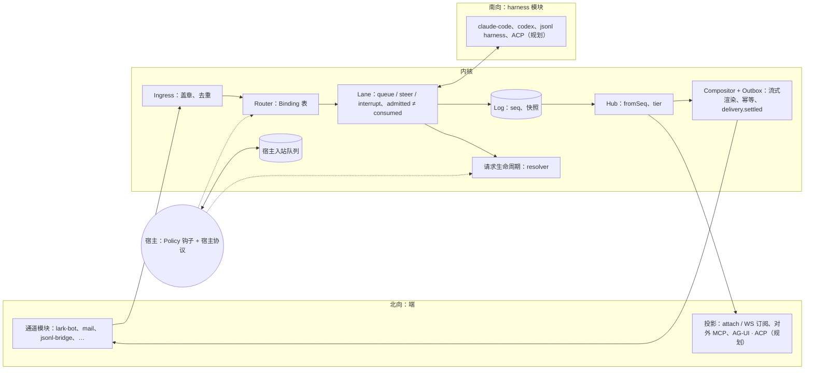

# 瘦身：定义核心流程，给每个功能分级，其余移成模块或交还宿主

> 状态：已采纳（2026-11-23，决定 16）。§9 各项 owner 全部按推荐拍板。第 0 阶段已全部落地：守卫（§6）、第一条接缝 G1（`ChannelCaps.pacing`）、生产代码不再用 testkit、`aio e2e` 移出 daemon、飞书机器人开通连同它的 admin 类型移进 lark-bot。G10（outbox 结算一个事务、游标超前给快照、LN-10）也已落地。G3 的第一块（停止与重启：`HarnessAdapter.detach` / `dispose` / `adopts`）、第二块（压缩、Plan 模式、主人切换权限档：`compact` / `modes` / `ownerProfileSwitch`，回复里的名字取 `displayName`）和第三块（会话 env、指令、媒体：`sessionEnv` / `ownProcess`、`HarnessOpenArgs.instructions`、`HarnessFactoryInit.blobs`）已落地，评审的后续（模块声明的类型检查、只读的 blob 视图、CT-2 / CT-3 / RN-1 的 core 测试、EX-8 跨重启）也已落地。第四块（工厂注册与配置形状：harness 种类是各自包里的 `HarnessModule`，由组合根 `packages/daemon/src/bundle.ts` 注册，`config.ts` 和 `gateway.ts` 不再 import harness 包）也已落地。G2 的第一块（通道模块契约 `ChannelModule`；lark-bot、mail、bridge、module 各一份描述符，由 `bundle.ts` 注册；`config.ts` 经注册表拼出 `channels[]` 的 schema、解析条目、做跨条目校验，不再点名任何通道类型；通道与 harness 模块共用一个加载器）也已落地。G2 的第二块（gateway 经注册表构造通道、判 id 归属，不写 `evidence` 时的证据由组合根注册时给定，gateway 不再 import 通道包；控制台按类型的 `x-credential` 标记和 `isCredential` 判断凭据）也已落地，它的后续（类型名与模块成员在注册时检查，网关建不出的条目是配置错误，延后的证据授予检查有 core 测试，控制台对字面凭据的建议由类型给出，module harness 的 `nativeClient` 也在 CF-4 的检查里）也已落地。G5（模块贡献 admin 路由和控制台设置：`AdminContribution`；飞书机器人开通的两个路由、`console.larkBotCommand` 和 `LarkBotJobs` 的挂载都由 lark-bot 的描述符贡献，`console.ts`、`config.ts` 不再点名飞书）也已落地。G6 的注册表骨架（第 0 步）和第 1 步（对外 MCP 端点成为内建功能模块 `external-mcp`，由 `bundle.ts` 注册；配置段 `externalMcp`、缺省关、`external.mcp` 只在监听时报、状态块都不变）也已落地。G6 第 2 步即 G4（模型生成的话题标题成为内建功能模块 `topic-title`，经 `onTurnCompleted` 钩子，由 `bundle.ts` 注册；缺省开、行为不变，`topicTitles: { enabled: false }` 关；触发规则先由网关层测试钉住再搬）也已落地。其余按 §4 推进。
>
> 参照：persona 的 [#13411](https://github.com/nwverse/persona/issues/13411)（功能瘦身：定义核心流程、给每个功能分级）、#13430（Persona Core 与模块、只降不升的守卫）、#13438 / #13551 / #13555（内建领域按第三方同一契约做成扩展；`interactive_sessions`、`work_executor` 契约）。persona 在 agent IO 上的做法见 §7。

## 0. 问题

agents-io 的包级分层是干净的：`protocol` 不依赖任何包，`session` 只依赖 `protocol`，适配器（`harness/*`、`channel/*`）也只依赖 `protocol`。问题都集中在 `packages/daemon`：它既是组合根，又装着所有功能，而且直接认识具体的适配器。

| 指标（`main` 638eccf） | 数值 |
|---|---|
| 非测试源码 | 约 37.5K 行。daemon 11.6K（`gateway.ts` 3263、`config.ts` 1615），session 8.0K，codex 4.7K，lark-bot 4.2K，protocol 3.3K，host-mcp 1.9K，claude-code 1.8K |
| 宿主协议 feature 标记 | 17 个（`packages/daemon/src/host.ts` `FEATURES`） |
| 会话事件种类 | 31 种（`packages/protocol/src/events.ts`） |
| 聊天命令 | 16 个（`packages/daemon/src/commands.ts`） |
| 给模型的工具 | 内部 15 个（`host-mcp/src/server.ts`）、对外端点 6 个 |
| 不变量 | 102 条（`docs/INVARIANTS.md`） |
| 核心文件越界（§6 守卫初始基线） | 318 处：`gateway.ts` 直接 import 5 个适配器包，按 `instanceof LarkBotAdapter`、`kind === 'codex'` 分支；`config.ts` 115 处飞书 / Codex 专属校验；`protocol/src/admin.ts` 带着飞书机器人开通的类型；生产代码从 `testkit` 取 `AsyncQueue`、`loadEnvFile` |

这和 persona 是同一个病：persona 有 33 个 assistant 文件直接 import `feishubot`，这里是 `gateway.ts` import `LarkBotAdapter` 再按它分支。后果也一样：

- 内核删不掉、关不干净、也没法单独测任何一个通道或 harness；
- 第三方的通道和 harness 拿不到内建适配器享有的能力（飞书的回复节奏、Codex 的重启接管、Claude Code 的上下文压缩，都写在 gateway 的分支里，而不是在契约里）；
- 定位上要成为"不耦合业务、可以嵌进任何框架"的组件，就必须做到：**内核不认识任何具体通道、harness 和模型，内建适配器与第三方走同一条契约**（persona #13438 的原则）。

## 1. 核心流程

一句话：**一条输入从任意通道进来，先盖上来源，再按确定的规则落到一个会话的 lane；lane 把它交给任意 harness 的一轮；这一轮的过程写进带 seq 的日志，任何端都能按 fromSeq 订阅；正式答复按投递义务送回来源，每次以 `delivery.settled` 结束；途中的请求（审批、提问）由宿主指定的 resolver 结算。**

**内核保留的东西**（列出名字，以免以后搬家时被顺手带走）：

- **协议**：`InboundEnvelope` / `Origin` / `Evidence`、`SessionEvent`、`Command`、`ChannelAdapter` / `HarnessAdapter` 及其 caps、`Policy` 钩子、进程外 JSONL 帧、JSON Schema。
- **会话内核**（`packages/session`）：Ingress（盖章、IN-5 去重）、Router（确定的 Binding 表）、Lane（单写者、queue / steer / interrupt、消费对账）、Log（内存 / SQLite、seq）、Hub（订阅、快照、tier）、Compositor（`ProgressView` → 各 tier 的 `RenderedMessage`，即"中立的卡片模型"）、Outbox（operationId 幂等）、请求与 resolver（auto / model / human / host）、宿主入站队列、因果链与防循环。
- **宿主控制面**：`host.hello` 与 features、`bindings.put/get`、入站队列（推 / 拉 / ack / 补投）、`run.start/cancel/ended`、`deliver`、`input` / `resolve`、各回调（route / resolve / outbound / contact / external / review）、`session.prepare/launch/compact`。
- **可解释性**：路由与副作用记录、`aio explain`、`aio verify`。
- **IO 原语工具**：`send_message`、`send_file`、`ask_choice`、`get_channel_context`。
- **守护进程内核**：配置的通用部分、模块加载、本地 socket / WS 服务、token、私有文件、`aio` 的基础命令（serve、attach、input、sessions、tail / ack、explain、verify、run、send、bindings、redispatch）。

内建的 claude-code、codex、lark-bot、mail、jsonl-bridge 是**默认随 `aio` 打包的模块**，不是内核。

## 2. 功能分级

等级：

- **core**：留在内核。
- **module**：做成模块，与第三方走同一条契约（`use: "module"` 或 JSONL 桥），默认随 `aio` 打包，行为不变。
- **opt-in**：留在仓库，默认关，配置开启（相当于 persona 的"二级菜单"：不在默认面上）。
- **host**：属于宿主的策略或业务。agents-io 只留钩子，现有默认实现降级为一个可替换的模块。这一级是 agents-io 特有的，"不耦合业务"主要靠它。
- **delete**：删除。

载体一栏写现有机制，或者需要先补的接缝（G 编号见 §3）。

| 功能 | 现在在哪 | 等级 | 载体 | 阶段 |
|---|---|---|---|---|
| 飞书回复节奏（5 秒开卡、2 秒预览、回复卡不带停止按钮） | `gateway.ts` `compose` 里的 `instanceof LarkBotAdapter` | core 机制，数值归适配器 | G1 `ChannelCaps.pacing` | **已完成** |
| 飞书 / 邮件 / 桥的构造与配置校验 | `gateway.ts` `new LarkBotAdapter`、`channelOwner`、`grantedByDefault`；`config.ts`（115 处） | module | G2 | P1–P2；**契约与配置已完成**（每种通道是自己包里的 `ChannelModule`：`channel/lark-bot/src/module.ts`、`channel/mail/src/module.ts`、`channel/jsonl-bridge/src/module.ts`，`module` 类型在 `packages/daemon/src/module-channel.ts`，由 `bundle.ts` 注册；条目的专有字段、解析、跨条目规则都在里面，`config.ts` 不再点名任何通道类型，当时只剩 `console.larkBotCommand`（G5 已改由 lark-bot 贡献））；**构造、id 归属、证据与凭据也已完成**（gateway 经注册表调 `create`、`owner`、`idOf`，不写 `evidence` 时的证据由 `bundle.ts` 注册时给定，gateway 不再 import 通道包；控制台按 `x-credential` 和 `isCredential` 判断凭据）；**后续也已完成**（类型名与模块成员在注册时检查，网关建不出的条目是 `ConfigError`，控制台对字面凭据的建议由类型给：`credentialHint`）；**控制台的飞书开通路由也已完成**（G5：由 lark-bot 的描述符贡献） |
| Claude Code / Codex 的构造，以及按 `kind` 的分支：压缩、TUI 接入、停止时 detach、重启接管、Plan 模式、bypass、会话 env 改走 stdio | `gateway.ts`、`launch.ts`、`commands.ts`、`media.ts` | module | G3 | P1–P2；**停止时 detach、重启接管、dispose 已完成**（适配器声明 `detach` / `dispose` / `adopts`，gateway 不再有 `codexOf`）；**压缩、Plan 模式、bypass 已完成**（适配器声明 `compact` / `modes` / `ownerProfileSwitch`，聊天命令、`/status` 和 `session.compact` 只读声明）；**会话 env、指令、媒体已完成**（适配器声明 `sessionEnv`、实现 `ownProcess`，Codex 的传输改写搬进 `harness/codex`；指令走 `HarnessOpenArgs.instructions`；媒体由适配器拿 `HarnessFactoryInit.blobs` 自己解析，daemon 的 `media.ts` 删除）；**工厂注册与配置形状已完成**（每个种类是自己包里的 `HarnessModule`：`harness/claude-code/src/module.ts`、`harness/codex/src/module.ts`，由 `bundle.ts` 注册；配置的专有字段、旧 `harness` 块、缺省模型、配置目录变量、跨实例规则和构造都在里面）。剩原生终端接管 |
| 话题机制（一个对话多个会话、当前指针、`topic.changed`） | `session/src/topics.ts` | core | – | – |
| 话题标题由模型生成（临时起一个 Codex thread） | `daemon/src/topic-title.ts` | host | G4 | P2；**已完成**（G6 第 2 步：内建功能模块 `topic-title`，经 `onTurnCompleted` 钩子；缺省开，行为不变；宿主可用 `topicTitles: { enabled: false }` 关掉、自己给标题，见 HOSTS §4.4） |
| 控制 IO 的聊天命令：`/help` `/status` `/stop` `/steer` `/answer` `/new` `/topics` `/switch` | `commands.ts` | core（每个通道可关） | – | – |
| 改运行配置的聊天命令：`/model` `/effort` `/agent` `/preset` `/plan` `/bypass` `/compact` | `commands.ts` | module（"主人命令"，默认开）；真正的接缝是 `Policy.plan` | G3、G6 | P2；**命令表已由注册表组成**（G6 第 0 步：内核的 `KERNEL_COMMANDS` 再接活动模块的命令，这几个命令还在内核里） |
| agent 预设 | `config.ts` `presets` | host（运行配置属于策略），默认实现做成模块 | G6 | P2 |
| 陌生人放行卡片（允许一次 / 总是 / 忽略） | `daemon/src/strangers.ts` | host（`Policy.admit` 的一种默认实现），做成模块 | G6 | P2 |
| 监听与汇总：路由动作 `context` / `digest` | `session/src/router.ts`、`watch.ts` | core | – | – |
| 监听的模型工具 `watch_*` | `host-mcp` | opt-in 模块 | G6 | P2；**工具目录已由注册表组成**（G6 第 0 步：`toolCatalog` 是内核的工具再接活动模块的 `mcpTools`，这一组还在内核里） |
| 话题的模型工具 `session_list/rotate/switch` | `host-mcp` | opt-in 模块（跟着话题） | G6 | P2；工具目录同上 |
| 实时语音、会议（`live_*` 工具、`HarnessLive`、`openLive`） | protocol、session、host-mcp、codex、私有 open-lark | 协议与 LN 不变量留 core；工具和实现做成模块 | G6；**改决定 12**（§9） | P2 |
| 外部持有的会话：Claude Code TUI 接管、Codex `--remote` | `tui-claude.ts`、`tui-bridge.ts` | module（harness 的 `attach` 能力） | G3 | P2 |
| 对外 MCP 端点 | `external-mcp.ts`、`host-mcp/src/external.ts` | opt-in 模块（现已默认关） | G6 | P2；**已完成**（G6 第 1 步：`external-mcp.ts` 的 `externalMcpModule` 是内建功能模块，由 `bundle.ts` 注册；配置段、缺省关、feature、状态块、启停顺序都不变，`gateway.ts`、`config.ts` 不再认识它）。`ExternalMcpServer` 照旧在 `host-mcp`，是模块用的库 |
| 控制台 admin HTTP API、配置编辑 | `console.ts`、`console-config.ts` | module（`console` 包） | G5 | P2；**模块贡献已完成**（G5：模块经 `AdminContribution` 贡献路由、控制台设置和 schema，`console.ts`、`config.ts` 不再点名任何模块）。剩独立成包 |
| 飞书机器人开通（扫码建应用） | 原在 `daemon/src/provision.ts`、`protocol/src/admin.ts`；现在 `channel/lark-bot/src/provision.ts`（`LarkBotJobs`，配置经结构化的 `ProvisionConfig` 注入）、`channel/lark-bot/src/admin.ts`（`AdminLarkBot*`、`LARK_BOT_ADMIN_ENDPOINTS`，JSON Schema 在 `channel/lark-bot/schema/`） | 归 lark-bot 模块；protocol 不留飞书类型 | G5 | P0 **已完成**（类型与实现）；**路由由模块贡献也已完成**（G5：`larkBotChannelModule.admin` 即 `channel/lark-bot/src/provision-admin.ts` 的 `larkBotAdmin`，带 `console.larkBotCommand`、三个 schema、两个路由，挂载时建 `LarkBotJobs`） |
| 任务运行（`run.start` / `run.ended`、task agent） | `runs.ts` | core（调用方形态的 agent 通信） | – | – |
| 宿主入站队列、补投、Binding 表、各回调 | `session/src/host-queue.ts`、`host.ts` | core | – | – |
| agent 之间的通信：地址、因果链、跳数上限、`Policy.contact` | session、daemon | core（ROADMAP §2） | – | – |
| 回执表情、会话历史、回复链 | `ChannelAdapter` 的可选方法 | core 接口；实现归模块 | – | – |
| `aio e2e` 场景运行器 | `daemon/src/e2e.ts`，在运行时依赖 testkit | 移出生产包：`packages/daemon-e2e`（私有，bin `aio-e2e`，`pnpm e2e`） | – | **已完成** |
| testkit 里被生产代码用到的工具（`AsyncQueue`、`loadEnvFile`） | `daemon` 的 `client.ts`、`config.ts`、`console-config.ts`、`tui-claude.ts` | `AsyncQueue` 搬到 session，`parseEnv` / `loadEnvFile` 搬进 daemon 的 `env-file.ts`；testkit 留着自己的一份 | – | **已完成** |
| `aio-dev` 旧名包装 | `examples/dev-gateway` | delete（定一个日期） | – | P3 |

## 3. 接缝缺口

| 编号 | 缺什么 | 挡住了哪些搬家 |
|---|---|---|
| G1 | 通道声明自己的回复节奏（`ChannelCaps.pacing`）。**已完成**：飞书适配器声明，gateway 不再判断类型，通道条目照旧可以覆盖延迟 | 飞书节奏 |
| G2 | 通道模块契约带上配置 schema、校验和默认证据授予。内建类型也按模块注册，`channelOwner` / `grantedByDefault` 不再列具体类型。**契约与配置这一块已完成**：`packages/protocol/src/channel-module.ts` 的 `ChannelModule`（`type`；`ids`：适配器用的固定通道 id，注册了就成为保留 id；`entry`：条目的专有字段，`type`、共有字段（`account`、`tier`、`openDelayMs`、`previewDelayMs`、`ack`、`evidence`）和封闭由 daemon 加，装凭据的字符串标 `x-credential`；`isCredential?`：schema 说不清的凭据位置；`implicitEnv?`：不经 `env:` 引用直接读的变量；`resolve(entry, ctx)`，`ctx` 给 `index`、`where`、env、`substitute`（即 `substituteEnv`）、`path` 和 `fail`，daemon 保留它没返回的键并设 `account`；`validateAll?`：同一类型的条目之间的规则，`ctx` 给 `reservedIds`、`fail`、`warn`；`owner?`、`idOf?`；`create(entry, init)` → `BuiltChannel`（`adapter`、`config`、`close`、`idKnown`），`init` 是 `ChannelFactoryInit` 加 `index`、`stateDir`、`acceptId`、`onState`；`admin?` 留给 G5，现在是占位类型）。lark-bot、mail、bridge 各写一份描述符（`channel/*/src/module.ts`，只依赖 protocol）；`module` 类型要用 daemon 的模块加载器，描述符在 `packages/daemon/src/module-channel.ts`。`bundle.ts` 注册 `builtinChannels = new ChannelRegistry([lark-bot, mail, bridge, module])`（`packages/daemon/src/channel-registry.ts`：类型不得重复，声明的 id 不得重复、不得是守护进程自己的 `CORE_CHANNEL_IDS`）。`configFileSchema(harnessRegistry, channelRegistry?)` 按注册表拼出 `channels[]` 的联合（`ConfigFile` 就是内建注册表的，联合的成员、字段和顺序都不变，所以错误文字不变；条目字段与共有字段重名时拼 schema 就报错）；`resolveConfig` 多了可选的 `channelRegistry`；`resolveChannels` 按条目顺序分派 `resolve`，再按注册顺序分派 `validateAll`（先飞书后 bridge，与原来报错的先后一致）；`RESERVED_CHANNEL_IDS` 由注册表给出（类型声明的 `ids` 加 `CORE_CHANNEL_IDS` 的 `local`、`agent`，值仍是 `lark-bot`、`mail`、`local`、`agent`）。飞书的 `LARK_APP_*` 兜底和 `domain`、多机器人规则（CF-3）、bridge 的 id 规则（ID-3）连同错误文字搬进了各自的描述符；`ChannelEntry`、`ResolvedChannel` 由内建类型的类型拼出（形状不变），`LarkChannelConfig` 移到 lark-bot，daemon 经 `bundle.ts` 再导出、标为弃用。通道与 harness 模块共用一个加载器（`packages/daemon/src/module-loader.ts`：`resolveModuleFile` 解析文件、`loadExport` 导入并取导出；`loadHarnessModule` 从 gateway 搬了过来），两边的导出规则不变：通道写了 `export` 仍回落到 `default`，harness 写了就不回落（`module-loader.local.test.ts`）。基线从 81 降到 57（`config.ts` 30 → 6，剩 `console.larkBotCommand`）。**构造、id 归属、证据与凭据这一块也已完成**：`loadConfig` 与 `Gateway.start` 收 `channelRegistry`（缺省内建的），gateway 删掉 `buildChannel`、`channelOwner`、`grantedByDefault`、`isBridge`，不再 import 三个通道包。构造：每个配置条目调它类型的 `create(entry, init)`（`channelAdapter` 钩子照旧优先），`init` 是 `index`、`account`、`config`、不带前缀的日志、`stateDir = <dataDir>/channels/<type>.<enc(account)>`（飞书的目录不变）、`acceptId`、`onState`；`BuiltChannel` 的 `config`、`close`、`idKnown` 原样用上，飞书 `look` 缺省 `chat`、bridge 的首连重试（CF-1）都在描述符里。id 归属：`ChannelRegistry.owner` 是 `<type>:<owner>`，没有 `owner` 时就是类型（bridge 的 `owner` 是程序，module 的是文件与导出，拼出来的字符串和原来一样，错误文字不变；按类型加前缀，一种类型说不出另一种的归属）；`idConflict` 的保留 id 检查改问 `mayUse(type, id)`（保留 id 只给声明它的类型）；live apply 失败时按 `idOf` 记已配置（缺省是类型唯一声明的 id，bridge 的是 `id`，都没有时退回类型，值与原来相同）；`idKnown` 读 `BuiltChannel.idKnown`。证据授予（E3）：`ChannelRegistry` 的选项 `defaultEvidence: { <type>: 'caps' | 'ungranted' }`，缺省 `ungranted`；`bundle.ts` 给 lark-bot、mail `caps`，bridge、module 不给；模块对象上自己写的任何字段都不算数（`channel-registry.test.ts`，ID-3、ID-4）；嵌入方的适配器照旧取 caps。延后的授予检查改成通用的：构造时经 `onState` 报过状态的通道（bridge），到连上时才查授予，其余在启动时查。控制台的飞书开通（`LarkBotJobs`）改由 `bundle.ts` 的 `builtinConsoleParts` 构造，只在注册表里有内建 lark-bot 时提供，接到 `ConsoleHost.larkBots`，线上不变（路由的贡献留给 G5）。凭据：`console-config.ts` 的 `isCredential` 对通道条目先读类型 `entry` 上的 `x-credential`（标在 map 或数组上就是其中每个字符串；沿对象属性、`Record`、数组和联合的每个成员找），再问 `isCredential?`（返回 false 时照旧落到"像机密的键"规则）；bridge 的 `env` 用标记，bridge 的 `args`（`SECRET_FLAG` 搬进 bridge 描述符）、mail 的 `auth.pass` / `auth.accessToken`、飞书的 `appSecret` / `encryptKey` / `verificationToken` 用钩子：mail 与飞书的 `config` 是自由的 `Record`，要标记就得改 schema，会改变校验和错误文字。`ConfigStore` 收 `harnessRegistry`、`channelRegistry`（gateway 给自己的），校验、解析、脱敏都按它们。基线从 57 降到 36（gateway 35 → 18，剩 Claude Code TUI 接管；`console-config.ts` 1 → 0）。**后续**：`ChannelRegistry` 注册时检查类型名（`TYPE_NAME`：ASCII 字母、数字、`-`、`_`，以字母或数字开头；类型名拼进归属 `<type>:<owner>` 和状态目录 `<type>.<account>`，带 `:` 的类型能说出别的类型的归属，带 `.`、`/` 的能共用或跳出目录，ID-3）和模块成员（`badChannelModule`：`entry` 是对象，`resolve`、`create` 是函数，可选钩子写了就得是函数，`ids` 是非空字符串的数组），所以过得了 `resolveConfig` 的类型都有 `create`；网关建不出的条目（类型不在它的注册表里，或 `create` 返回的不是带 `ChannelAdapter` 的 `BuiltChannel`，`badBuiltChannel` 与 module 通道共用 `module-loader.ts` 的 `badChannelAdapter`）是 `ConfigError`（退出码 2），说出条目位置和类型，不再是 `Gateway.start` 里的 `TypeError`（`channel-registry.local.test.ts`）；延后的授予检查（`!e.reported`）补了 core 测试：授予了证据的 bridge 首连失败时，启动时不按离线 caps 误报，连上后按对端的 caps 查（`channel-stamping.test.ts`，ID-3、CF-1）；控制台对字面凭据的建议改由类型给（`ChannelModule.credentialHint`，bridge 参数在命令行上别人看得见的那句搬进 bridge 描述符，文字不变），`console-config.ts` 不再按 `args` 认出 bridge。基线不变（36；`console.ts` 剩的 2 处是 `larkBots`，等 G5）。没动的：`implicitEnv` 还没有读取方；module 类型的第三方模块仍只能导出工厂，不能导出 `ChannelModule`；harness 实例的凭据位置仍是 `console-config.ts` 里按路径写的规则 | 通道构造与校验、`config.ts` 里飞书多机器人的冲突检查 |
| G3 | harness 的可选能力由 caps 声明、由适配器方法实现，gateway 里不再出现 `kind ===`。具体包括：`compact()`、跨重启的 `detach()` / 是否可接管、`attach`（原生终端加入，`nativeClient` 已有）、`modes`（Plan）、权限 profile、会话 env 的运行方式、媒体解析。**跨重启这一块已完成**：`HarnessAdapter` 加了三个可选成员：`detach?()`（停止时不打断、不退订；有它的 lane 改 detach，否则 close）、`dispose?()`（立刻关掉自己的进程：为一个 launch 或任务 run 单独建的适配器结束时调；停止时调不 detach 的实例，在它的会话关完之后）、`adopts?`（静态声明，不起进程就能读：重启后 `open({ resume })` 可能接管上个进程留下的 turn；有它的会话启动时重开，其余走 `settleLeftover`）。Codex 两种传输都 `detach`，只有 unix 声明 `adopts`；Claude Code 都不声明。gateway 删掉 `codexOf` 和按 `kind === 'codex'`、传输做的接管判断；模块 harness 同样拿到这三项，每个加载了的 module 实例都拿到，不论有没有会话或任务 run 用过它，几个实例共用的适配器对象每种调用只调一次（见 `packages/protocol/src/harness.ts`、`packages/daemon/README.md`）。守护进程层补了测试：`restart.test.ts`（RS-2 的启动重开、RS-4 的实例级 detach）。**压缩、模式与权限档这一块也已完成**：`HarnessAdapter` 再加五个可选的静态声明，与 `adopts` 一样不起进程就能读：`compact?: { command }`（一轮只有这条命令、作为原生命令原样交给 harness，就压缩上下文；Claude Code 声明 `/compact`，`session.compact` 和 `/compact` 发的就是它，lane 的 CT-3 路径不变）、`modes?`（Codex：`['plan']`，`/plan` 与 `/status` 的 Plan 一行读它）、`ownerProfileSwitch?`（`/bypass`，只有 Codex 声明。Claude Code 原生也认 `bypass`，但不能从 profiles 推出这一项，否则 Claude 上会多出 `/bypass`，行为就变了）、`displayName?`（回复里的名字：`/plan is available only on Codex (this session runs claude-code).` 里的 Codex 取自声明了该能力的已配置实例，没有 `displayName` 的用实例名；一个都没有时取注册了的种类的静态声明 `HarnessModule.declares`（见下面的工厂注册），种类也都没有时改说 `is not available on any harness configured here`）、`ephemeralOpen?`（G4 之前的过渡：`open` 认 `options.ephemeral` 等 Codex 形状的选项，话题标题只在声明了它的 harness 上生成，只有 Codex 声明）。`commands.ts` 和 gateway 里这几处不再按 `kind` 判断；module harness 声明了就能用，不声明的照旧答不可用（`harness-caps.test.ts`，CT-2 / CT-3；话题标题在 `harness-caps.local.test.ts`）。没动的：`BUILTIN_PROFILES`（`run.overrides.profile` 在任何实例上都可以写 `bypass` / `restricted`，RN-2）仍假定每个 harness 都映射这两档，对 module harness 没有核实；话题标题的 options 仍是 Codex 形状（G4）。**会话 env、指令与媒体这一块也已完成**：`HarnessAdapter` 加静态声明 `sessionEnv`（`'open'`：`open` 把 `args.env` 用到这个会话自己的子进程，缺省，Claude Code；`'own-process'`：一个进程服务所有会话，`open` 拒绝 env，带 env 的 launch 会话改用 `ownProcess({ env, cwd })` 为它建的适配器，lane 关闭时 `dispose`，Codex stdio；`{ refused }`：两者都不行，带 env 的 launch 答 `launch_unsupported`，文字是 `harness instance <名> is <refused>; …`，只带 cwd 可以，Codex unix 的 `refused` 是 `a shared Codex app-server (unix transport)`，所以文字不变）和方法 `ownProcess?()`（Codex 两种传输都有：同一套设置的 stdio app-server，env 合并，launch env 里的 `CODEX_HOME` 作为它的 home）。`launch.ts` 的预检和 `launchAdapters` 只读声明，不再看 `kind` 和传输；`checkLaunch` 不再拿配置实例，改拿一个只在带 env 时才问的拒绝原因（gateway 的 `sessionEnvRefusal`）：实例暂时不可用（`env:` 变量没设）时从配置原样建一个适配器只读声明，所以不可用的 Codex unix 实例照旧答 `launch_unsupported`；连这也建不出的（没加载的 module 实例）带 env 的 launch 一律拒绝，免得钉住一个永远跑不了的 launch。任务运行仍为每次运行把 env 并进实例再建适配器（运行的 env 在实例配置的配置目录之下，运行不能改写它），适配器有 `ownProcess` 时再在它上面调 `ownProcess({ env: {} })`，所以只多了 `AGENTS_IO_RUN_ID` 的运行也独占进程。指令：`HarnessOpenArgs.instructions`（wire 的 `open` 帧加同名可选字段），`withAgent` 不再按种类分支；Claude Code 把它追加到预设系统提示（盖过 `options.sdk.systemPrompt`），Codex 作为 `developerInstructions`（盖过 `options.developerInstructions`）；过渡期 module harness 照旧同时收到 `options.developerInstructions`；话题标题的提示改走 `instructions`。媒体：`HarnessFactoryInit.blobs`（`BlobAccess { stat, get }`，网关给的是只读视图 `harnessBlobs`：只有这两个方法、拆下来也能调，不是可写的 `FsBlobStore`），内建适配器也经构造参数拿到同一个视图，自己做 resolver：Claude Code 的 `blobResolvers` 和内联上限 `CLAUDE_IMAGE_MAX_BYTES`（3,750,000 字节，错误文字不变）在 `harness/claude-code/src/media.ts`，Codex 的 `blobMediaResolver` 在 `map.ts`；open 选项（含配置里的 `options`）显式给的 resolver 照旧优先，存储里没有的引用（`lark-file:`）照旧解析为空。module harness 声明了就能用（`harness-open.local.test.ts`）。**评审的后续**：module 工厂返回的适配器在启动时逐个检查静态声明和生命周期成员的类型（`displayName`、`compact`、`modes`、`ownerProfileSwitch`、`ephemeralOpen`、`adopts`、`sessionEnv` 含 `{ refused }`、`detach` / `dispose` / `ownProcess` / `nativeClient` 是函数；`nativeClient` 是 G2 的后续补上的），不对的让启动失败并说出成员名（CF-4），不再等到命令、终端加入或停止时报 TypeError，也不再把 `null` 或未知字符串的 `sessionEnv` 当成 `'open'`；module 的 open 参数在 `env` 里总是带实例 env 和任务 run 的 env（`ownProcess` 返回的适配器上的也一样），`SessionEnvSupport`、`HarnessOpenArgs.env` 的说明改成与此一致（行为没变）；CT-2、CT-3 的 module harness 用例移到 core（`harness-caps.test.ts`），Claude Code 把指令追加到预设系统提示改由 core 测试守（RN-1、CT-2）；外部客户端发送的 `external` 随进行中记录保存（`InFlightDelivery.atSend`），重启后补结算的发送 explain 仍说出客户端（EX-8，与 EX-2 的 `inputIds` 同类）。**工厂注册与配置形状这一块也已完成**：`packages/protocol/src/harness-module.ts` 的 `HarnessModule`（`kind`；`schema`：实例的专有字段，共有字段 `use` / `env` / `cwd` / `run` / `profiles` / `options` 和封闭由 daemon 加；`resolve(entry, ctx)` → `{ launch, unavailable? }`，`ctx` 给实例名、实例的 env、`path()`、把 `env:` 值改走子进程环境的 `HarnessChildSecrets` 和 `fail`；`checkAll`：同一种类的实例之间的规则；`defaults`：`model`、`modelEnv`、`configDirEnv`；`legacy`：旧 `harness` 块里它那一节的 schema、`resolve` 和 `.env.live` 前缀；`declares`：静态声明，形状就是 `HarnessAdapter` 的那几个成员（`HarnessDeclarations = Pick<HarnessAdapter, …>`）；`profilesInOpen`；`create(init)` → 适配器，`init` 是 `HarnessFactoryInit` 加 `launch`、`env`、`profiles`）。Claude Code 与 Codex 各写一份（`harness/claude-code/src/module.ts`、`harness/codex/src/module.ts`，只依赖 protocol），实例 schema、旧块、缺省模型 `haiku` / `''`、`AGENTS_IO_LIVE_*_MODEL`、`CLAUDE_CONFIG_DIR` / `CODEX_HOME`、`env:` 改走子进程环境（SE-1）、codex 的 `stateDir` 不得共用、按种类构造（含 `findOnPath`）都从 `config.ts` 和 gateway 的 `buildHarness` 搬了进去。`packages/daemon/src/bundle.ts` 是组合根（`scripts/boundaries.json` 的 `bundle`），只有注册：`builtinHarnesses = new HarnessRegistry([Claude Code, Codex])`，第一个是缺省种类。`resolveConfig` / `loadConfig` / `Gateway.start` 接收 `harnessRegistry`（缺省就是它），`configFileSchema(registry)` 拼出文件 schema（`ConfigFile` 就是内建注册表的，联合的结构不变，所以错误文字不变）；`--harness <种类>` 查注册表，没有该种类的实例时照旧现造一个；旧块的实例名就是种类名，codex 的 `stateDir` 照旧是适配器缺省 `~/.agents-io/codex`。`HarnessInstance` 变成 `{ kind: string; launch }`，原来的 `claude` / `codex` / `module` 字段并成 `launch`（值不变）；旧字段名在 `resolveConfig` 解析出的实例上再留一个版本（已弃用），是 `launch` 的不可枚举访问器，读写都转到 `launch`，所以已有宿主读 `inst.claude.mcpServers`、在 `buildHarness` 前改 `inst.claude` 都照旧生效（内建种类的别名由 `bundle.ts` 经 `HarnessRegistry` 的 `launchAliases` 给出，`module` 由 config 自己给；`harness-registry.local.test.ts`）。`InstanceHarness.open` 不再看 `kind === 'claude-code'`，改读种类的 `profilesInOpen`（Claude Code 声明，module 实例恒为真），open 参数不变。`use: "module"` 的模块照旧导出工厂，也可以导出一个 `HarnessModule` 描述对象：`schema` 在加载时检查 `config`，`create` 拿到同样的 init（CF-4）。顺带修了上一块留下的回归：只配了 Claude Code 的默认部署里 `/plan`、`/bypass` 又答 `… is available only on Codex (this session runs claude-code).`（`commands.test.ts`，CT-2）。基线从 198 降到 81。没动的：原生终端接管（`tuiAttach` 仍按 `kind === 'claude-code'` 分支，读的是 `launch` 里的 `claudePath` / `configDir`） | Claude Code / Codex 分支、外部持有会话、`/plan` `/bypass` `/compact` |
| G4 | 内核不再自己发起模型调用：话题标题改为宿主钩子（`Policy.title?`）或一个默认关的模块。**已完成**（G6 第 2 步，下面 G6 一行有细节）：做成了模块，但缺省开着，因为默认关会让现有部署不再有生成的标题，与 §5 的"默认不变"冲突；宿主（决定 16 的 host 级）用 `topicTitles: { enabled: false }` 关掉，自己在建话题时给标题（`topic.switch` 的 `new.title`，HOSTS §4.4），嵌入方要在建好之后再起标题就写自己的模块（`onTurnCompleted` 加 `KernelContext.topics.setAutoTitle`）。网关里不再有这次模型调用，`Policy.title?` 没有做 | 话题标题 |
| G5 | 模块可以贡献 admin 路由和配置界面所需的 schema（相当于 persona 的 `settings_section`）；protocol 的核心类型里不再出现飞书。**已完成**：`packages/protocol/src/admin-module.ts` 的 `AdminContribution`（`console`：合进封闭的 `console` 段的键与 schema，每个都是可选的，schema 的 `default` 是不写时的值；`schemas`：模块自己的线上类型，`pnpm schema` 照原名和 `$id` 写进模块的包；`routes`：`AdminRoute`，即 `AdminEndpoint` 加 `handle(req, ctx)` → `{ status, body }`；`mount?(ctx)` → `{ close? }`）、`AdminContext`（模块自己的控制台设置；私有工作目录，守护进程的是 `<dataDir>/provision`，0700，挂载前建好，各贡献共用；日志；子进程的环境；`config?: ConfigAccess`，守护进程没有配置文件时没有；`applyChannels?`。同一个对象交给 `mount` 和这个贡献的每次 `handle`，模块按它保存自己挂载的东西）、`ConfigAccess`（`read`、`defined`、`envFilePath`、`lookup`、`envRefs`、`updateValidated`：就是 lark-bot 原来的 `ProvisionConfig` 加 `envRefs`，`ProvisionConfig` 改成它去掉 `envRefs`；守护进程的 `ConfigStore` 实现它）。`ChannelModule.admin` 的类型就是它（原先的占位类型 `ChannelAdminContribution` 删除）。`ChannelRegistry` 注册时检查成员（`badAdmin` / `badRoute`：方法只能是 GET、PUT、POST，路径在 `/api/` 下，状态 200 或 202，有 `response` schema 与 `handle`，不许 `public`）和归属（`claimAdmin`：一个路由（方法加路径，参数不计名字）、一个控制台键、一个 schema 名只属于一个类型，路由不得是核心端点），按注册顺序给出 `adminContributions`；控制台键不得是核心自己的，由 `config.ts` 拼段时检查。`config.ts` 按注册表拼 `console` 段（`consoleSchema`：核心的服务器键、各类型贡献的键、`liveChannels`，所以 `larkBotCommand` 的位置不变，封闭照旧），`ConsoleConfig` 在原来的位置带上各类型的设置（`consoleSettings`：写了的值，否则 schema `default` 的副本；`ConsoleConfig` 因此有索引签名，不再有 `larkBotCommand` 字段的类型）。`ConsoleServer` 在核心路由与 `authorize` 之后按顺序分派 `ConsoleHost.routes`，`Host` / `Origin` 检查、`application/json`、`AdminError` 都和核心路由一样；路径的 `:name` 是一段，结尾的那段取路径的其余部分（和核心的 `/api/explain/:inputId` 一样，所以 `/api/bots/lark/a/b` 照旧答 `unknown_job`）；请求体按路由的 `body` 校验，文字照旧。`ADMIN_ENDPOINTS` 只列核心端点，`console.ts` 的 `adminEndpoints(registry)` 给出核心加贡献的端点表（PR-1）。gateway 在控制台启动时为每个贡献建上下文、调 `mount`（`mountAdmin`，抛错让启动失败），控制台没起来或守护进程停止时调 `close`（`closeAdmin`）。lark-bot 的描述符贡献 `console.larkBotCommand`（缺省是钉死版本的 `CREATE_LARK_BOT`，常量移到 lark-bot，daemon 经 `bundle.ts` 再导出、标为弃用）、`AdminLarkBot*` 三个 schema（`scripts/emit-schema.mjs` 改读贡献，文件、内容和 `$id` 不变）、两个路由（路径、202 / 400 / 404 / 409、答复体、`unknown_job` 都不变）和挂载 `LarkBotJobs`，没有配置文件时两个路由照旧答 404 `bot provisioning needs a config file`。`bundle.ts` 的过渡物 `builtinConsoleParts` / `ConsoleParts` / `ConsolePartsInit` 与控制台的 `BotProvisioning` / `ConsoleHost.larkBots` 删除。顺带修了上一块留下的问题：注册表里没有 lark-bot 时，`/api/bots/lark` 原先答 404 `bot provisioning needs a config file`，现在答未知路由的 404（`no POST /api/bots/lark`）（`console-modules.test.ts`，PR-1）。两处细小差别，只出现在没有配置文件的守护进程（嵌入方自己拼配置、又开了控制台；`aio serve` 总有配置文件路径）：控制台启动时也建一个空的私有 `<dataDir>/provision`；`POST /api/bots/lark` 的请求体不合 schema 时先答 400，原来先答 404。基线从 36 降到 28（`config.ts` 6 → 0，`console.ts` 2 → 0）。没动的：harness 模块还不能贡献（`HarnessModule` 没有 `admin`）；控制台仍在 daemon 里（P2 独立成包）；不在 `ADMIN_ENDPOINTS` 里的核心路径（`/api/login-link`、`/api/console-proof`）注册时不查，贡献了也到不了处理函数 | 控制台、飞书开通 |
| G6 | 一份模块清单，内建和第三方同一形状：`{ id, kind, config schema, features, mcpTools, commands, admin }`，带 `origin: builtin \| module`（对应 persona #13430 的 `Origin = builtin \| extension`）。关掉的模块即不存在：工具不挂、命令不列、feature 不报。**注册表骨架（第 0 步）已完成**，一个功能都还没搬：`packages/protocol/src/module.ts`（只有类型，第三方可用）的 `ModuleManifest`（`id`；`kind: 'feature'`，通道与 harness 照旧走 `ChannelModule` / `HarnessModule`；`needs`：`module:<id>` 或 `kernel:<能力>`；`config`：配置文件的一个顶层段 `section`，段里是模块自己的键 `schema` 加 daemon 加的 `enabled`、封闭，`aliases` 是旧位置的点路径，`aliasEnabled(value, alias)` 说旧位置上的值开还是关，`defaultEnabled`，`resolve(raw, ctx)`；`features`；`mcpTools`：名字、说明、JSON Schema 对象 `input`、`readOnly`、`needsTurn`；`commands`：名字、`/help` 一行、`ownerOnly` 缺省为真；`admin`；`setup(kernel, config)`）、`ModuleInstance`（`tools`、`commands`、`hooks`（`onUndispatched`、`onAction { prefix, handle }`、`onTurnCompleted`、`onTopicChanged`、`resolver`、`planRun`、`harnessFor`、`inputHint`、`statusLines`、`identities`）、`localFrames`、`status`、`start`、`stop`）和窄的 `KernelContext`（`log`、`events`、`policy`、带 `module:<id>:` 命名空间的 `records`、`db`、`topics`、`router`（`identify`、只管自己那份的 `setExtraIdentities`、`newTopic`、`conversationAgent`）、`lanes`（`has`、`open`、`command`）、`channelFor`、`send`（经 outbox）、`ownerRoute`、`redispatch`、`explain`、`host`（`connected`、`answers`），每一项都是 gateway 现有的闭包；晚绑定，`setup` 期间只有 `id` 和 `log` 能用）。运行时在 `packages/daemon/src/modules.ts`：`ModuleRegistry` 注册时检查每份清单和它们合起来的声明（id、配置段与别名、工具、命令、feature 各属一个模块，且不得是内核的；`needs` 的模块要已注册），`bundle.ts` 注册 `builtinModules`（现在是空的，origin `builtin`）。生命周期五步：**resolve** 在 `resolveConfig` / `loadConfig`（`config.ts` `resolveModules`：段在就开，除非 `enabled: false`；段不在时由第一个设了的别名决定：模块有 `aliasEnabled` 就听它的（`policy.strangers: "drop"` 是关），没有时值是带 `enabled: false` 的对象就关（`externalMcp: { enabled: false }`，与段一样），其余的值开、原样交给 `resolve`；都没有按 `defaultEnabled`；开着的模块需要的模块关了就是配置错误；注册表空时 `Config.modules` 不出现，`configFileSchema` 照旧是 `ConfigFile`）；**setup** 在 `Gateway.start` 里、建 Ingress（即 gateway 构造）之前（`ModuleHost.setup`，返回的处理函数必须和清单一一对应，`setup` 抛错或返回不对是 `ConfigError`，说出模块）；**start** 在通道、本地 socket、控制台之后（对外 MCP 原来就在这里启动；第 1 步起它是最后注册的模块）；**stop** 在停止时最先做，倒序，每个限 2 秒；模块段的改动答 `applied: restart`。从内核自己的条目加活动模块的条目组成的有：工具目录（`host-mcp` `toolCatalog`，`build` 遍历它，`HostTools.call` 按名字分派到模块的处理函数；`agents.<n>.tools` 按全目录校验，列了关掉的模块的工具时报错并说出模块）、命令表（`commands.ts` `CommandTable`：`KERNEL_COMMANDS` 再接模块命令，`/help` 按这个顺序，关掉的模块的 `/名字` 是普通消息）、`host.hello` 的 features（`FEATURES` 只是内核的，运行中的模块的接在后面）、`adminStatus.modules: [{ id, origin, enabled, status? }]`（新增字段）。没有模块时工具列表、`/help`、features 和错误文字逐字节与原来相同，由 core 测试对照改动前取下的输出（CF-6：`packages/host-mcp/test/catalog.test.ts`、`output-tools.test.ts`；CT-2：`commands.test.ts`），模块的路径由 `modules.local.test.ts` 覆盖。**评审的后续**：别名原先只要设了就开模块，表达不了 `externalMcp: { enabled: false }`、`policy.strangers: "drop"` 这类旧的关值，对外 MCP 搬成带别名的模块时会在端点关着时报 `external.mcp`（SE-5）；改为上面的规则（`aliasEnabled` 写了就得是函数、只给有 `aliases` 的模块，返回的不是布尔值是配置错误，说出模块），别名关掉的模块不 `setup`、不报 feature，`modules` 里只有 `enabled: false`（`modules.local.test.ts`）；SE-5 的测试也补上了 `enabled: false` 时守护进程的 `hello` 不报 `external.mcp`。没做的：`admin`（注册即报错）、`hooks` 与 `localFrames`（`setup` 返回了就报错，说出是哪一个），各自随需要它的那一步搬家接上；模块段里的 `x-credential` 还没有读取方（控制台按"像机密的键"的通用规则处理）。基线不变（28）。**第 1 步（对外 MCP 端点）也已完成**：`packages/daemon/src/external-mcp.ts` 的 `externalMcpModule`（id `external-mcp`）是第一个内建功能模块，`bundle.ts` 把它注册为 `builtinModules` 的最后一个（最后启动、最先停止，以后加的模块排在它前面），gateway 和 `config.ts` 不再 import 或点名它。配置：段就是 `externalMcp`（键、形状、错误文字不变，schema 从 `config.ts` 搬进模块；`ConfigFile` 是内建注册表的 schema，含模块段；模块段排在 `local` 之前，即 `externalMcp` 原来的位置，所以多处错误时的先后不变），`defaultEnabled: false`，`enabled: false` 关；`resolveExternalMcp` 搬进模块（只许回环改用 host-mcp 的 `isLoopback`，结果相同；owners 经新增的 `ModuleResolveContext.valueAt('policy.owners')` 读，与原来一样只看文件里的 `policy.owners`），模块的设置在其余配置都解析完之后才解析（原来 `externalMcp` 就在最后），所以一份配置有几处错误时报的还是原来那一处；`Config.externalMcp` 作为弃用别名保留一个版本（与 `Config.modules` 里的是同一个对象；在 `Gateway.start` 之前换成别的值或删掉照旧生效：`ModuleHost` 发现它不再是解析出的那个对象时以它为准；完全不带 `modules` 的配置（自己拼的）也照它开关）。feature：`external.mcp` 移出内核的 `FEATURES`，成了模块的 feature，只在端点监听时报（新增 `ModuleInstance.features()`：模块此刻报清单里的哪些；端口被占只记日志、不报）；`callouts.external` 照旧总是报（留在内核）。状态：`GET /api/status` 的 `externalMcp` 块原样留在原处（`modules` 之前），`modules` 里多了它的一项（`status` 同样是 `{ url, clients }`）。这两个旧位置由 `bundle.ts` 经新增的 `ModuleRegistryOptions.fields`（`{ config, status }`）给出：解析出的 `Config.<config>`、状态里的 `<status>`；注册时检查字段名、模块已注册、一个字段只属于一个模块、状态字段是 `AdminStatus` 声明的可选字段（`modules` 除外），解析时 `Config` 自己的字段不许用。启停：`start` 读或生成客户端令牌、监听（令牌不对让启动失败，端口被占只记日志），`stop` 关端点；`ModuleHost.start` 对模块抛的 `ConfigError` / `TokenError` 原样抛出（它们自己说出设置的位置，`aio serve` 照旧退出码 2，文字不变），其余照旧包成 `module <id>: start failed: …`。`externalOutbound`（DL-6）和 `externalSends`（EX-8）留在内核，经 `KernelContext` 用：新增的成员都是 gateway 原来交给端点的闭包——`head`、`appendNative`（只能写 native 事件）、`sessions`（`list`、`known`、`agentOf`）、`status`、`stopping`、`router.record`、`lanes.input`（只收 `kind: "peer"` 的输入，其余抛错）、`resolveRoute`、`send` 的 `external`（发送期间记进 `externalSends`）、`settled`、`outbound`、`host.heldBy` / `host.external` / `host.isToken`（模块拿不到宿主令牌本身）。可见的细小差别：端点开着时 `hello` 的 `features` 里 `external.mcp` 排到内核的 feature 之后（原来在 `callouts.external` 与 `session.compact` 之间；按名字协商，不影响）；端点与它的工具写的日志行多了 `module external-mcp: ` 前缀；`GET /api/status` 的 `modules` 多了 `external-mcp` 一项。core 测试（`external-mcp.test.ts`，SE-5、ID-10、DL-6、CF-10、EX-8）断言不变；`modules.local.test.ts` 改为对照新的内建注册表（别名规则的例子由 `externalMcp` 改用 `console`），并覆盖端点开着、端口被占、`Config.externalMcp` 改写与不带 `modules` 的配置、`fields`、`lanes.input` 只收 peer、`ConfigError` 原样抛出。没动的：控制台把 `externalMcp.clients.<名>.tokenFile` 当路径而非凭据的规则仍在 `console-config.ts`（模块段还没有"不是凭据"的标记）；`ExternalMcpServer` 仍在 `host-mcp`。基线不变（28）。**第 2 步（话题标题，即 G4）也已完成**：先补了网关层测试（`packages/daemon/test/topic-title.local.test.ts`，话题标题没有不变量，所以在 local 层），对着搬家前的网关跑过、逐条改坏代码确认会红：只在声明了 `ephemeralOpen` 的实例上（Codex；Claude Code 上不生成）、按这一轮自己的实例（`/preset` 换过的也算）、第 1 次完成的轮次和之后每第 3 次（失败的轮次不算、不计数）、只在 `titleSource` 为 `auto` 时、只给已配置的 agent（没有 `agents` 时的默认 agent 不生成），明确给的标题（`topic.switch` 带标题）不覆盖，生成期间标题被改过的结果丢掉，同一话题同时只有一个生成，标题换上后最新一张卡片被编辑成带新标题。然后 `updateTopicTitle` 与 `titleJobs` 从 gateway 搬进 `packages/daemon/src/topic-title.ts` 的 `topicTitleModule`（id `topic-title`），`bundle.ts` 把它注册为 `builtinModules` 的第一个（`external-mcp` 照旧最后）。配置：段 `topicTitles`，只有 `enabled`，`defaultEnabled: true`，不写就是开着，所以已有配置不变（段在文件 schema 里排在 `externalMcp` 之前）。钩子：`ModuleHooks.onTurnCompleted` 开始生效（`SERVED_HOOKS`，写了不是函数就是配置错误）：lane 的 `onTurnCompleted` 改调 `ModuleHost.turnCompleted`，一个会话的一轮写进日志之后、按注册顺序同步调每个模块，任务 run 的轮次照旧不算；抛错或返回的 promise 拒绝只记日志（`module <id>: onTurnCompleted failed: …`）；从网关建好到停止模块（第 4 步）为止。`KernelContext` 新增 `topics.titleSource`、`topics.setAutoTitle`（只在标题仍是 `auto`、仍是模块读到的 `expected` 时换上，换上后刷新这个会话在各通道上最新的卡片，即原来的 `refreshLatestTitle` 循环，刷新失败的日志不变）和 `lanes.harness`（`KernelLaneHarness`：已配置 agent 的 lane 跑在哪：`agent`、`instance`、`cwd`、`adapter(instance)`（launch 的适配器，否则 agent 的）、`run(instance)`；任务 run 和未配置的默认 agent 没有），都是 gateway 原来就用的闭包。自己拼的、完全不带 `modules` 的配置：原来只有带旧字段的模块（对外 MCP）有办法，现在 `Gateway.start` 再给没有旧字段的内建模块"文件里没有它们的段"时的结果（`ModuleHostOptions.defaults`，即 `resolveModules({}, …)`），所以这样的配置照旧启动、照旧生成标题，第三方模块照旧报错。可见的细小差别：`GET /api/status` 的 `modules` 第一项是 `topic-title`；`title update failed` 的日志行多了 `module topic-title: ` 前缀；守护进程开始停止模块之后才完成的轮次不再起标题（原来会起，但结果因 `stopped` 被丢掉）。`modules.local.test.ts` 改为对照新的内建注册表，并补了钩子（顺序、任何状态、抛错与拒绝、停止后不调、不是函数报错）和新 `KernelContext` 成员的用例。没动的：标题的 open 选项仍是 Codex 形状（`ephemeralOpen` 的说明照旧写着过渡）；没有改已有话题标题的帧。基线不变（28） | 所有 P2 搬家 |
| G7 | 标准投影 `attention`：从日志 fold 出"现在需要人"（有未答的人工请求、失败、等待），并用 fixture 固定。persona #13552 正需要这个，现在每个宿主各算一遍 | 宿主的角标、推送 |
| G8 | 与语言无关的一致性 fixture：JSON 写的"输入序列 → 期望的事件与帧"，非 TS 的实现或宿主不用跑 TS 就能自检（persona 的 `spec/fixtures` 做法） | §8 的语言选择、§9 的通用组件定位 |
| G9 | 标准协议适配：南向 ACP harness，北向 AG-UI / ACP 投影（POSITIONING §9）。另有一个待补的缺口：进程外 JSONL harness 帧（`packages/protocol/src/wire.ts`）在 G3 加的东西里只带了 `open.instructions`；静态声明（`displayName`、`compact`、`modes`、`ownerProfileSwitch`、`ephemeralOpen`、`adopts`）、`sessionEnv` / `ownProcess`、`detach` / `dispose` 和 `blobs` 目前只有进程内（内建、`use: "module"`）的适配器拿得到，JSONL 对端还没有对应的 hello 字段或帧 | 成为各框架的 IO 层；进程外 harness 与进程内的同一条契约 |
| G10 | outbox 结算合成一个事务：结算记录、出站索引、`delivery.settled` 一起提交，扇出推迟到提交之后（`hub.batch`）。原先在 put 之后、append 之前崩溃，日志里就永远没有这条 settled，也不会自愈。附带：`fromSeq > head` 改发快照。**已完成**：`SessionLog.transaction`（SQLite 日志：`BEGIN IMMEDIATE` / savepoint，回滚连同内存里的 head、fold）、`Hub.batch`、`OutboxOptions.atomic`（守护进程在日志与 records 同一连接时开）；结算抛错不再被当成失败的尝试重发。DL-1 先以 `it.fails` 复现再修好；新承诺 LN-10。后续（同日）：`atomic` 时 `onSettled`（出站索引）出错也回滚整个结算，不再吞掉；本进程结算失败的补结算写明原因；系统回复的 `inputIds` 经进行中记录随结算写入（EX-2） | DL-1、EX-2、ID-8 的缝 |
| G11 | 客户端命令的操作 id（feature `client.opId`）：回执与事件同一事务写入，重放时答第一次的结果，冲突时答 `op_id_conflict`，应答带 `seq` | 客户端断线重发导致重复打断、重复建话题和监听 |

## 4. 阶段

**P0：不加新机制的清理。**

- [x] §6 守卫、分类文件和初始基线。
- [x] G1 `ChannelCaps.pacing`：基线从 318 降到 311。
- [x] `AsyncQueue`、`loadEnvFile` 移出 testkit；daemon 的 `dependencies` 去掉 testkit（只留在 `devDependencies`，给测试用）。
- [x] `aio e2e` 场景运行器移出 daemon 生产包：`packages/daemon-e2e`（`aio-e2e`），`aio e2e` 只提示改用它、退出码 2。这两项把基线从 311 降到 295。
- [x] `AdminLarkBot*` 类型移出 `protocol/src/admin.ts`，连同 `provision.ts` 一起搬进 lark-bot（`channel/lark-bot/src/admin.ts`、`provision.ts`；三个 JSON Schema 移到 `channel/lark-bot/schema/`，内容和 `$id` 不变）。console 只认一个结构化接口，用它的 `request` schema 校验请求体，admin HTTP API 在线上不变。基线从 295 降到 233。宿主须知（包导出与 schema 位置的变化）写在 HOSTS §4.3 与 `packages/daemon/README.md`。

**P1：补接缝。** 依次做 G3（harness caps）、G2（通道模块契约）、G6（模块清单）、G5（admin 贡献）。每一步都是"抽接口、不改行为"的 PR；守卫的计数只降。

- [x] G3 停止与重启：`HarnessAdapter.detach?()` / `dispose?()` / `adopts?`，gateway 不再认 Codex 来决定 detach、dispose 和启动时重开。基线从 233 降到 220。
- [x] G3 压缩、模式与权限档：`HarnessAdapter.compact` / `modes` / `ownerProfileSwitch` / `displayName`，与 `adopts` 一样是静态声明；`commands.ts` 和 gateway 不再按 `kind` 判断 `/compact`、`/plan`、`/bypass`、`/status` 的 Plan 一行和 `session.compact`。话题标题（G4）改按过渡声明 `ephemeralOpen` 判断，只有 Codex 声明，效果不变。基线从 220 降到 215。
- [x] G3 会话 env、指令注入与媒体：`HarnessAdapter.sessionEnv` / `ownProcess`、`HarnessOpenArgs.instructions`、`HarnessFactoryInit.blobs`；Codex 的传输改写从 gateway 和 `launch.ts` 搬进 `harness/codex`，`withAgent` 不再按种类分支，daemon 的 `media.ts` 删除（不再 import 适配器包）。基线从 215 降到 198。
- [x] G3 评审的后续：module 适配器的声明在启动时检查类型（CF-4）；`HarnessFactoryInit.blobs` 是只读视图；env 契约的说明与实际一致；CT-2、CT-3、RN-1 的 core 测试；外部客户端发送跨重启仍可解释（EX-8）；`rollbackTo` 有真实 SQLITE_FULL 的测试（DL-1）。基线不变（198）。
- [x] G3 工厂注册与配置形状：`HarnessModule`（protocol），Claude Code 与 Codex 的描述符在各自包里，组合根 `bundle.ts` 注册内建种类；`config.ts` 与 `gateway.ts` 不再 import harness 包，配置文件照旧加载出同样的值、同样的错误。`use: "module"` 也可以导出描述符。旧的实例字段 `claude` / `codex` / `module` 作为 `launch` 的别名保留一个版本。基线从 198 降到 81。
- [x] G2 契约与配置：`ChannelModule`（protocol），lark-bot、mail、bridge、module 的描述符，组合根 `bundle.ts` 注册内建通道类型；`config.ts` 按注册表拼 schema、分派 `resolve` / `validateAll`，配置文件照旧加载出同样的值、同样的错误；通道与 harness 模块共用一个加载器。基线从 81 降到 57。
- [x] G2 构造、证据与凭据：gateway 按注册表构造（`create`、`owner`、`idOf`、`mayUse`、注册时给的默认证据授予），去掉三个通道包的 import；控制台的凭据走 schema 标记（`x-credential`、`isCredential?`），`ConfigStore` 收注册表。基线从 57 降到 36。
- [x] G2 的后续：注册时检查类型名与模块成员，网关建不出的条目是 `ConfigError`（退出码 2），延后的证据授予检查有 core 测试（ID-3、CF-1），控制台的凭据建议由类型给（`credentialHint`），module harness 的 `nativeClient` 也检查类型（CF-4），INVARIANTS 的行号引用对上现在的代码。基线不变（36）。
- [x] G5 admin 贡献：`AdminContribution`（protocol），控制台在核心路由之后分派模块的路由、鉴权相同，`console` 段的键由模块贡献，`adminEndpoints(registry)` 组合端点表；飞书机器人开通的路由、`console.larkBotCommand` 和 `LarkBotJobs` 由 lark-bot 的描述符贡献，`bundle.ts` 的过渡物删除；没有 lark-bot 的注册表下 `/api/bots/lark` 是未知路由。admin HTTP API 与配置文件不变。基线从 36 降到 28。
- [x] G6 注册表骨架（第 0 步）：`ModuleManifest` / `ModuleInstance` / `KernelContext`（protocol），`ModuleRegistry` 与五步生命周期（`modules.ts`），`bundle.ts` 注册空的 `builtinModules`；聊天命令表、模型工具目录（含 `agents.<n>.tools` 的校验）和 `host.hello` 的 features 改由内核条目加活动模块的条目组成，`GET /api/status` 多了 `modules`。一个功能都没搬，输出逐字节不变。评审的后续：配置旧位置（别名）上的关值让模块关着（`aliasEnabled`，或带 `enabled: false` 的对象）。基线不变（28）。
- [x] G6 第 1 步，对外 MCP 端点成为内建功能模块：`externalMcpModule`（`external-mcp.ts`）由 `bundle.ts` 注册，配置段 `externalMcp`、缺省关、`external.mcp` 只在监听时报、`callouts.external` 照旧总报、`GET /api/status` 的 `externalMcp` 块、最后启动最先停止都不变；`KernelContext` 补上端点要的内核能力（外发检查与 `externalSends` 留在内核），`ModuleInstance.features()`、`ModuleRegistryOptions.fields`、`ModuleResolveContext.valueAt` 是新的。基线不变（28）。
- [x] G6 第 2 步（即 G4），模型生成的话题标题成为内建功能模块：先补网关层测试钉住触发规则（`topic-title.local.test.ts`），再把 `updateTopicTitle`、`titleJobs` 搬进 `topicTitleModule`（`topic-title.ts`），由 `bundle.ts` 注册在最前；配置段 `topicTitles` 只有 `enabled`、缺省开，行为不变；`onTurnCompleted` 钩子开始生效，`KernelContext` 补上 `topics.titleSource` / `setAutoTitle`（含刷新卡片）与 `lanes.harness`；宿主可关、自己给标题（HOSTS §4.4）。基线不变（28）。
- [ ] G3 其余：原生终端接管。
- [ ] JSONL harness 帧补上 G3 的声明、生命周期调用与 blob 访问（§3 G9）。

**P2：搬家。** 按收益与风险排序：

1. 新建 `packages/daemon/src/bundle.ts` 作为唯一的组合根，内建模块全在这里注册；gateway 不再 import 任何适配器包。（已建，内建 harness 种类和通道类型已在这里注册，gateway 和 `config.ts` 不再 import 任何适配器包，也不再认识通道类型；还 import 的只剩 `tui-claude.ts`（G3 的原生终端接管）。功能模块的注册表 `builtinModules` 也在这里，G6 第 0 步时还是空的，第 1 步注册了对外 MCP 端点，第 2 步注册了话题标题，下面第 2、3 项各自把其余功能注册进来。）
2. 话题标题（G4）、主人命令、预设、陌生人放行，各成模块。（话题标题已完成：G6 第 2 步，`topicTitleModule`，缺省开。）
3. 监听工具、话题工具、live 工具、对外 MCP、TUI 接管，各成 opt-in 模块。（对外 MCP 已完成：G6 第 1 步，`externalMcpModule`。）
4. 控制台独立成包。
5. 加一个 `aio` 的 core-only 构建：只带 jsonl-bridge 和假 harness。core 测试在它上面必须全部通过（对应 persona 的 `persona_core_only`）。

**P3：删除。** 删 `aio-dev` 包装、到期的兼容别名，以及被冻结且已确认没有使用者的宿主接口。

## 5. 每一步都要守的规则

- **默认不变**：现有配置升级后行为一致，除非这一步写明要改（飞书节奏就是这样处理的：数值从 gateway 搬到适配器的 caps，部署者无感）。
- **承诺不变**：INVARIANTS 不因搬家而改。搬家 PR 只搬代码或抽接口，不改行为。wire 兼容：帧字段只增不删，未知字段原样透传，新能力用 feature 标记。
- **同一条契约**：内建模块拿到的能力，第三方模块也拿得到。内核永不 import 模块，组合根除外。
- **基线只降**：新违例在代码里修掉，不加进基线。
- **无模块也是产品**：core-only 构建要可测、可用。

## 6. 守卫

`scripts/boundaries.mjs`（`pnpm boundaries:check`）只读文本，不构建也不跑测试，对应 persona #13430 M0 的"分类文件 + 只降不升的基线"：

- **分类**：`scripts/boundaries.json` 把每个工作区包标为 `core`、`module`、`test` 或 `example`，并列出它可以 import 的包。新加的包没分类，守卫直接报错。core 包可以指定 `bundle` 文件作为组合根，只有这些文件能 import 模块。
- **规则**：
  - `import:<包>`：生产代码（`src/`）引用了不在许可列表里的工作区包。
  - `vendor`：core 文件（组合根除外）的代码里出现具体模块的名字，包括含 lark、feishu、codex、claude、imap、smtp 的标识符，以及等于模块 id 的字符串字面量。注释不算；`mail` 不算，它同时是一种会话类型。
- **基线**：`scripts/boundaries.baseline.json`。计数超过基线就报错；修掉违例后跑 `shrink` 把新计数写进基线，`shrink` 在有计数超标时拒绝执行。
- **现状**：初始基线 318 处，做完 G1 后是 311 处，P0 去掉 testkit 和 e2e 之后是 295 处，飞书机器人开通移进 lark-bot 之后是 233 处，G3 的停止与重启接缝之后是 220 处，G3 的压缩、模式与权限档之后是 215 处，G3 的会话 env、指令与媒体之后是 198 处，G3 的工厂注册与配置形状之后是 81 处，G2 的通道契约与配置之后是 57 处，G2 的构造、证据与凭据之后是 36 处（它的后续之后不变），G5 的 admin 贡献之后是 28 处（`config.ts`、`console.ts` 归零），G6 的注册表骨架、第 1 步（对外 MCP）与第 2 步（话题标题）之后不变，全部在 `packages/daemon`。`protocol`、`session` 和 `host-mcp` 已经是 0。
- **已知盲区**：模板字符串 `${…}` 里的代码不检查。

## 7. 从 persona 学到的

persona 在自己的 Go 服务里做了一整套 agent IO（代码位置以 `origin/main` 7954ea436a 为准）。逐项对照：

| persona 的机制 | agents-io 的对应物 | 借鉴什么 |
|---|---|---|
| 每会话一条 seq，批次带 `from_seq` / `to_seq`，客户端记录已覆盖到哪、用 `after_seq` 补洞；订阅者的队列（512 条）满了就断开，不静默丢消息（`docs/protocol/protocol.md`） | Log 的 seq、Hub 的 `fromSeq` 与快照；慢订阅者只丢 ephemeral 事件（`Subscription.dropped` 计数），durable 事件改从日志重读（`lagging`），不用断开 | agents-io 这里做得更细。已补 LN-10"慢订阅者只丢 ephemeral 事件、durable 事件从日志重读、游标超前先给快照"，配上测试 |
| 三种状态分开：客户端操作回执（`X-Persona-Op-Id`：pending / done / failed / unknown，重试时重放）、传输状态（processing / delivered / failed / unknown）、执行状态（`Session.status`）；"1 秒内显示 Processing"写成超级规则 | `input.admitted` / `consumed` / `rejected`、`delivery.settled`、`session.state`、`acknowledge` 表情 | 方向一致。可以补上：客户端发命令也带操作 id，按 id 重放结果；把"多快给出已接收反馈"写成可测的承诺 |
| `needs_you` / `working` / `unread` 等状态，以及 needs-you 计数，用 `spec/fixtures/{needs-you,attention}` 固定 | 没有 | G7 |
| Claude Code 跑在交互式 TUI 面板里，靠 tail transcript、hooks 和插件桥工作；明确不用 `claude -p` 跑 agent（`docs/server/architecture.md`） | Agent SDK 无头运行，外加外部持有会话（决定 15） | "人在原生 TUI 里用、agents-io 旁挂 IO"是一等形态，不是边角情况。G3 的 `attach` 要按这种用法设计：谁持有进程、谁写输入 |
| `runtime.sock` 运行时协议加一个零依赖的 JS SDK（`listSessions` / `items` / `send` 按 `client_msg_id` 去重 / `interrupt` / `fork` / `rewind`；回调 `rt.append` / `rt.stream` / `rt.ask`）；opencode 经 ACP 桥接入 | `HarnessAdapter`、JSONL harness 帧、harness 模块 | 给适配器作者发零依赖的 SDK，JS 之外再给 Python 和 Go；做一个 ACP harness 适配器，一次接入一批 agent（G9） |
| 审批路由：hook 阻塞等卡片；先答的生效；在别处答了就撤回卡片；超时后交回 TUI | `request.opened/resolved`、RQ-1（只结算一次）、RQ-2（超时即拒） | 补两种 resolver 行为：在原生端被答了就撤回各端的卡片；超时后交回原生端，而不是拒绝 |
| `channel` 包：`Capabilities`（格式、字数上限、提问方式、typing、进度、线程），`send` 的 `kind` 分 answer / note / ask / push，按 `ref` 幂等重试 | `ChannelCaps`、`RenderedMessage`、tier、Outbox | 基本一致。persona 缺**中立的卡片模型**（#13408 要先补它，Lark 才能搬出去），而 agents-io 的 `ProgressView` → tier 渲染正是这个模型 |
| 跨语言一致性靠 fixture，不靠共享库：Rust 客户端核心、Go hub、JS SDK 各自实现，用 `spec/fixtures` 对齐 | testkit 一致性套件，只有 TS | G8，也是 §8 的依据 |
| Persona Core 与模块：各平台一份同名字段的清单；关掉的模块即不存在；守卫基线只降；core-only 构建要测 | 本文 §4–§6 | 已采纳 |

反过来看，persona 正在规划的几个契约，agents-io 已经有可用的语义：

- `interactive_sessions`（#13551：流式记录、卡片、回执、send / queue / interrupt）对应 SessionEvent + Command + Hub；
- `work_executor`（#13555：start / send / interrupt / status / events / cards / artifacts）对应 `HarnessAdapter` + `run.start`；
- `attention`（#13552）对应 G7；
- Lark 搬出去之前需要的中立卡片模型，对应 Compositor 与 tier。

这是 agents-io 作为通用组件可以提供给 persona 这类宿主的部分，详见 POSITIONING §9。

### 7.1 从 t3code 学到的

t3code（pingdotgg/t3code，MIT，Effect-TS）是开源 coding agent 控制台。2026-11-23 读了它的源码（homelab 评估见 lan-bing-homes `docs/homelab/parts/t3code.md`）。

**协议的取舍：不采用它的协议。** 它的 WS RPC 契约（`packages/contracts`，Effect Schema，0.x，nightly）是一个产品的内部接口，不是标准。它的模型是单用户、只有自己的客户端、投影为真相、事件只留约 1 天。缺的那一半正是 agents-io 的核心：通道、身份盖章、投递义务、多方同场，还有宿主策略。和它互通走 ACP：t3code 本身支持任意 ACP agent，agents-io 把会话暴露成 ACP agent（G9 的北向投影），它就能接上，Zed、JetBrains 也一样。概念能一一对上，所以真需要接它的客户端时，再做一个 t3code 投影模块：

| t3code | agents-io |
|---|---|
| AppThread | session（`sessionKey`） |
| Run | turn |
| ExecutionNode 树 | item 树（`itemId` / `parentItemId`） |
| ProviderThread | `nativeId`（`session.bound`） |

**借鉴的设计：**

| t3code | 借鉴到哪 |
|---|---|
| `ProviderAdapterV2` + 能力标记，缺失时由编排层显式降级，不按 provider 名字分支 | G3。教训：它约 72 个能力标记里有约 46 个没有任何读取方，所以每个新 cap 都要有读取方和测试 |
| 每个请求标注 `responseCapability`：进程在才能答、可以用新消息作答、重启后不可续 | `request.opened` 加可选字段，配合 RQ-2 和 RS 系列 |
| 命令回执、事件、投影、outbox 在一个 SQLite 事务里，先提交后发布 | G10（已完成）：outbox 结算的三步一个事务，提交之后才扇出，见 §3 |
| 客户端带 `commandId`；被拒的也记回执；id 冲突单独报错；应答带 `sequence`，客户端据此读到自己的写 | G11：客户端命令的操作 id |
| 续传有上限：游标超前、或者积压太多，就改发快照 | `fromSeq > head` 原先被静默夹到 head，现在改发快照（G10 附带，LN-10）；积压多时仍按批从日志重读，不改发快照 |
| 真实 provider 的录制回放：NDJSON transcript，加上输入脚本和断言 | G8：transcript 沿用它的格式；输入和断言也写成数据，按端保持顺序、端与端之间不排序 |
| Peer Link 的权限只缩不扩；子 agent 的 turn 结束不关父 Run | agent 之间的通信（`agent_run`）与 item 树各补一条不变量 |
| 一次性配对码换取有 scope、可撤销的 session | 以后有远程或移动端接入时用；本地形态下，现在的 token 文件和每客户端令牌够用 |

**不借鉴的：** effect 的"至少一次、可回放就重跑"（平台发送不可撤回，DL-2 的"unknown 不重发"是对的）；fork、rollback、checkpoint、跨 provider 交接（属于 agent 状态，归宿主）；17K 行的 Orchestrator（正是瘦身要避开的形态）。

## 8. 实现语言

**建议：参考实现继续用 TypeScript（Node 24），不重写。语言中立靠协议、JSON Schema 和 fixture（G8），不靠换语言。**

依据：

1. **宿主不受语言限制**：宿主经进程边界（socket、JSONL、JSON Schema）使用 agents-io（HOSTS §1）。persona 的 Go hub、Python 写的框架都能直接接，用不着同一种语言。
2. **离上游越近，越该用 TS**：变化最快的上游，最好或唯一的 SDK 都在 TS：
   - Claude Agent SDK 只有 TS 和 Python。`spawnClaudeCodeProcess`、`reinitialize()`、hooks 回调、进程内 MCP 都是 SDK 能力，换成 Go 或 Rust 要自己逆向 stream-json 控制协议，并且每个版本都跟着改。
   - Codex 有 `generate-ts`。
   - 飞书官方有 node SDK。
   - MCP、AG-UI、ACP、Vercel Chat SDK 都是 TS 优先。
3. **瓶颈不在运行时**：瓶颈是语义正确（102 条不变量），以及跟上上游的速度。单机守护进程的负载在模型调用上，不在 Node。
4. **重写代价大**：37.5K 行源码加 20K 行测试，全部换掉要停下功能开发很长时间，换来的是同样的语义。

**什么时候重新评估，换成什么：**

| 触发条件 | 做法 |
|---|---|
| 有宿主要把内核**嵌进进程**里（例如 persona-node 的 Go 进程，或移动端） | 只移植内核（protocol + session，约 11K 行），用 G8 的 fixture 对齐。首选 Rust：能经 FFI 嵌进 Go、Swift、Kotlin、Node、Python；Codex 的 app-server 类型和 ACP 都有 Rust 版；persona 的客户端核心也是 Rust。适配器仍是 TS，作为进程外模块经 JSONL 接入 |
| 只想单文件分发、少依赖 | 不换语言：用 Node 的 single executable application 打包；`node:sqlite` 已内置 |
| 单机会话数或内存成为瓶颈（预计远在模型配额之后） | 先测量；必要时把 Log 和 Hub 放进一个原生进程，适配器不动 |

不建议换成 Go：Go 换来部署方便，但丢了 Claude Agent SDK 和大部分 TS 优先的生态；要嵌进 Go 宿主，Rust 内核加 cgo 同样可行，还能顺带覆盖其他语言。

## 9. owner 拍板（2026-11-23，全部按推荐采纳，见决定 16）

1. **§2 的分级**，特别是"改运行配置的聊天命令、预设、陌生人放行归 host 级"。这几项现在是 agents-io 默认就有的能力，降级成可替换的模块后，默认部署仍然开启。
2. **决定 12 的修订**：决定 12 规定实时语音是核心能力。建议改为"live 的协议、事件和 LN 不变量留在核心，工具和实现是模块"，与 persona owner 把全双工语音改成模块（#13430）的判断一致。
3. **§8 的语言建议**。
4. **POSITIONING §9 的定位扩展**：从"x-work-os 等宿主的 IO 层"扩大为"各 agent 框架共用的会话 IO 运行时"，南北两侧都接标准协议。
